<p align="center">
  
</p>

<h1 align="center">QCCOM</h1>

<p align="center">
  A fast, lightweight serial / TCP / UDP / MQTT / BLE debug tool for embedded developers,<br>
  with a built-in terminal, code viewer and Git history browser.
</p>

<p align="center">
  <a href="https://github.com/zenghi/QCCOM/releases"></a>
  <a href="https://github.com/zenghi/QCCOM/actions"></a>
  <a href="LICENSE"></a>
  
</p>

<p align="center">
  English · <a href="README.zh-CN.md">简体中文</a>
</p>

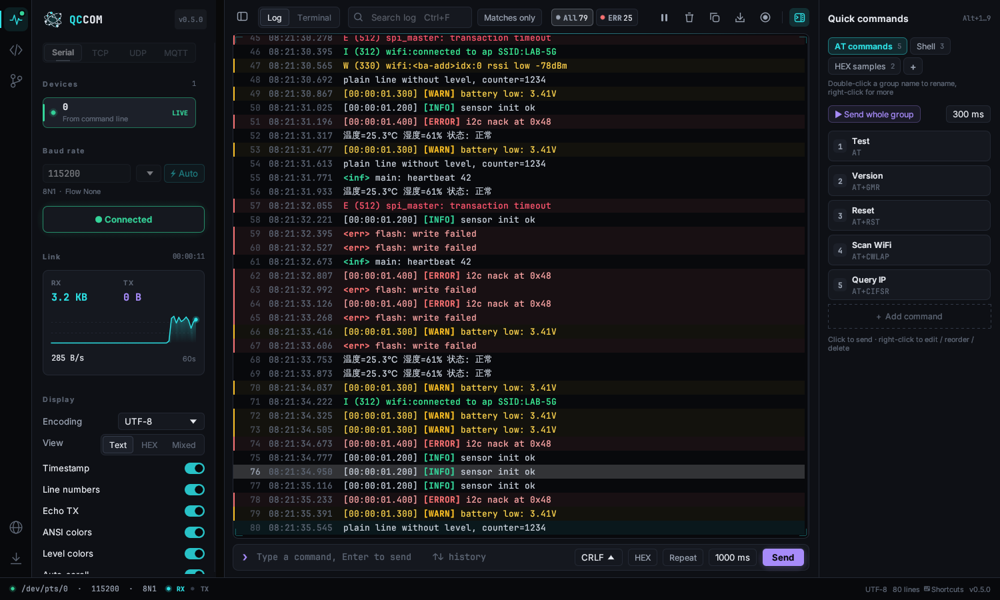

QCCOM is a single portable executable (about 8 MB on Windows) written in Rust with [egui](https://github.com/emilk/egui). No installer, no runtime, no admin rights. It starts in well under a second and stays smooth with hundreds of thousands of log lines.

## Highlights

- **Serial ports that just work.** Ports are rescanned every second and shown with their chip name and VID:PID (`COM5 · CH340 (1a86:7523)`). A newly plugged device is selected for you, and an unplugged one is reconnected automatically when it comes back.
- **Automatic baud-rate detection.** Tries 18 common rates, scores the received text for readability and connects with the best one.
- **Linux-terminal style logs.** ANSI colors (16 / 256 / true color), automatic level coloring for `[ERROR]`, `E (123) tag:`, `E/tag:`, `<err>` and similar formats, millisecond timestamps, keyword highlighting, search, level filter, text / HEX / mixed views.
- **Encodings:** UTF-8, GBK / GB2312, ASCII and Latin-1. Switching re-decodes the existing history instantly.
- **Full terminal mode.** VT100 / xterm emulation for U-Boot and Linux shells. vi, top, less and menuconfig all render correctly, with scrollback, mouse selection and copy / paste.
- **Network transports, all at once.** TCP client, TCP server (multiple clients), UDP, MQTT 3.1.1 (TLS, user / password, QoS 0–2, retain, multiple subscriptions) and WebSocket. The serial port and every network connection can be open at the same time, each with its own log, or merged into one time-ordered view; the status bar shows what is online. Every log, terminal and quick-command feature works the same over the network.
- **Bluetooth LE.** Scan nearby devices with signal bars, connect, browse services and characteristics, subscribe to notifications, read values and write from the command bar. Nordic UART, HM-10 (FFE0) and similar serial-over-BLE modules are picked up automatically.
- **HTTP API testing.** A Postman-style **API** tab for the REST endpoints on your board: methods, params, headers, JSON / form / text bodies, Bearer / Basic auth, `{{variables}}`, saved requests and history, colored JSON responses, and cURL import / export (paste a "Copy as cURL" straight into the URL bar).
- **Quick commands.** Groups of one-click commands (text or HEX) with per-command line endings, `Alt+1…9` hotkeys and "send the whole group" sequencing.
- **Debugging tools.** Live plots of numbers in the log, filter / highlight rules, binary protocol framing with checksum checks, auto-replies, [Rhai](https://rhai.rs) test scripts, a Modbus RTU / TCP master, XMODEM / YMODEM file transfer, CRC on send, an AT command assistant, multi-line sending, log replay with the original timing, statistics, markers and bookmarks.
- **Serial extras.** DTR / RTS / Break and live CTS / DSR / RI / CD, one-click reset (including the ESP32 bootloader sequence), sharing a port over TCP or with other apps through a virtual port (a flasher and QCCOM on the same device at once), a second sniffing port, port aliases, profiles and multiple windows.
- **Code viewer.** Open your firmware folder next to the log: file tree, tabs, syntax highlighting for 12 language families, quick open, workspace-wide search, and for C / C++ go to definition, find references and macro expansion with the computed value.
- **A real code editor.** Multiple cursors, column selection, folding, bracket matching, sticky scroll, line commands, and Source Insight-style context window, call hierarchy, bookmarks and semantic colors. Uses clangd automatically when it is installed and the project has a `compile_commands.json`.
- **Code generation.** F8 multi-color highlights, greyed-out `#if 0` / undefined `#ifdef` code, `#ifdef` and `#if 0` wrapping, printf of a variable with the right format, Doxygen and file headers, 16 customizable macro actions, key recording, navigation history and VS Code / Source Insight / Keil key schemes. Code, Git, terminal and file servers share one project folder.
- **Built-in terminal, find / replace, split view.** A terminal panel (PowerShell, cmd, Git Bash, bash…) with one-click build / flash tasks, a Problems list of compiler errors, command blocks you can copy or jump between, find, colored and split tabs, clickable `file:line`, regex find and replace in a file or across the project with preview, split editor, Git change bars and inline blame, auto-reload, crash recovery and portable mode.
- **Firmware tools.** Map / ELF / HEX / BIN viewers with memory-usage bars and a byte inspector, text and binary file compare, a bit calculator with field extraction, number hovers, code snippets, a TODO panel, Kconfig / device tree / linker-script highlighting and optional Vim keys.
- **Compare & merge** (`Ctrl+Shift+M`). Built-in, Beyond Compare-style: text compare with inline changes, editing on both sides and block copy; folder compare with sync; hex compare that re-aligns inserted bytes and compares HEX files by address; three-way merge for Git conflicts; CSV and map symbol-table compare; HTML reports. Available from right-click menus everywhere, including the system file manager (*Open with QCCOM*, *Compare with QCCOM*).
- **External changes and local history.** Files changed by other programs (AI tools, Keil, scripts) are listed for review and can be kept or reverted block by block; every file is versioned automatically, and one click makes a checkpoint you can take the whole project back to. Stored locally, `.git` untouched.
- **Viewers.** Images (GIF playback, frame stepping, C arrays, side-by-side / overlay / difference compare), raw RGB565 frame buffers, Markdown preview with synced split view, JSON / YAML / TOML trees, CSV tables with plots.
- **Register preview.** The chip's SVD is found from the Keil / IAR / CubeMX / ESP-IDF / PlatformIO project; hover registers and values to see their bit fields, plus a register panel and dump compare.
- **Git.** Branches, tags and remotes, a commit graph across all branches, commit details and line-numbered diffs; commit, push, stage by file or hunk, pre-commit checks, undo last commit, stash, tags with a suggested version, submodules, firmware size per commit, and the branch in the status bar.
- **SSH and Telnet.** Log in to boards and gateways with several sessions open at once, using the system OpenSSH (keys, agent and `~/.ssh/config` work); drop files on the terminal to upload them.
- **Toolbox** (`Ctrl+Shift+B`). All the communication tools (TCP, UDP, MQTT, BLE, WebSocket, SSH / Telnet, HTTP API, Modbus slave) plus TFTP / HTTP file servers, a local MQTT broker, a Syslog receiver, LAN device discovery, ping and port check, a subnet calculator, a data converter, checksums with custom CRC, timestamps, a regex tester, font / image to C arrays, a color converter, an ASCII table, a UART baud-rate calculator, CAN over SLCAN adapters and USB HID. Searchable, with favorites and recently used tools, and every tool is in the command palette; the checksum tool also hashes files (MD5 / SHA1 / SHA256).
- **Embedded tools.** Firmware convert / merge (HEX, BIN, S-record, ELF), update-package headers with CRC, size diff between two builds (GCC, Keil and LLVM map files), worst-case stack usage, the vector table with unimplemented IRQs, an SVD register browser (also on hover in the editor), Keil / IAR project import to `compile_commands.json`, CubeMX pin tables, resistor / divider / NTC / PWM / I2C pull-up calculators, a C struct parser, CBOR / MessagePack / Protobuf decoding, a VCD waveform viewer and QR codes.
- **Recording and export.** Save or copy the log, or record every new line to a file (split by size or time) for long unattended captures.
- **Self-update** from your own server, with SHA-256 verification. See [docs/UPDATE_SERVER.md](docs/UPDATE_SERVER.md).
- **Dark and light themes** (or follow the system, with a matching Windows title bar), optional background images, a searchable **command palette** (`Ctrl+Shift+P`), a settings page, and **fully customizable keyboard shortcuts** including two-step sequences.
- **10 UI languages**, picked automatically from the system locale: English, 简体中文, 繁體中文, 日本語, 한국어, Deutsch, Français, Español, Русский, Português.

| Debugging tools | Firmware tools |
|---|---|
| 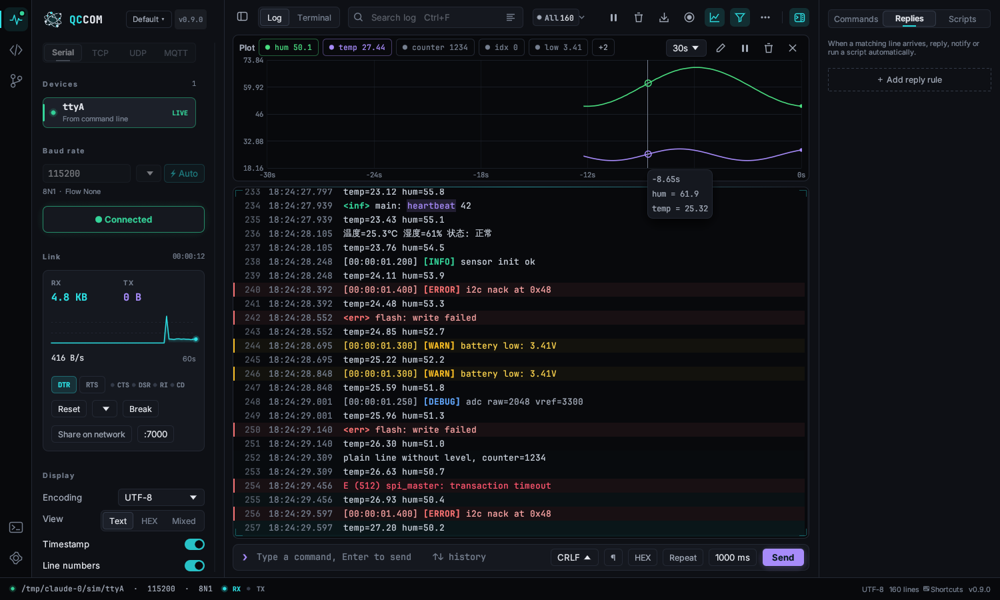 | 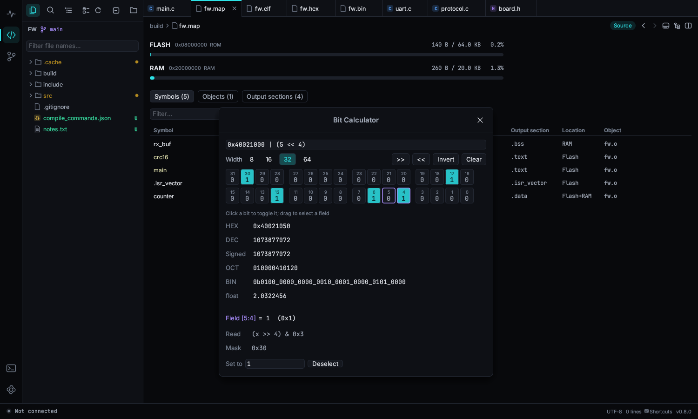 |

| Code viewer | Git history |
|---|---|
| 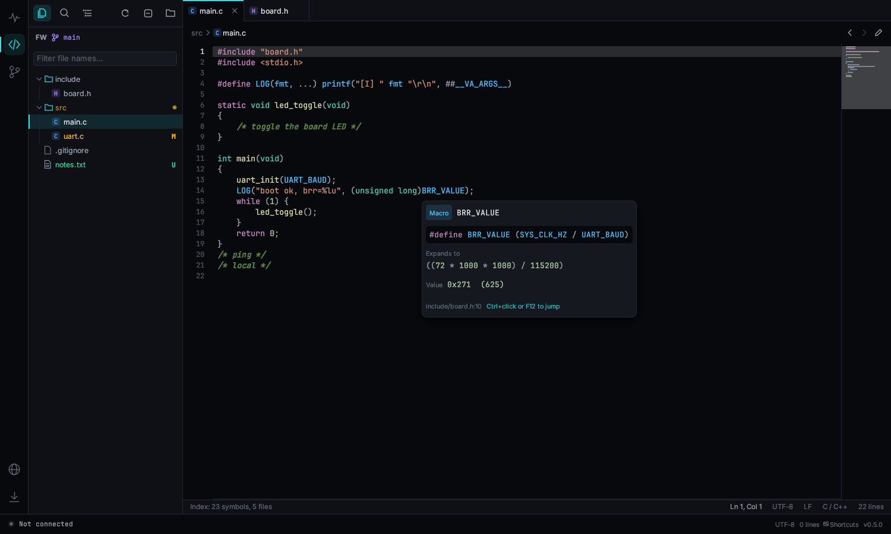 | 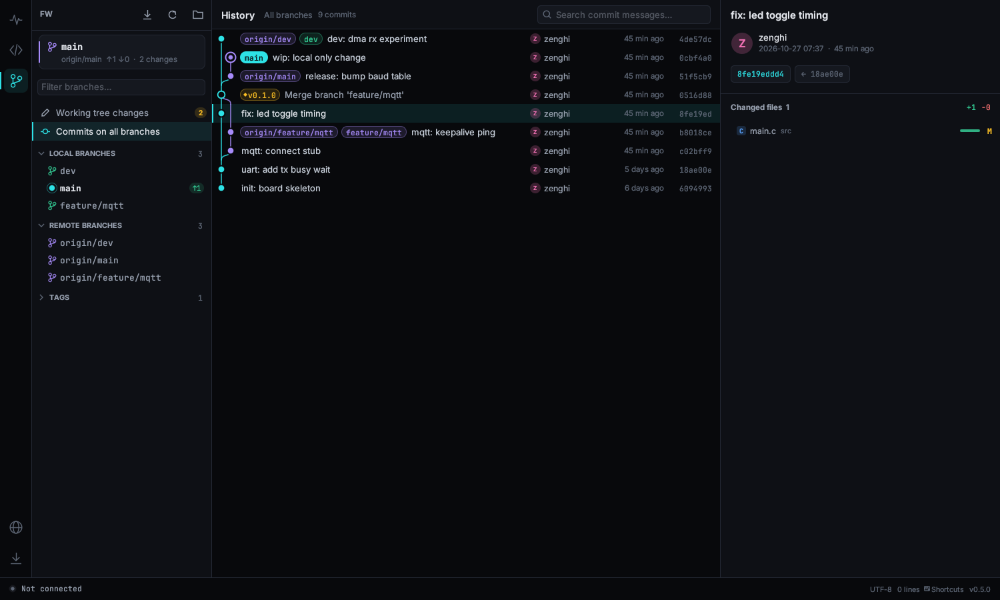 |

| Terminal mode | Light theme |
|---|---|
| 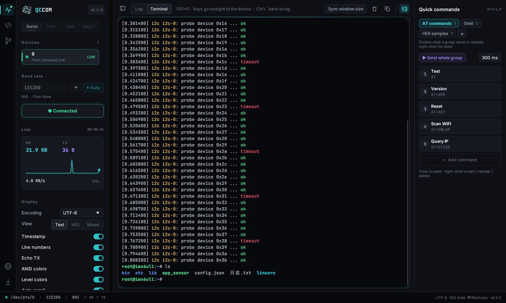 | 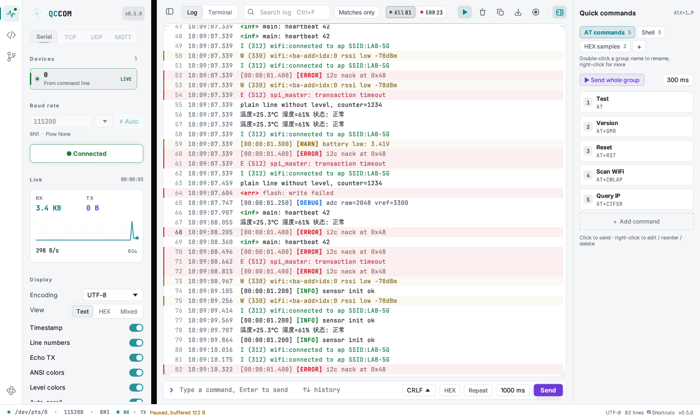 |

| HTTP API | Bluetooth LE |
|---|---|
| 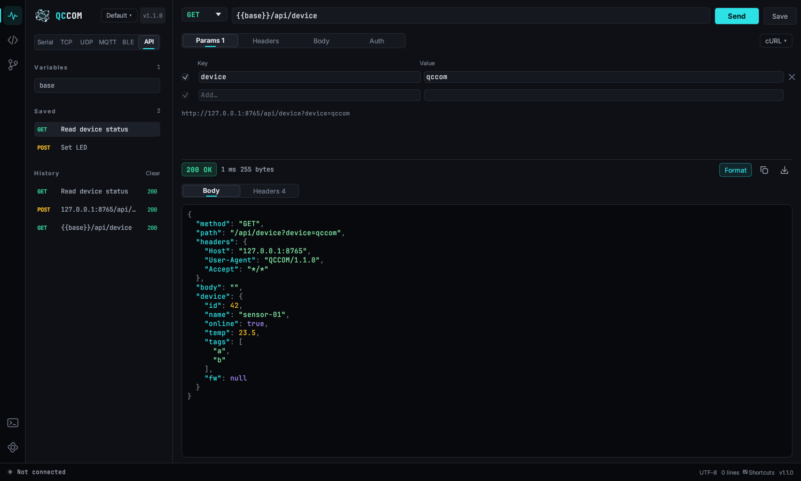 | 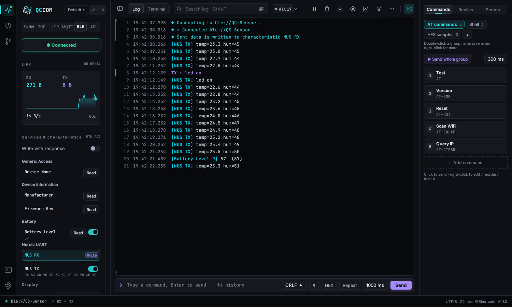 |

| Toolbox: CAN | Compare |
|---|---|
| 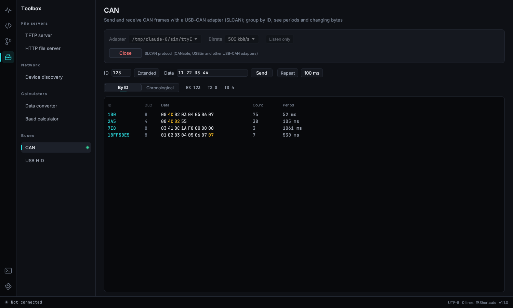 | 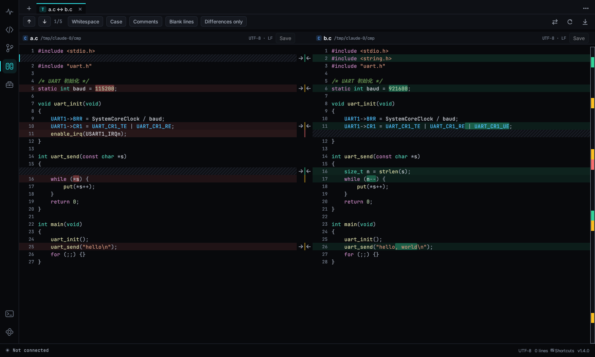 |

| Size diff | VCD waveforms |
|---|---|
| 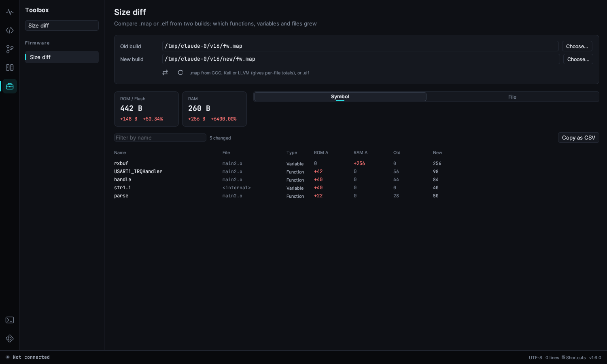 | 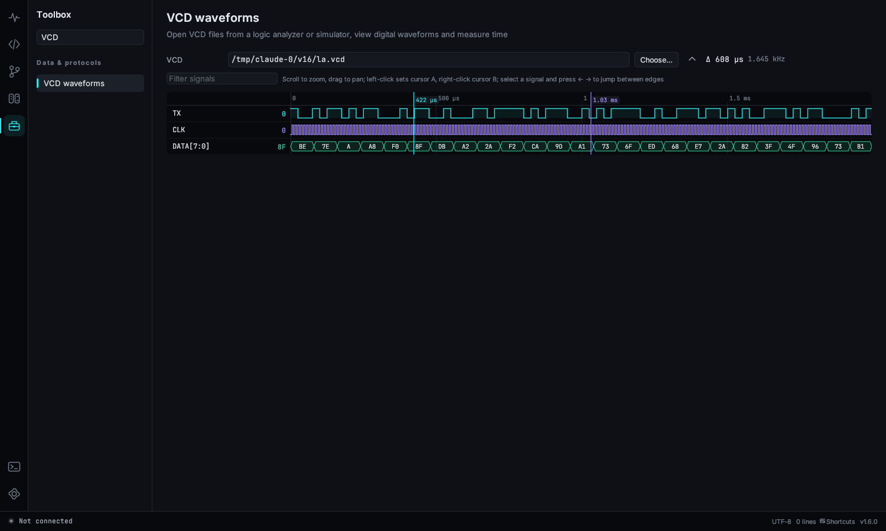 |

## See it in action

| Auto baud, colored log, search | Live plot from log values |
|---|---|
| 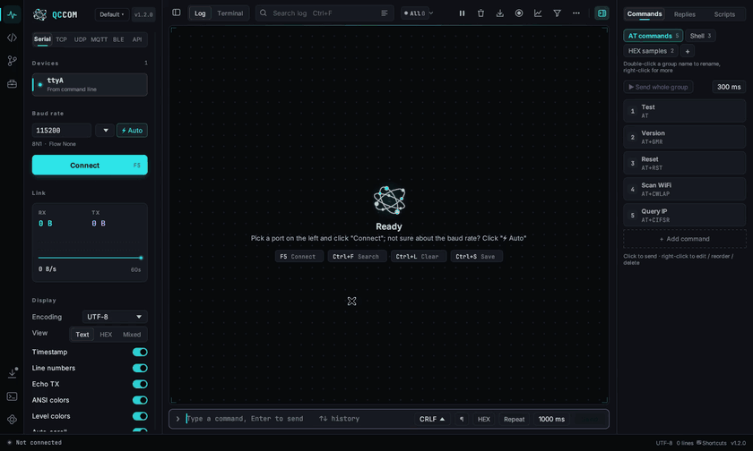 | 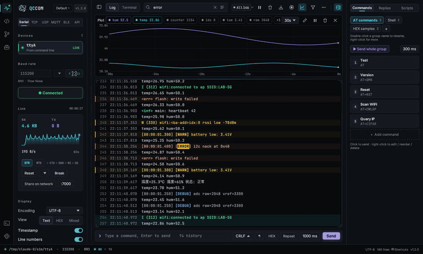 |
| **Terminal mode** | **Macro values and go to definition** |
| 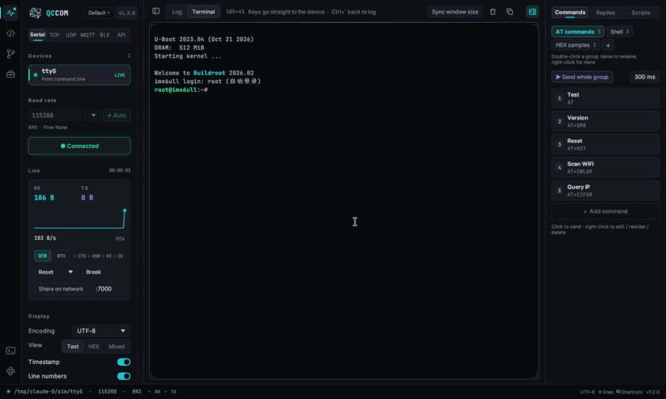 | 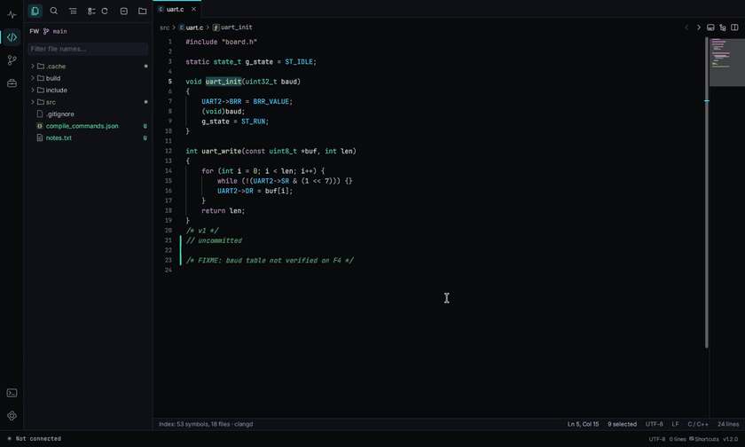 |
| **HTTP API** | **Toolbox** |
| 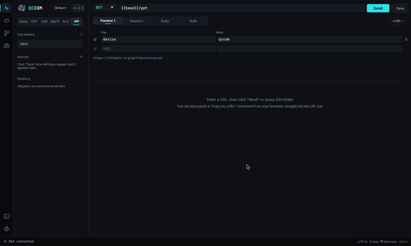 | 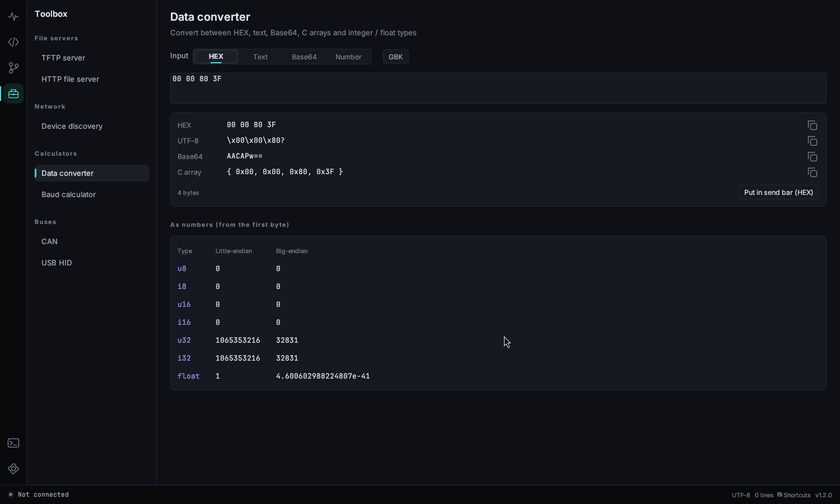 |

More in the [user guide](docs/USER_GUIDE.md).

## Download

Grab the latest build from the [Releases page](https://github.com/zenghi/QCCOM/releases).

| Platform | File | Notes |
|---|---|---|
| Windows 10 / 11 x64 | `qccom-windows-x64.exe` | Double-click to run. Install the USB-serial driver for your adapter (CH340, CP210x, FTDI…) if Windows does not have it. |
| Linux x64 | `qccom-linux-x64` | `chmod +x qccom-linux-x64 && ./qccom-linux-x64`. To open serial ports without root, add yourself to the `dialout` group (`uucp` on Arch): `sudo usermod -aG dialout $USER`, then log out and back in. |

Each release also ships a `SHA256SUMS.txt` so you can verify the download.

> **Windows SmartScreen** may warn that the app is unrecognized because the executable is not code-signed yet. Click **More info → Run anyway**, or right-click the file → **Properties** → tick **Unblock**.

## Quick start

1. Pick a port in the left sidebar.
2. Click **Connect** or press **F5**. If you do not know the baud rate, click **⚡ Auto** while the device is printing.
3. Read the log. Type a command at the bottom and press **Enter** to send it.

To talk to a shell interactively (like PuTTY or minicom), switch to **Terminal** in the top bar or press **Ctrl+\`**. For TCP, UDP, MQTT or BLE, pick the tab above the device list; **API** opens the HTTP request editor.

The full manual is in [docs/USER_GUIDE.md](docs/USER_GUIDE.md).

## Build from source

You need a recent stable Rust toolchain (`rustup`, Rust 1.85 or newer).

```bash
git clone https://github.com/zenghi/QCCOM.git
cd QCCOM

# Linux only: system headers for serial-port enumeration and Bluetooth
sudo apt install pkg-config libudev-dev libdbus-1-dev   # Debian / Ubuntu
# sudo dnf install pkgconf-pkg-config systemd-devel dbus-devel   # Fedora
# sudo pacman -S pkgconf systemd-libs                 # Arch

cargo build --release
# -> target/release/qccom  (qccom.exe on Windows)

cargo test
```

Cross-compiling the Windows build from Linux, release profiles, CI and other details are in [docs/BUILDING.md](docs/BUILDING.md).

## Project layout

| Path | What it does |
|---|---|
| `src/main.rs` | Entry point, window setup, settings migration |
| `src/app.rs` | Main window: sidebar, log view, command bar, activity bar, update card |
| `src/serial.rs` | Port scanning, I/O thread, auto-baud detection |
| `src/net.rs` | TCP client / server, UDP, a small MQTT 3.1.1 client |
| `src/ble.rs`, `src/app/blex.rs` | Bluetooth LE (btleplug): scanning, GATT, notifications; BLE sidebar |
| `src/api.rs`, `src/app/apiview.rs` | HTTP requests, variables, cURL import / export, JSON formatting; API tab |
| `src/toolbox/`, `src/app/toolbox.rs`, `src/app/toolbox2.rs` | TFTP / HTTP servers, discovery, converter, baud calculator, SLCAN, HID, CRC, subnet, Syslog, ping, MQTT broker, Modbus slave, bitmap encoding; Toolbox page |
| `src/app/sess.rs`, `src/ws.rs` | Simultaneous connections (one session per transport); WebSocket client |
| `src/logbuf.rs` | Line splitting, decoding, ANSI parsing, log-level detection |
| `src/term.rs` | VT100 / xterm terminal emulator |
| `src/cmds.rs` | Quick-command panel |
| `src/app/logx.rs`, `src/app/plot.rs` | Log rules, replay, statistics, protocol framing UI; live plot |
| `src/app/dock.rs`, `src/script.rs` | Auto-reply and script panels; Rhai script runner |
| `src/app/dbgtools.rs`, `src/modbus.rs`, `src/xfer.rs`, `src/checksum.rs` | Modbus master, XMODEM / YMODEM, checksum calculator |
| `src/app/serialx.rs`, `src/bridge.rs`, `src/atcmds.rs` | Signal lines, reset, port B, aliases, profiles; serial-to-TCP bridge; AT command list |
| `src/codeview.rs`, `src/cindex.rs`, `src/highlight.rs` | Code viewer, C symbol index, syntax highlighter |
| `src/editor.rs`, `src/codeview/insight.rs`, `src/lsp.rs` | Text editor widget, context window / call hierarchy, optional clangd client |
| `src/shell.rs`, `src/termview.rs`, `src/pattern.rs` | Terminal panel (pseudo-terminals), shared terminal widget, find / replace patterns |
| `src/binview.rs`, `src/binview/parse.rs`, `src/tools.rs` | Map / ELF / HEX / BIN viewers and parsers, file compare, bit calculator |
| `src/snippets.rs`, `src/vim.rs` | Code snippets, Vim key emulation |
| `src/compare/`, `src/compareview.rs`, `src/compareview/` | Diff, three-way merge, folder / hex / table compare and HTML reports; Compare page |
| `src/shellint.rs` | System right-click menu, forwarding files to the running window |
| `src/gitview.rs`, `src/git.rs` | Git viewer UI and the `git` CLI wrapper |
| `src/update.rs` | Self-update (version check, download, verify, replace) |
| `src/i18n.rs`, `assets/i18n.tsv` | Translations |
| `src/theme.rs` | Dark / light palettes, fonts |
| `src/keymap.rs` | Commands, default shortcuts, user overrides |
| `src/app/palette.rs`, `src/app/prefs.rs` | Command palette, settings page and shortcut editor |
| `assets/` | App icon, bundled fonts (Inter, JetBrains Mono, SIL OFL 1.1) |
| `build.rs` | Embeds the icon and version info into the Windows executable |

Source comments are mostly in Chinese. Identifiers and the public docs are in English.

## Contributing

Bug reports, feature ideas, translations and pull requests are welcome. Please read [CONTRIBUTING.md](CONTRIBUTING.md) first. Adding or fixing a UI language only needs edits to one TSV file.

## License and attribution

QCCOM is licensed under the [Apache License 2.0](LICENSE). Copyright © 2026 [zenghi](https://github.com/zenghi).

You may use, modify and redistribute it, including commercially. If you redistribute QCCOM or a work based on it, the license requires you to:

- include a copy of the [LICENSE](LICENSE),
- include the [NOTICE](NOTICE) file, which carries the attribution **"Based on QCCOM by zenghi – https://github.com/zenghi/QCCOM"**,
- keep existing copyright and attribution notices, and mark files you changed.

Please do not remove the author and repository information shown in the app's About box.

Bundled fonts: Inter and JetBrains Mono, both under the SIL Open Font License 1.1 (see [assets/licenses](assets/licenses)).
