<p align="center">
  
</p>

<h1 align="center">QCCOM</h1>

<p align="center">
  给嵌入式开发者的串口 / TCP / UDP / MQTT / BLE 调试助手，轻量、快速，<br>
  自带串口终端、代码浏览器和 Git 历史查看器。
</p>

<p align="center">
  <a href="https://github.com/zenghi/QCCOM/releases"></a>
  <a href="https://github.com/zenghi/QCCOM/actions"></a>
  <a href="LICENSE"></a>
  
</p>

<p align="center">
  <a href="README.md">English</a> · 简体中文
</p>


QCCOM 用 Rust + [egui](https://github.com/emilk/egui) 编写，只有一个可执行文件（Windows 版约 8 MB），免安装、不需要运行库、不需要管理员权限。启动不到一秒，几十万行日志也能流畅滚动。

## 主要功能

- **串口即插即用**：每秒自动扫描，显示芯片型号和 VID:PID（如 `COM5 · CH340 (1a86:7523)`）；新插入的设备自动选中，拔掉后重新插上会自动重连。
- **自动识别波特率**：依次尝试 18 种常用波特率，给收到的数据打可读性分，选最好的自动连接。
- **Linux 终端风格日志**：ANSI 颜色（16 / 256 / 真彩色）；`[ERROR]`、`E (123) tag:`、`E/tag:`、`<err>` 等格式自动按级别着色；毫秒时间戳、关键词高亮、搜索、按级别过滤、文本 / HEX / 混合视图。
- **多种编码**：UTF-8、GBK / GB2312、ASCII、Latin-1，切换后历史日志立即按新编码重新显示。
- **完整的终端模式**：VT100 / xterm 仿真，直接操作 U-Boot 和 Linux shell；vi、top、less、menuconfig 都能正常显示；支持回滚历史、鼠标选择复制、粘贴。
- **网络连接，可同时在线**：TCP 客户端、TCP 服务器（可多客户端）、UDP、MQTT 3.1.1（TLS、用户名密码、QoS 0–2、retain、多个订阅）、WebSocket。串口和各个网络连接可以同时连着，各自一份日志，也可以按时间合并成一份看，状态栏显示哪些在线。日志、终端、快捷命令等功能在网络连接下全部可用。
- **低功耗蓝牙（BLE）**：扫描附近设备（带信号格），连接后列出服务和特征，订阅通知、读取，在命令栏直接写入。Nordic UART、HM-10（FFE0）这类蓝牙串口模块自动识别写入特征。
- **HTTP 接口调试**：类似 Postman 的 **API** 标签，调开发板上的 REST 接口：各种方法、参数、请求头、JSON / 表单 / 文本请求体、Bearer / Basic 认证、`{{变量}}`、收藏和历史、彩色 JSON 响应，支持 cURL 导入导出（浏览器里「复制为 cURL」直接粘到地址栏）。
- **快捷命令**：多组一键发送的命令（文本或 HEX），每条可单独设换行符，`Alt+1…9` 快捷发送，可按间隔依次发送整组。
- **两个页面并排看**：串口日志放在代码旁边、仿真串口放在电路旁边、比较放在文件旁边——中键点或把任意页面、工具拖到右边或下方即可。第一次用得上时会自动出现（烧录后、电路通电、日志里出现 HardFault），来回切页时提示放在一起，按工程记住布局，还能弹出到第二块屏幕。
- **代码浏览器**：在日志旁打开固件工程，文件树、多标签、12 类语言语法高亮、按文件名快速打开、全工程搜索；C / C++ 支持跳转到定义、查找引用、宏展开并计算出数值。
- **完整的代码编辑器**：多光标、列选择、代码折叠、括号匹配、粘性滚动、行操作，以及 Source Insight 式的上下文窗口、调用关系、书签和语义着色。装了 clangd 且工程有 `compile_commands.json` 时自动使用 clangd。
- **代码生成**：F8 多色高亮，`#if 0` / 未定义 `#ifdef` 的代码变灰，`#ifdef` 和 `#if 0` 一键包裹，按类型自动选格式的变量打印，Doxygen 和文件头说明，16 个可自定义宏动作，按键录制，导航历史，可切换 VS Code / Source Insight / Keil 快捷键方案。代码、Git、终端、文件服务器共用一个工程文件夹。
- **内置终端、查找替换、分屏**：底部终端面板（PowerShell、cmd、Git Bash、bash 等），一键编译 / 烧录任务按钮、编译错误「问题」列表、按命令分块复制和跳转、查找、标签着色和并排，`文件:行号` 可点击跳转；文件内和全工程的正则查找替换带预览；拆分编辑器、Git 行标记和行内 Blame、外部修改自动重载、崩溃恢复、便携模式。
- **固件工具**：Map / ELF / HEX / BIN 查看器（内存占用条、字节解读）、文本和二进制文件比较、带字段提取的位域计算器、数字悬停、代码片段、TODO 列表、Kconfig / 设备树 / 链接脚本高亮、可选 Vim 键位。
- **调试工具**：日志数值实时波形图、过滤 / 高亮规则、二进制协议分帧和校验检查、自动应答、[Rhai](https://rhai.rs) 测试脚本、Modbus RTU / TCP 主站、XMODEM / YMODEM 发送文件、发送时自动加 CRC、AT 指令助手、多行发送、按原时序回放日志、统计、标记和书签。
- **串口扩展**：DTR / RTS / Break 控制和 CTS / DSR / RI / CD 实时状态，一键复位（含 ESP32 下载模式时序），串口共享到网络、虚拟串口（烧录工具和别的串口助手可同时使用，不占用 COM 口；Windows 一键下载安装 com0com 驱动），双口监听，端口别名，配置方案，多窗口。
- **电路仿真和接线记录**：在面包板上搭电路、通电看结果，真实求解器，接错会冒烟；万用表、示波器、逻辑分析仪；单片机引脚不写代码也能动（还能生成 Arduino / STM32 HAL / ESP-IDF / 51 代码）；AT 模块能连真实网络；72 个带讲解的示例。接线表配实物照片和编号标记，存在工程的 `.qccom/wiring/` 里。
- **比较与合并**（`Ctrl+Shift+M`）：内置 Beyond Compare 式比较。文本比较带行内差异，两边都能直接改、一键把一段推到另一边；文件夹比较和同步；十六进制比较能自动对齐插入的字节，HEX 按地址比较；Git 冲突三方合并；CSV 和 map 符号表比较；HTML 报告。到处都能右键比较，包括系统文件管理器（「用 QCCOM 打开」「用 QCCOM 比较」）。
- **外部修改和本地历史**：AI 工具、Keil 等别的程序改了工程文件会列出来，逐块保留或还原；每个文件自动留版本，一键打存档点、整个工程回到任意存档点，只存本机、不动 `.git`。
- **查看器**：图片（GIF 播放、逐帧、转 C 数组、两图对比）、原始像素（RGB565 显存）、Markdown 预览（分屏同步滚动）、JSON / YAML / TOML 树、CSV 表格和曲线。
- **寄存器预览**：从 Keil / IAR / CubeMX / ESP-IDF 等工程配置自动找到芯片的 SVD，悬停寄存器和数值按位域解码，寄存器面板和转储对比。
- **Git**：本地 / 远程分支和标签、所有分支的提交图、提交详情、带行号的差异对比；提交、推送、按文件或代码块暂存、提交前检查、撤销上次提交、stash、打标签、子模块，每次提交记录固件体积，状态栏显示当前分支。
- **SSH 和 Telnet**：远程登录开发板和网关，多个会话同时在线；用系统自带的 OpenSSH（密钥、agent、`~/.ssh/config` 都能用），把文件拖到终端上就能上传。
- **工具箱**（`Ctrl+Shift+B`）：所有通信调试工具（TCP、UDP、MQTT、BLE、WebSocket、SSH / Telnet、HTTP 接口、Modbus 从站）排在最前，另有 TFTP / HTTP 文件服务器、本地 MQTT 服务器、Syslog 接收、局域网设备发现、Ping 和端口检测、子网计算、数据转换、校验计算（含自定义 CRC）、时间戳、正则测试、字模 / 图片取模、颜色转换、ASCII 表、UART 波特率计算、SLCAN CAN 调试和 USB HID。可搜索（支持拼音首字母）、可收藏、记住最近使用，每个工具都能从命令面板直接打开；校验计算也能算文件的 MD5 / SHA1 / SHA256。
- **嵌入式工具**：固件转换 / 合并（HEX、BIN、S-record、ELF）、带 CRC 的升级包头、两次编译的体积对比（支持 GCC、Keil、LLVM 的 map）、最坏栈深度分析、中断向量表（标出没实现的中断）、SVD 寄存器查看（编辑器里悬停也能看）、Keil / IAR 工程导入生成 `compile_commands.json`、CubeMX 引脚表、电阻 / 分压 / NTC / PWM / I2C 上拉计算、C 结构体解析、CBOR / MessagePack / Protobuf 解码、VCD 波形查看和二维码。
- **录制与导出**：保存或复制日志；也可以把之后的每一行实时写入文件（可按大小或时长分卷），适合长时间挂机抓日志。
- **自动更新**：从你自己的服务器检查新版本，下载后做 SHA-256 校验再替换。格式见 [docs/UPDATE_SERVER.md](docs/UPDATE_SERVER.md)。
- **深色 / 浅色主题**（或跟随系统，Windows 标题栏颜色同步）、可选背景图片、可搜索的**命令面板**（`Ctrl+Shift+P`）、设置中心，以及**完全可自定义的快捷键**（支持 Ctrl+K Ctrl+S 这类序列键）。
- **10 种界面语言**，按系统语言自动选择：English、简体中文、繁體中文、日本語、한국어、Deutsch、Français、Español、Русский、Português。

| 调试工具 | 固件工具 |
|---|---|
| 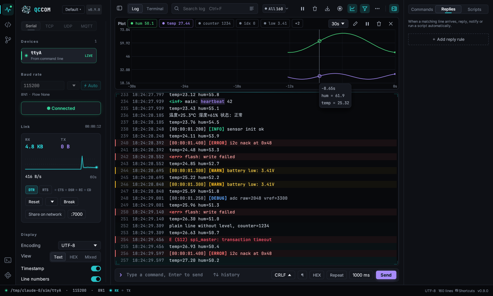 | 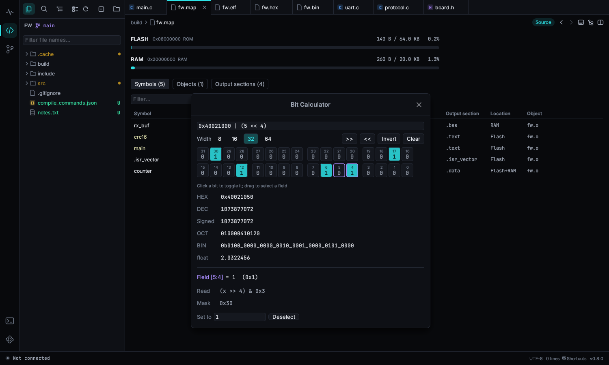 |

| 代码浏览器 | Git 历史 |
|---|---|
|  |  |

| 终端模式 | 浅色主题 |
|---|---|
|  |  |

| HTTP 接口 | 低功耗蓝牙 |
|---|---|
| 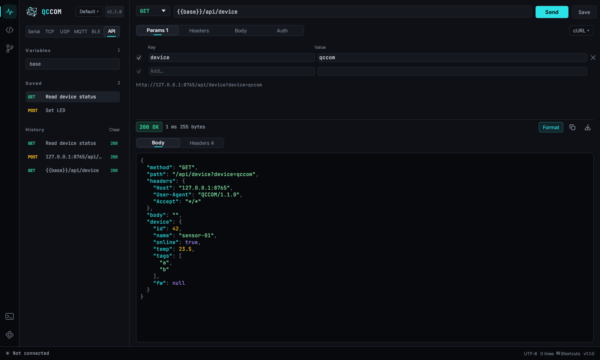 | 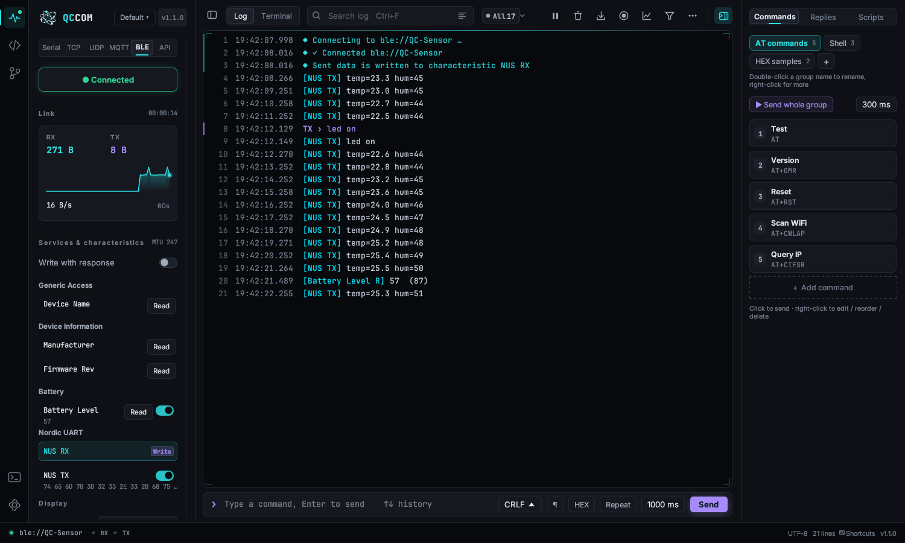 |

| 工具箱：CAN 调试 | 比较 |
|---|---|
| 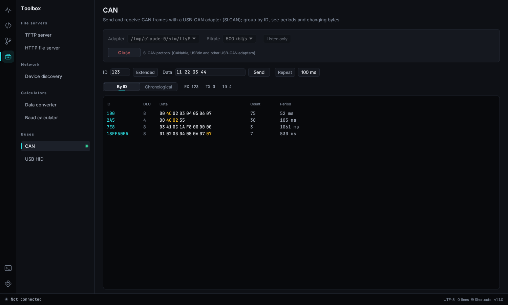 | 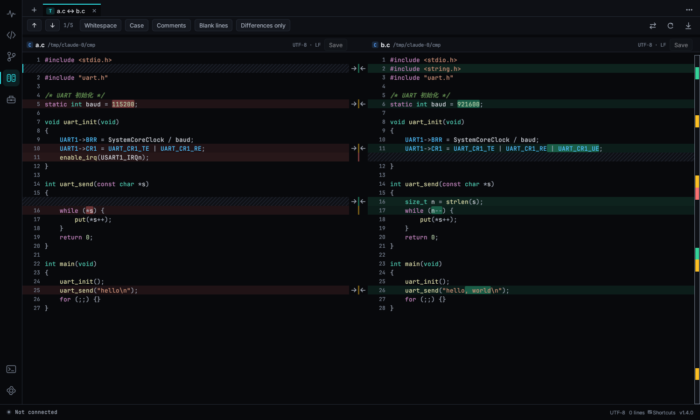 |

| 体积对比 | VCD 波形 |
|---|---|
| 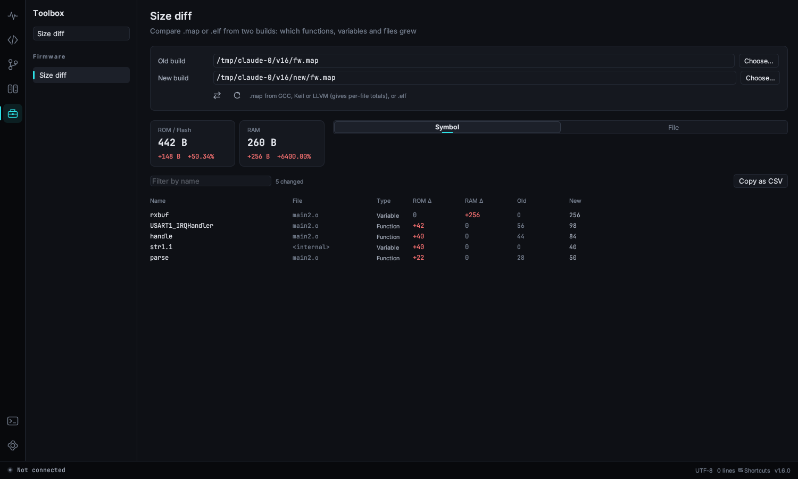 | 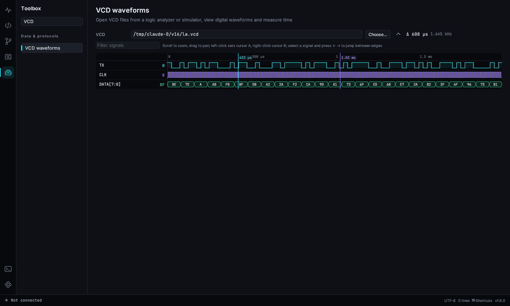 |

## 动图演示

| 自动波特率、彩色日志、搜索 | 日志数值实时曲线 |
|---|---|
| 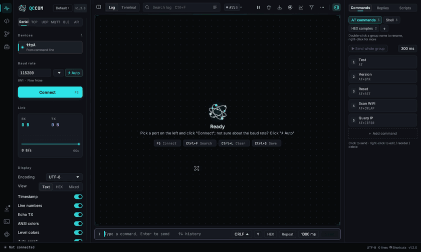 | 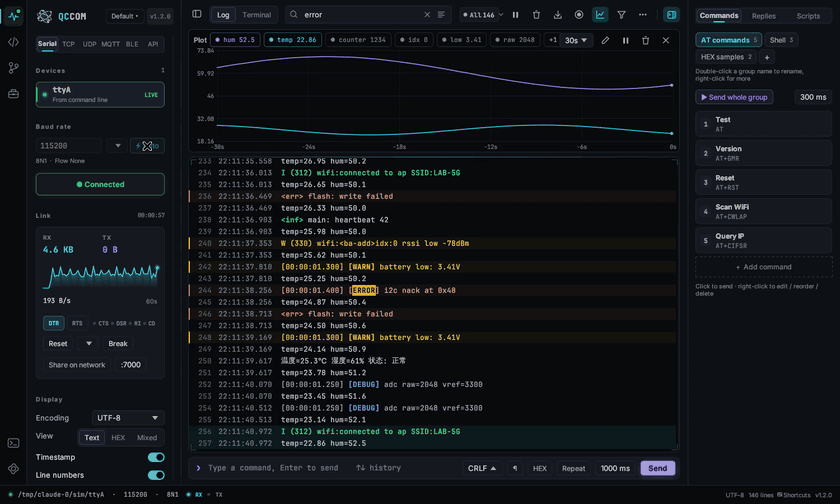 |
| **终端模式** | **宏展开和跳转定义** |
| 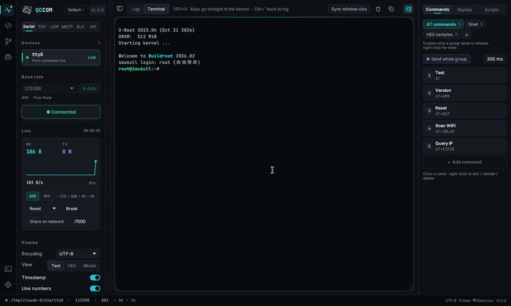 | 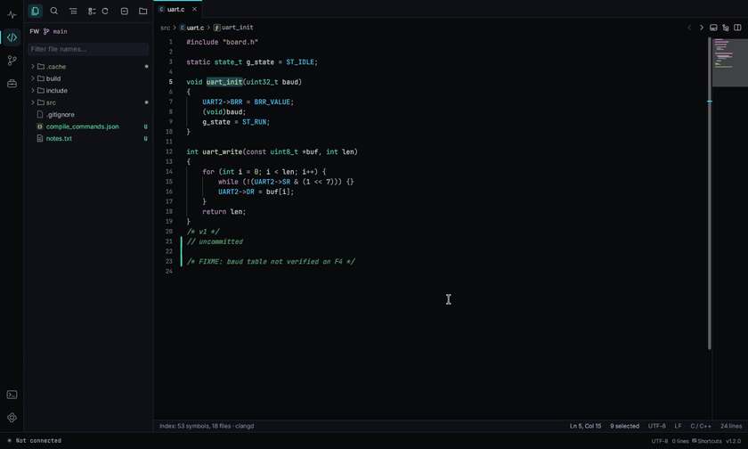 |
| **HTTP 接口调试** | **工具箱** |
| 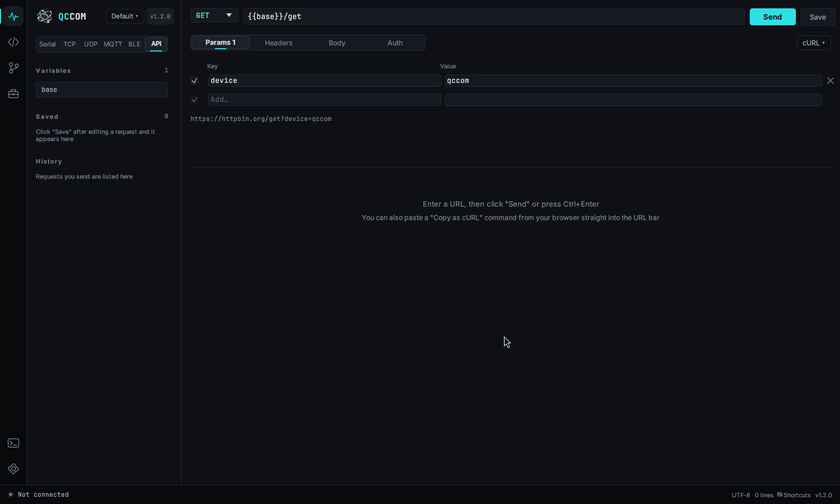 | 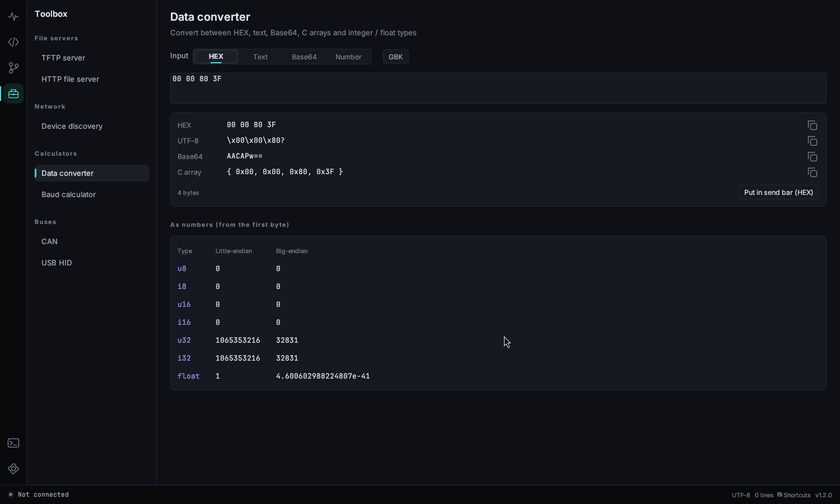 |
| **串口日志放在代码旁边** | |
| 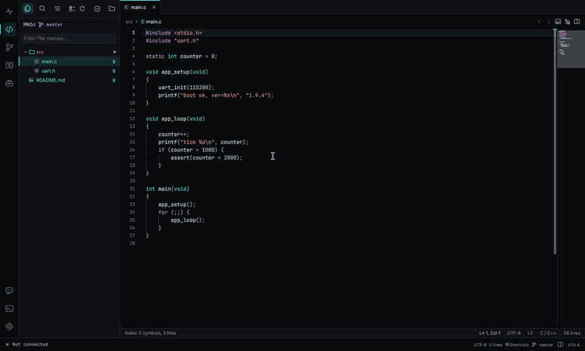 | |

更多见[使用手册](docs/USER_GUIDE.zh-CN.md)。

## 下载

到 [Releases 页面](https://github.com/zenghi/QCCOM/releases) 下载最新版。

| 系统 | 文件 | 说明 |
|---|---|---|
| Windows 10 / 11 x64 | `qccom-windows-x64.exe` | 双击运行。如果系统没有自带，需要装 USB 转串口驱动（CH340、CP210x、FTDI 等）。 |
| Linux x64 | `qccom-linux-x64` | `chmod +x qccom-linux-x64 && ./qccom-linux-x64`。普通用户打开串口需要加入 `dialout` 组（Arch 是 `uucp`）：`sudo usermod -aG dialout $USER`，重新登录后生效。 |

每个版本都附带 `SHA256SUMS.txt`，可以用来校验下载的文件。

**代码签名**：Windows 版通过 SignPath.io 提供的免费代码签名、SignPath Foundation 签发的证书签名（申请中）。见[代码签名政策（Code signing policy）](CODE_SIGNING.md)和[隐私政策](https://www.zenghi.com/privacy/)。签名版发布前，**Windows SmartScreen** 可能提示“无法识别的应用”，点 **更多信息 → 仍要运行** 即可。

## 快速上手

1. 在左侧选择端口。
2. 点 **连接** 或按 **F5**。不知道波特率就在设备输出日志时点 **⚡ 自动**。
3. 看日志。在底部输入命令，按 **回车** 发送。

想像 PuTTY、minicom 那样直接敲命令，就点顶栏的 **终端** 或按 **Ctrl+\`**。要用 TCP、UDP、MQTT 或 BLE，点设备列表上方的对应标签；**API** 标签打开 HTTP 请求编辑器。

完整说明见 [使用手册](docs/USER_GUIDE.zh-CN.md)。

## 从源码编译

需要较新的 Rust 稳定版（用 `rustup` 安装，1.85 或更高）。

```bash
git clone https://github.com/zenghi/QCCOM.git
cd QCCOM

# 仅 Linux：枚举串口和蓝牙需要的系统头文件
sudo apt install pkg-config libudev-dev libdbus-1-dev   # Debian / Ubuntu
# sudo dnf install pkgconf-pkg-config systemd-devel dbus-devel   # Fedora
# sudo pacman -S pkgconf systemd-libs                 # Arch

cargo build --release
# 产物：target/release/qccom（Windows 上是 qccom.exe）

cargo test
```

在 Linux 上交叉编译 Windows 版、发布配置、CI 等细节见 [docs/BUILDING.md](docs/BUILDING.md)。

## 参与贡献

欢迎提交问题、功能建议、翻译和 PR，请先看 [CONTRIBUTING.md](CONTRIBUTING.md)。新增或修正一种界面语言只需要改一个 TSV 文件。

## 许可证与署名

QCCOM 使用 [Apache License 2.0](LICENSE) 开源。Copyright © 2026 [zenghi](https://github.com/zenghi)。

你可以自由使用、修改、再分发，包括商业用途。但再分发 QCCOM 或基于它修改的作品时，许可证要求你：

- 附带 [LICENSE](LICENSE) 副本；
- 附带 [NOTICE](NOTICE) 文件，其中包含署名 **“基于 zenghi 的 QCCOM 开发 – https://github.com/zenghi/QCCOM”**；
- 保留原有的版权和署名声明，并在修改过的文件中注明修改。

请不要删除程序“关于”窗口里显示的作者和仓库信息。

代码签名政策：[CODE_SIGNING.md](CODE_SIGNING.md)。

内置字体：Inter 和 JetBrains Mono，均为 SIL Open Font License 1.1（见 [assets/licenses](assets/licenses)）。
