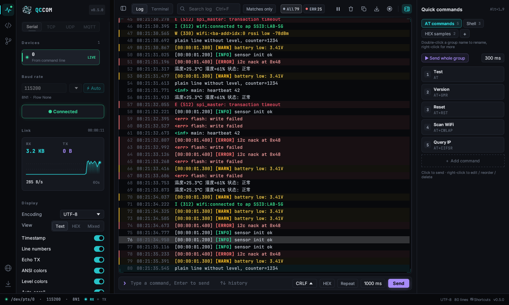
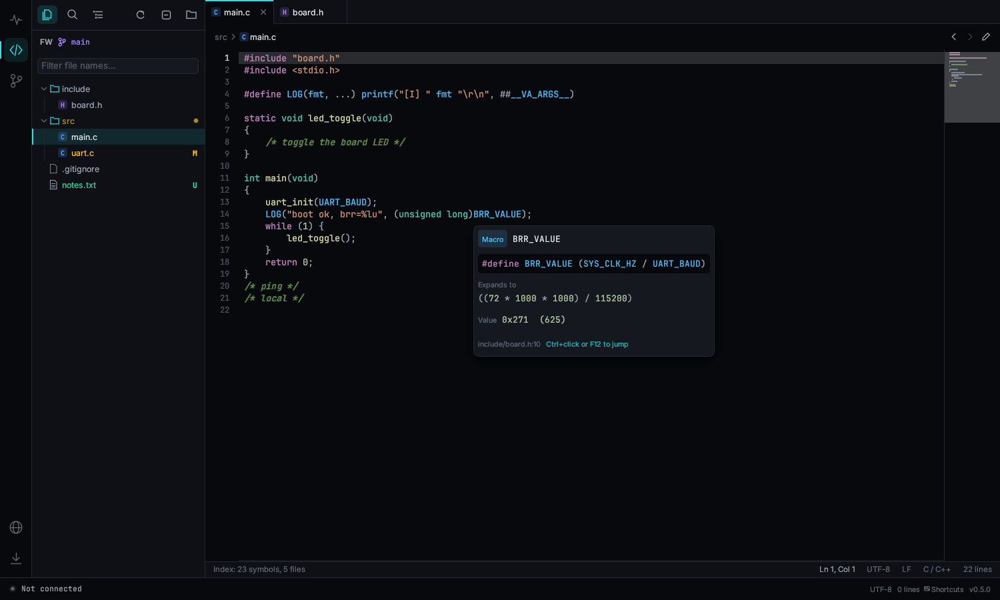
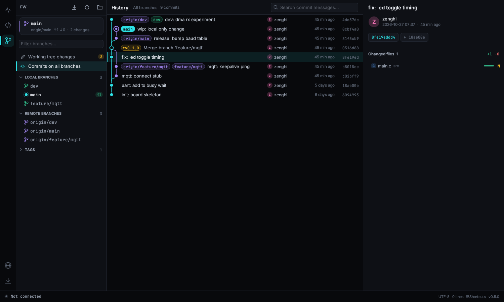
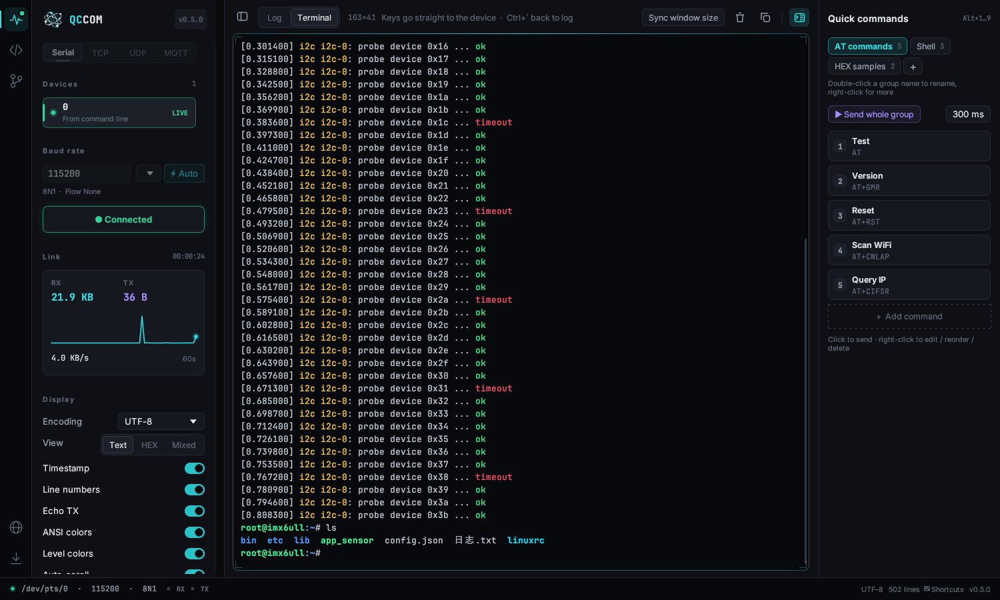
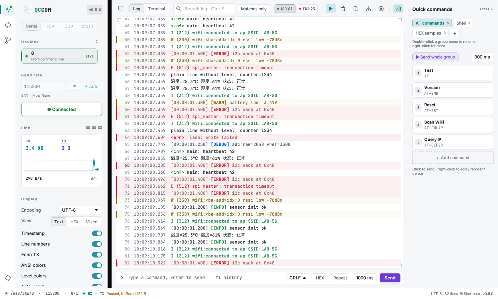

<p align="center">
  
</p>

<h1 align="center">QCCOM</h1>

<p align="center">
  给嵌入式开发者的串口 / TCP / UDP / MQTT 调试助手，轻量、快速，<br>
  自带串口终端、代码浏览器和 Git 历史查看器。
</p>

<p align="center">
  <a href="https://github.com/zenghi/QCCOM/releases"></a>
  <a href="https://github.com/zenghi/QCCOM/actions"></a>
  <a href="LICENSE"></a>
  
</p>

<p align="center">
  <a href="README.md">English</a> · 简体中文
</p>



QCCOM 用 Rust + [egui](https://github.com/emilk/egui) 编写，只有一个可执行文件（Windows 版约 4 MB），免安装、不需要运行库、不需要管理员权限。启动不到一秒，几十万行日志也能流畅滚动。

## 主要功能

- **串口即插即用**：每秒自动扫描，显示芯片型号和 VID:PID（如 `COM5 · CH340 (1a86:7523)`）；新插入的设备自动选中，拔掉后重新插上会自动重连。
- **自动识别波特率**：依次尝试 18 种常用波特率，给收到的数据打可读性分，选最好的自动连接。
- **Linux 终端风格日志**：ANSI 颜色（16 / 256 / 真彩色）；`[ERROR]`、`E (123) tag:`、`E/tag:`、`<err>` 等格式自动按级别着色；毫秒时间戳、关键词高亮、搜索、按级别过滤、文本 / HEX / 混合视图。
- **多种编码**：UTF-8、GBK / GB2312、ASCII、Latin-1，切换后历史日志立即按新编码重新显示。
- **完整的终端模式**：VT100 / xterm 仿真，直接操作 U-Boot 和 Linux shell；vi、top、less、menuconfig 都能正常显示；支持回滚历史、鼠标选择复制、粘贴。
- **网络连接**：TCP 客户端、TCP 服务器（可多客户端）、UDP、MQTT 3.1.1（TLS、用户名密码、QoS 0–2、retain、多个订阅）。日志、终端、快捷命令等功能在网络连接下全部可用。
- **快捷命令**：多组一键发送的命令（文本或 HEX），每条可单独设换行符，`Alt+1…9` 快捷发送，可按间隔依次发送整组。
- **代码浏览器**：在日志旁打开固件工程，文件树、多标签、12 类语言语法高亮、按文件名快速打开、全工程搜索；C / C++ 支持跳转到定义、查找引用、宏展开并计算出数值。
- **Git 查看器**：本地 / 远程分支和标签、所有分支的提交图、提交详情、带行号的差异对比、工作区状态、切换分支、拉取。
- **录制与导出**：保存或复制日志；也可以把之后的每一行实时写入文件，适合长时间挂机抓日志。
- **自动更新**：从你自己的服务器检查新版本，下载后做 SHA-256 校验再替换。格式见 [docs/UPDATE_SERVER.md](docs/UPDATE_SERVER.md)。
- **深色 / 浅色主题**（或跟随系统）、可搜索的**命令面板**（`Ctrl+Shift+P`）、设置中心，以及**完全可自定义的快捷键**（支持 Ctrl+K Ctrl+S 这类序列键）。
- **10 种界面语言**，按系统语言自动选择：English、简体中文、繁體中文、日本語、한국어、Deutsch、Français、Español、Русский、Português。

| 代码浏览器 | Git 历史 |
|---|---|
|  |  |

| 终端模式 | 浅色主题 |
|---|---|
|  |  |

## 下载

到 [Releases 页面](https://github.com/zenghi/QCCOM/releases) 下载最新版。

| 系统 | 文件 | 说明 |
|---|---|---|
| Windows 10 / 11 x64 | `qccom-windows-x64.exe` | 双击运行。如果系统没有自带，需要装 USB 转串口驱动（CH340、CP210x、FTDI 等）。 |
| Linux x64 | `qccom-linux-x64` | `chmod +x qccom-linux-x64 && ./qccom-linux-x64`。普通用户打开串口需要加入 `dialout` 组（Arch 是 `uucp`）：`sudo usermod -aG dialout $USER`，重新登录后生效。 |

每个版本都附带 `SHA256SUMS.txt`，可以用来校验下载的文件。

> **Windows SmartScreen** 可能提示“无法识别的应用”，这是因为程序暂时还没有代码签名。点 **更多信息 → 仍要运行**，或者右键文件 → **属性** → 勾选 **解除锁定**。

## 快速上手

1. 在左侧选择端口。
2. 点 **连接** 或按 **F5**。不知道波特率就在设备输出日志时点 **⚡ 自动**。
3. 看日志。在底部输入命令，按 **回车** 发送。

想像 PuTTY、minicom 那样直接敲命令，就点顶栏的 **终端** 或按 **Ctrl+\`**。要用 TCP、UDP 或 MQTT，点设备列表上方的对应标签。

完整说明见 [使用手册](docs/USER_GUIDE.zh-CN.md)。

## 从源码编译

需要较新的 Rust 稳定版（用 `rustup` 安装，1.81 或更高）。

```bash
git clone https://github.com/zenghi/QCCOM.git
cd QCCOM

# 仅 Linux：枚举串口需要的系统头文件
sudo apt install pkg-config libudev-dev      # Debian / Ubuntu
# sudo dnf install pkgconf-pkg-config systemd-devel   # Fedora
# sudo pacman -S pkgconf systemd-libs                 # Arch

cargo build --release
# 产物：target/release/qccom（Windows 上是 qccom.exe）

cargo test
```

在 Linux 上交叉编译 Windows 版、发布配置、CI 等细节见 [docs/BUILDING.md](docs/BUILDING.md)。

## 参与贡献

欢迎提交问题、功能建议、翻译和 PR，请先看 [CONTRIBUTING.md](CONTRIBUTING.md)。新增或修正一种界面语言只需要改一个 TSV 文件。

## 许可证与署名

QCCOM 使用 [Apache License 2.0](LICENSE) 开源。Copyright © 2026 [zenghi](https://github.com/zenghi)。

你可以自由使用、修改、再分发，包括商业用途。但再分发 QCCOM 或基于它修改的作品时，许可证要求你：

- 附带 [LICENSE](LICENSE) 副本；
- 附带 [NOTICE](NOTICE) 文件，其中包含署名 **“基于 zenghi 的 QCCOM 开发 – https://github.com/zenghi/QCCOM”**；
- 保留原有的版权和署名声明，并在修改过的文件中注明修改。

请不要删除程序“关于”窗口里显示的作者和仓库信息。

内置字体：Inter 和 JetBrains Mono，均为 SIL Open Font License 1.1（见 [assets/licenses](assets/licenses)）。
