# QCCOM User Guide

English · [简体中文](USER_GUIDE.zh-CN.md)

- [The window](#the-window)
- [Serial connection](#serial-connection)
- [Reading the log](#reading-the-log)
- [Sending data](#sending-data)
- [Quick commands](#quick-commands)
- [Terminal mode](#terminal-mode)
- [TCP, UDP and MQTT](#tcp-udp-and-mqtt)
- [Code viewer](#code-viewer)
- [Git viewer](#git-viewer)
- [Compare and merge](#compare-and-merge)
- [System right-click menu](#system-right-click-menu)
- [Language](#language)
- [Updates](#updates)
- [Keyboard shortcuts](#keyboard-shortcuts)
- [Troubleshooting](#troubleshooting)

## The window

The thin **activity bar** on the far left switches between the pages:

| Icon | Page |
|---|---|
| Pulse | **Debug**: the serial port, log, terminal, quick commands. A green dot means a connection is open. |
| `</>` | **Code**: browse source code next to the log. |
| Branch | **Git**: branches, commit graph and diffs. |
| Two panes | **Compare**: folder, text, hex, table compare and three-way merge. |
| Toolbox | **Toolbox**: TCP, UDP, MQTT, BLE, WebSocket, HTTP API and Modbus slave, plus servers, network tools, calculators, CAN and HID. |

The **gear** at the bottom of the activity bar holds everything you need less often: the command palette, settings, keyboard shortcuts, theme, language, update check and About. A **download arrow** appears above it only while an update needs your attention.

### Command palette

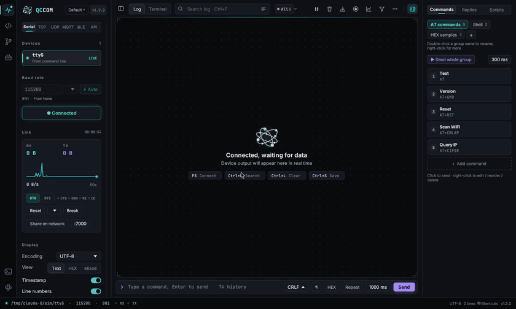

Press `Ctrl+Shift+P` (or `F1`) and type a few letters of what you want, for example *theme*, *clear* or *shortcut*. Arrow keys move, Enter runs, Esc closes. Every command, theme, language and settings page is listed, and the ones you used recently come first.

### Settings

`Ctrl+,` opens the settings page: General, Appearance, Log, Connection, Code Editor, Keyboard Shortcuts and About. The search box at the top filters every option. Press Esc or click × to go back to where you were.

The Debug page has three columns:

- **Left sidebar** (`Ctrl+B` hides it): device list, baud rate, the Connect button, a live link monitor (RX / TX bytes and a 60-second rate graph), display settings and advanced settings.
- **Center**: the top bar (Log / Terminal switch, search, level filter, pause, clear, copy, save, record), the log or terminal itself, and the command bar.
- **Right**: the quick-command panel (`Ctrl+J` shows or hides it).

The status bar at the bottom shows the connection, RX / TX activity lights, every other connection that is online (click one to jump to it; its dot flashes when data arrives), the encoding, the line count and the version. Click **Shortcuts** for the full key list. Click the version pill at the top of the sidebar to open the About box.

## Serial connection

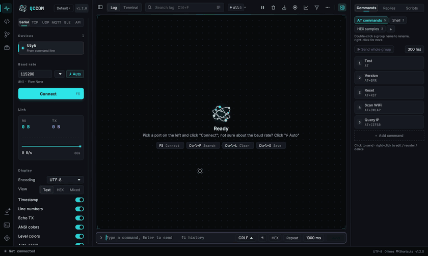

1. **Choose a port.** Ports are rescanned every second. Each card shows the chip name and VID:PID, and the connected one is marked **LIVE**. A newly plugged device is selected for you.
2. **Choose a baud rate**, either by typing it or picking it from the list. If you don't know the rate, let the device print something and click **⚡ Auto**. QCCOM tries 18 common rates, scores the received data for readability and connects with the best one.
3. Click **Connect** or press **F5**. Press F5 again to disconnect.

If the device is unplugged while connected, QCCOM waits and reconnects when it comes back.

**Advanced settings** (bottom of the sidebar) cover data bits, parity, stop bits, flow control, DTR / RTS (many ESP32 and Arduino boards use these for reset), auto-reconnect, auto-select of new ports, the font size, the maximum number of lines kept, and the idle frame gap (for binary protocols, it starts a new line after N ms of silence).

A port that the scanner cannot see, such as a virtual `/dev/pts/3`, can be passed on the command line: `qccom /dev/pts/3`.

## Reading the log

- **Colors.** ANSI escape codes are rendered (16 / 256 / true color), so ESP-IDF, Zephyr and Linux kernel logs look as they would in a terminal. Lines are also colored by level: errors get a red tint and a red left bar, warnings get yellow, and level tags such as `[ERROR]`, `E (123) tag:`, `E/tag:`, `<err>`, `<wrn>` and `[INFO]` are highlighted.
- **Encoding.** UTF-8, GBK / GB2312, ASCII or Latin-1. Changing it re-decodes the whole history.
- **View.** Text, HEX, or Mixed (text with HEX below).
- **Display switches:** timestamp (milliseconds), line numbers, echo of sent data, ANSI colors, level colors, auto scroll.
- **Keywords.** Enter comma-separated words, and each gets its own highlight color.
- **Search** (`Ctrl+F`). All matches are highlighted; Enter and Shift+Enter jump between them. **Matches only** hides every other line.
- **Level filter.** The `ALL` / `ERR` / `WRN` / `INF` / `DBG` chips show live counts. Click one to show that level and above.
- **Pause** (`Ctrl+P`) freezes the view while data keeps arriving in the background, so nothing is lost.
- **Scrolling** up stops auto scroll. A **Back to latest** button appears to resume it.
- **Selecting.** Drag to select any text, double-click for a word, triple-click for a whole line. Click the line-number gutter to select whole lines (Shift+click for a range). Dragging past the top or bottom edge scrolls. `Ctrl+C` copies without timestamps by default; turn on *Include timestamps when copying* in Settings → Log, or right-click and pick **Copy with timestamps**.
- **Save** (`Ctrl+S`) writes the current log to a file. **Record** appends every new line to a file as it arrives, which is ideal for overnight captures; Settings → Log can start a new file every N minutes or N MB. *Copy entire log* is in the **⋯** menu.
- **Time delta** (sidebar → Display) shows the time since the previous line in front of each line; gaps of a second or more turn yellow.
- **Bookmarks and markers.** `Ctrl+M` inserts a marker line (`Marker 1` with the time), right-click a line to bookmark it (`Ctrl+F2`), and `F2` / `Shift+F2` jump between them.
- **Clear** with `Ctrl+L`.

## Sending data

Type in the command bar at the bottom (`Ctrl+K` focuses it) and press **Enter**.

- **↑ / ↓** browse the command history, which is saved.
- **Line ending:** none, LF, CR or CRLF.
- **HEX:** `AA 55 01`, `0xAA,0x55`, and `AA5501` are all accepted.
- **Repeat** sends the same data every N ms until you turn it off.
- **Checksum:** with HEX on, the combo next to it appends a SUM8, XOR, CRC-8, CRC-16 (Modbus / CCITT / XMODEM) or CRC-32 to every frame.
- **Multi-line (¶):** Enter adds a line and `Ctrl+Enter` sends. Send the block at once, or turn on **Per line** to send each line as its own packet with a gap (Settings → Log).
- **AT assistant:** type `AT` and a list of matching commands appears (3GPP, ESP-AT, cellular modules, Bluetooth modules) with a one-line description. `↑` / `↓` choose and `Tab` completes.

Sent text is encoded with the encoding selected in the sidebar.

## Quick commands

The right-hand panel holds groups of one-click commands. Three example groups are included: AT commands, Shell, and HEX samples.

- Click a command card to send it. `Alt+1` … `Alt+9` send the first nine commands in the current group.
- Click **+** to add a group. Double-click a group name to rename it, and right-click it to duplicate or delete it.
- **+ Add command** creates a command. Right-click a command to edit, move or delete it. Each command can be text or HEX and can have its own line ending, or follow the command bar's setting.
- **Send whole group** sends every command in order, with the interval shown next to it.

Everything is saved automatically.

## Terminal mode

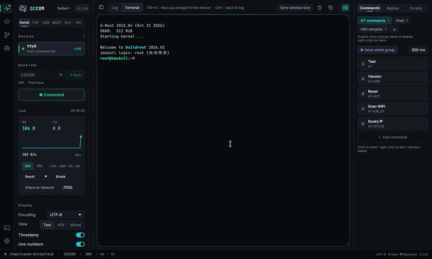

Switch to **Terminal** in the top bar or press `Ctrl+\``. Click inside the terminal and your keyboard goes straight to the device, just like PuTTY or minicom.

- Every key is sent through: Ctrl+C, Tab completion, arrow-key history, Ctrl+R, Ctrl+D, F1–F12, Home / End / PgUp / PgDn. The only exceptions are F5 and `Ctrl+\``.
- It supports VT100 / xterm sequences: cursor movement, erase, 16 / 256 / true color, scroll regions and the alternate screen. Full-screen programs such as vi, top, less and menuconfig work and restore the screen when they exit.
- CJK characters take two cells. Box-drawing and block characters are drawn as vectors, so frames line up exactly.
- Drag to select text, which is copied when you release the mouse. `Ctrl+Shift+C` copies and `Ctrl+V` pastes. Right-click to copy the screen, paste or reset.
- The mouse wheel scrolls back through the last 3000 lines. Press any key or click **Back to latest** to return.
- **Sync window size** sends `stty rows R cols C` so programs on the device use the whole window. Run it at a shell prompt.
- The log and the terminal share the same connection, so you can switch at any time without losing data. Quick commands work in terminal mode too.

The terminal always decodes UTF-8, which is what Linux boards use.

## TCP, UDP, MQTT and WebSocket

Network connections live at the top of the **Toolbox** (`Ctrl+Shift+B`), in the *Communication* group. Click one and the page shows the same sidebar, log, terminal and quick commands as the Debug page, so every log, terminal, quick-command and recording feature works on network connections too.

**Several connections at once.** The serial port, TCP, UDP, MQTT, BLE and WebSocket each have their own connection and their own log, terminal, statistics and recording. Connect the serial port, then a TCP server, then MQTT: all of them stay connected and keep logging (and reconnecting) in the background while you look at another one. The status bar lists every live connection; click one to jump to it. In the toolbox list a green dot marks a connected tool and flashes when new data arrives.

| Mode | Settings | Notes |
|---|---|---|
| **TCP client** | host, port | Connects to a server such as a Wi-Fi module or a test rig. |
| **TCP server** | listen port | Accepts any number of clients. Data you send goes to all of them, and the sidebar shows how many are connected. |
| **UDP** | local port, remote host and port | If you leave the remote host empty, replies go to whoever sent the last packet. Broadcast addresses are allowed. Each received datagram becomes a log entry tagged with the sender's address. |
| **MQTT** | broker host and port, TLS, client ID, user name, password, keep-alive, clean session | MQTT 3.1.1. Add any number of subscriptions (wildcards `+` and `#` are fine). Choose a publish topic, QoS 0 / 1 / 2 and retain, then type in the command bar to publish. Incoming messages are shown with their topic. |
| **WebSocket** | URL (`ws://` or `wss://`), text or binary frames, ping interval, extra headers | Each received message is one log entry tagged `txt` or `bin`. What you send goes out as one message. Use the headers box for `Authorization: Bearer …` and similar. |

TLS uses the operating system's certificate store on Windows and the Mozilla root store on Linux.

## Bluetooth LE

Open **Bluetooth LE** in the toolbox and click **Scan**. Nearby devices appear with their name, address, a hint such as *Nordic UART* or the manufacturer, and signal bars with the RSSI. Type in the filter box to narrow the list, or use the filter button to hide devices without a name. Devices not seen for 30 seconds are dimmed.

Select a device and click **Connect** (or double-click it). After connecting, the sidebar lists its services and characteristics:

- **Notify** switch: subscribe to notifications and indications. Notifiable characteristics outside the standard GAP / GATT services are subscribed automatically. Each notification is one log line tagged with the characteristic, e.g. `[NUS TX] temp=24.1`.
- **Read** button: read the value once. Text is shown as is; short binary values are shown as HEX with the little-endian number, e.g. `[Battery Level R] 57  (87)`.
- **Write target**: click a writable characteristic (marked **W**) to make it the target; whatever you send from the command bar, quick commands, scripts or auto-replies is written there, split into MTU-sized chunks. The Nordic UART RX characteristic, `FFE1` and `FFF2` are chosen automatically.
- **Write with response** switch: use Write Request (acknowledged) instead of Write Command.

Requirements: Windows 10 or later with Bluetooth turned on; on Linux, BlueZ with the `bluetooth` service running (the binary links `libdbus-1`, which every desktop distribution ships). If Bluetooth is not available, the tab shows why. To try the tab without hardware, start QCCOM with the environment variable `QCCOM_BLE_DEMO=1`; it simulates a few devices, and `QC-Sensor` echoes what you write and sends a reading every second.

## HTTP API testing

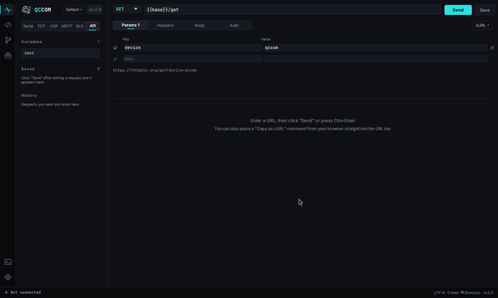

**HTTP API** in the toolbox is a Postman-style request editor, which is handy for the REST endpoints of ESP32, Linux boards and cloud services. A serial or network connection stays open in the background while you use it.

- Pick the method, type the URL and press **Send** (or `Enter` / `Ctrl+Enter`). The status, time and size appear above the response; JSON is indented and colored (toggle **Format**), and the **Headers** tab lists the response headers. Copy or save the body with the buttons on the right.
- **Params**, **Headers**, **Body** (JSON, form or text) and **Auth** (Bearer token or Basic) tabs. `Content-Type` and `Authorization` are added for you and listed under the header table.
- **Variables**: define `base = http://192.168.4.1` once and write `{{base}}/api/status`. Variables work in the URL, params, headers, body and token. The variables window also has the timeout and *follow redirects* settings.
- **Save** keeps a request in the sidebar list (right-click to rename, duplicate or delete); every request you send is added to **History**.
- **cURL**: paste a curl command (browser dev tools → *Copy as cURL*) into the URL bar to import it, or use **cURL ▾** to copy the current request as curl or start a new one.

Requests to `localhost`, private and link-local addresses never go through the system proxy.

## Debugging tools

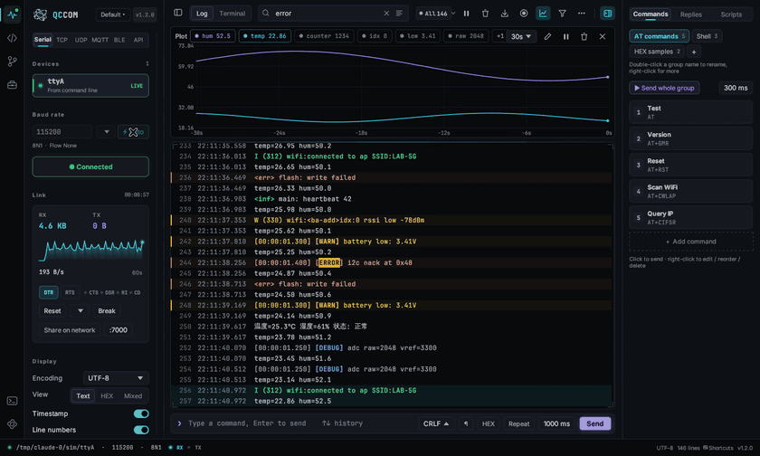

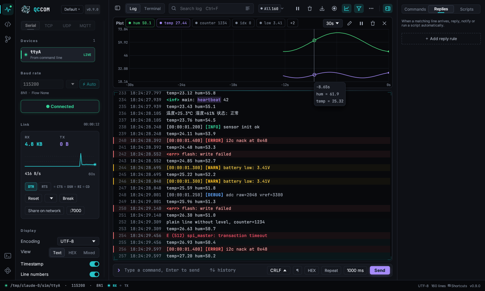

The rarely used tools live in the **⋯** menu at the top right of the log and in the command palette, so the main window stays clean.

**Plot** (chart icon, `Ctrl+Shift+W`). Numbers in the log are drawn as live curves above it. `temp=25.3`, `vbat: 3.71`, `x:1,y:2` and lines of comma-separated numbers are detected automatically; a value that never changes (a version number, an address) is listed but not drawn, so it doesn't flatten the scale. Click a legend chip to show or hide a curve, scroll to zoom the time window, hover to read values, pause the view while data keeps coming, or write your own regex (each group is a curve). Drag the divider to resize.

**Filter & highlight rules** (filter icon, `Ctrl+Shift+H`). Each rule is text or a regex with an action: *Highlight* in a color, *Show only* (rules are OR-ed) or *Hide* (wins over everything). Rules only change what you see; recordings keep every line. Right-click a line → *New auto-reply rule from this line* is the quickest way to start one.

**Protocol framing** (sidebar → Display → Protocol framing). For binary protocols: give the header (`AA 55`), a fixed length or a length field (offset, size, endianness, adjustment) and a checksum. Each frame becomes one line in HEX with the header, length and checksum colored, and bad checksums turn red. The status bar shows when framing is on.

**Auto-reply** (right panel → *Replies*). When a line matches, reply with text or HEX after a delay, show a notification, pause the log, or run a script. The hit count is shown on each rule. Replies are never sent while replaying a log.

**Scripts** (right panel → *Scripts*). Small [Rhai](https://rhai.rs) scripts for test sequences:

```rust
for i in 0..3 {
    sendln("AT");
    if wait("OK", 1000) { log(`#${i + 1}: OK`); } else { log(`#${i + 1}: no reply`); }
    sleep(500);
}
```

Functions: `send(text)`, `sendln(text)`, `send_hex("AA 55")`, `wait(text, ms)`, `wait_re(regex, ms)` (returns the first group), `read_line(ms)`, `sleep(ms)`, `now()`, `log(text)`, `clear()`, `dtr(bool)`, `rts(bool)`. `Ctrl+Enter` in the editor runs the script; the status bar shows it while it runs, click to stop.

**Modbus master** (⋯ menu). Read coils / discrete inputs / holding / input registers and write single or multiple coils and registers. RTU with CRC on serial ports, Modbus TCP on TCP connections. Results are shown as UINT16, INT16, HEX, 32-bit integers or floats (with optional word swap); poll at an interval to watch values change.

**Send file** (⋯ menu). XMODEM (128 / 1K) and YMODEM, for U-Boot's `loadx` / `loady` and most bootloaders. Start the receiver first, or click Send first: the sender waits 60 seconds for it.

**Checksum calculator** (⋯ menu). Every supported checksum for some HEX bytes or text, with the byte order used on the wire.

**Log files.** *Open log file* loads a saved or recorded log for reading and searching. *Replay log file* plays it back with the original timing at 0.5× to 10× or as fast as possible, so plots, rules and auto-replies can be tested without the device. Logs can also be dragged into the window, or opened with `qccom --open file.log` / `qccom --replay file.log`.

**Statistics** (⋯ menu, or click the line count in the status bar). Bytes and lines received and sent, current / peak / average rate, connection time, lines per level and an error histogram for the last minute.

**Serial port extras**, shown in the link card while a serial port is connected:

- DTR and RTS toggles and the CTS / DSR / RI / CD input lines, updated live.
- **Reset**: a DTR or RTS pulse, or the ESP32 sequences that reset into the app or into the bootloader. Pick the default with the arrow; right-click for the others.
- **Break** sends a 250 ms break.
- **Share on network** opens a TCP port; every client that connects is bridged to the serial port both ways, so a colleague or another tool can use the device remotely.

Right-click a port card to give it an alias (for example *Main board*) or to set it as **port B**. Port B is opened together with the main port and its data is shown in amber with a `B ›` prefix, which is handy for sniffing both directions of a link with two adapters.

**Profiles** (the button next to the logo) save the connection settings, quick commands, rules, replies and scripts under a name and switch between them in one click.

**More windows.** *New window* (`Ctrl+Shift+N`) starts another QCCOM window with its own settings, so you can watch two devices side by side.

## Code viewer

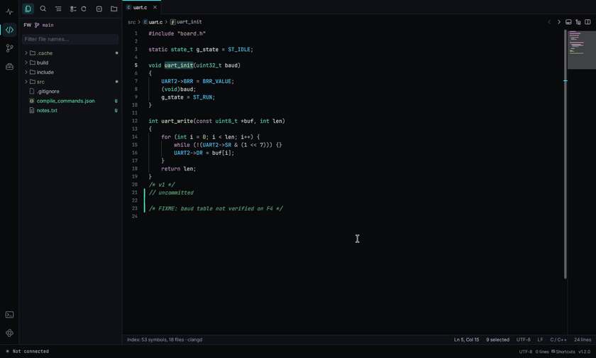

Click `</>` in the activity bar, then **Open folder** to open your firmware project (or start QCCOM with a folder: `qccom ~/fw`). QCCOM remembers it, along with your open tabs.

- **Explorer** (`Ctrl+Shift+E`): the file tree with Git status colors (M modified, U untracked), a filter box, refresh and collapse-all. Symbol indexing and search skip folders such as `.git`, `node_modules`, `target` and `dist`.
- **Explorer actions**: right-click a file or folder to create a file (you can type `drv/spi.c` to create folders on the way), create a folder, rename or delete it. Right-click empty space to create at the root. Right-click the folder button at the top for recent projects.
- **Tabs**: `Ctrl+Tab` switches tabs and `Ctrl+W` closes one. Middle-click also closes a tab. Drag tabs to reorder them. Right-click a tab to close others, close to the right, close saved tabs, split right, copy the path or reveal it in the file manager.
- **Split editor** (`Ctrl+\`, or the button on the right of the breadcrumb bar): two files side by side; drag the divider to resize.
- **Highlighting** for C / C++, Rust, Python, JavaScript / TypeScript, Go, Java / Kotlin, shell, JSON, Makefile / CMake, INI / TOML / YAML, Markdown and assembly.
- **Quick open** (`Ctrl+P`): type part of a file name. You can also prefix the query:
  - `#` searches symbols across the workspace (`Ctrl+T`).
  - `@` lists the symbols in the current file (`Ctrl+Shift+O`).
  - `:` goes to a line (`Ctrl+G`).
- **Search everywhere** (`Ctrl+Shift+F`): full-text search across the project with match case, whole word and regular expression options. Click a result to jump to it. Open the replace row to replace across the project: every result shows a preview, and **Replace all** asks for a second click. Open files are changed in the editor (undoable), the rest are written to disk keeping their encoding.
- **Find and replace in file** (`Ctrl+F` / `Ctrl+H`): match case, whole word and regular expressions (`$1` refers to a group). The bar shows the count and a preview of the current replacement. `Enter` replaces the current match and `Ctrl+Enter` replaces all, which `Ctrl+Z` undoes in one step.
- **C / C++ navigation**: hover an identifier to see its definition. Hovering a macro shows the `#define`, the full expansion and the computed value (for example `BRR_VALUE` → `((72 * 1000 * 1000) / 115200)` → `0x271 (625)`). Hovering an enum constant shows its value. `Ctrl+click` or `F12` goes to the definition, `Shift+F12` finds references, and `Alt+←` / `Alt+→` go back and forward.
- **clangd (optional)**: if [clangd](https://clangd.llvm.org/) is installed (on PATH, or in the default LLVM folder on Windows) and the project has a `compile_commands.json` in its root or `build/`, Go to Definition uses clangd. It tells apart static functions with the same name, local variables and struct members. The status bar shows `· clangd`. Without it QCCOM falls back to its built-in index; nothing to configure. You can turn it off or set the clangd path in Settings → Code Editor.
- `Ctrl+=` and `Ctrl+-` change the font size. A minimap is on the right.

### Editing

Files are editable; `Ctrl+S` saves, and a dot on the tab marks unsaved changes. The editor works like VS Code:

- **Undo / redo**: `Ctrl+Z` / `Ctrl+Y` (or `Ctrl+Shift+Z`). Continuous typing is one undo step.
- **Multiple cursors**: `Alt+click` adds a cursor. `Ctrl+D` adds the next occurrence of the word, `Ctrl+Shift+L` selects all of them, and `Ctrl+Alt+↑/↓` adds a cursor on the line above or below. `Esc` goes back to one cursor.
- **Column selection**: `Alt+Shift+drag` or middle-button drag.
- **Brackets**: brackets and quotes close automatically, and typing a bracket with text selected wraps it. The matching bracket is outlined; `Ctrl+Shift+\` jumps to it.
- **Indentation**: Enter keeps the indentation and opens a block after `{`. `Tab` / `Shift+Tab` indent and outdent. Indent guides highlight the current block.
- **Folding**: click the arrow next to a line number, or `Ctrl+Shift+[` / `Ctrl+Shift+]`. `Ctrl+K Ctrl+0` folds everything and `Ctrl+K Ctrl+J` unfolds everything. Works for `{}`, `#if/#endif` and multi-line comments.
- **Lines**: `Ctrl+/` toggles comments, `Alt+↑/↓` moves lines, `Shift+Alt+↑/↓` copies them, `Ctrl+Shift+K` deletes them, `Ctrl+L` selects the line, and `Ctrl+Enter` / `Ctrl+Shift+Enter` insert a line below / above.
- **Saving**: files changed by another program reload on their own; if you have unsaved edits too, a bar lets you reload or keep yours. Turn on **Auto save** in Settings → Code Editor to save one second after you stop typing. Unsaved files are backed up every few seconds, and after a crash QCCOM offers to restore them.
- **Git**: colored bars left of the code mark added (green), modified (blue) and deleted (red) lines compared with the last commit. The end of the current line shows who last changed it, when and why (turn off in settings).
- **More**: the word under the cursor is highlighted everywhere; the enclosing function and blocks stay pinned at the top while you scroll; holding `Ctrl` underlines identifiers you can jump to.

### Project folder

The Code page, the Git page, the terminal panel and the TFTP / HTTP servers share one project folder. Open it from the folder button, the Git page or the command palette (*Open project folder*). Each project remembers its open tabs, cursor positions and bookmarks, so switching back puts you where you were.

### Navigating

| Keys | Action |
|---|---|
| Alt+← / Alt+→, mouse back / forward | Back / forward |
| Ctrl+Alt+- (or `<` in quick open) | Navigation history |
| Ctrl+Q | Last edit location |
| Alt+O | Switch header / source |
| Ctrl+Alt+] | Matching `#if` / `#else` / `#endif` |
| Alt+PageUp / Alt+PageDown | Previous / next function |
| Ctrl+F12 | Go to declaration |
| Ctrl+K F12 | Open the definition to the side |

**Highlights**: `F8` marks the word under the cursor; press it on another word for the next of 8 colors, or again on the same word to change its color. `Shift+F8` removes one, `Ctrl+Shift+F8` clears all, `F3` / `Shift+F3` jump between marked words. Marks also show on the scrollbar.

**Inactive code** is greyed: `#if 0`, `#ifdef` of a macro that is not defined, the branch of `#if / #else` that is not compiled. Macros come from the project's `#define`s; add the ones your build passes with `-D` in Settings → Code Editor → *Extra macros*. Conditions QCCOM cannot evaluate are shown as active.

### Code generation and macro actions

Right-click in the editor for **Code generation**, **Edit** and **Key macros**. The default actions:

| Keys | Action |
|---|---|
| Ctrl+Alt+I | Wrap the selection in `#ifdef` (asks for the macro) |
| Ctrl+Alt+P | printf the variable under the cursor; the format follows its type |
| Ctrl+Alt+D | Doxygen comment for the function (also `/**` + Enter) |
| Ctrl+Alt+H | File header |
| Ctrl+Shift+Alt+P | Remove every debug print inserted by QCCOM |
| Ctrl+Shift+/ | Toggle block comment |
| Ctrl+Alt+/ | Wrap in `#if 0` / unwrap |
| Ctrl+Alt+U | Cycle naming style (snake / camel / Pascal / UPPER) |

Also in the menu: `#if / #else` wrap, hex dump, include guard + `extern "C"`, TODO, separator, enum → `switch`, add declaration to the header / stub to the source, and align on `=` or `,`.

Edit the actions in Settings → Code Editor → *Code generation*: name, where the result goes (replace selection, at cursor, line below / above, above the function, top of file, whole file) and the template. Variables: `${SELECTION}` `${WORD}` `${FUNC}` `${FILE}` `${GUARD}` `${DATE}` `${TIME}` `${YEAR}` `${AUTHOR}` `${COPYRIGHT}` `${PRINT}` `${FMT}` `${ARG}` `${PARAMS}` `${RETURN}` `${MARK}` `${INPUT:Label}` `${CURSOR}`. Set your name, copyright line and print function (`printf`, `rt_kprintf`, `SEGGER_RTT_printf(0, `…) in the same section. A line whose variable is empty is dropped.

**Key recording**: `Shift+Alt+R` starts and stops recording, `Shift+Alt+P` plays it back. *Save as macro* in the right-click menu keeps it under a name.

### Context window, call hierarchy and bookmarks

These follow Source Insight and help when reading an unfamiliar project.

- **Context window** (`Ctrl+Shift+Y`, or the button on the right of the breadcrumb bar): shows the definition of the function, macro or type under the cursor below the editor, including the comment above it. Click the file name to jump there. Drag its edge to resize it.
- **Call hierarchy** (`Ctrl+Shift+R`): shows which functions the current function **calls** and which functions it is **called by**, expandable level by level. Click an entry to jump to it. The pin keeps the current function while you move around.
- **Bookmarks**: `Ctrl+F2` toggles a bookmark on the current line (or click left of the line number). `F2` / `Shift+F2` go to the next / previous one. The Outline panel lists the bookmarks of all open files at the top.
- **Semantic colors**: functions, macros, types, enum constants and globals each get their own color.

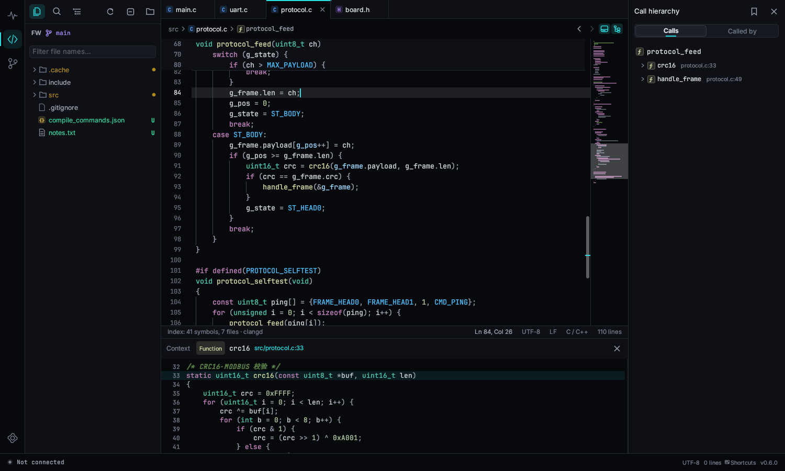

## Firmware tools

- **Map, ELF, HEX and BIN files** open in a viewer instead of as text. A Map file shows how full each memory region is, with tables of symbols, object files and output sections that you can sort and filter. An ELF file shows code / data / bss sizes, sections, symbols and segments. HEX, BIN and S-record files show a hex grid: click a byte to see it as u8 to u64, signed, float, little or big endian; drag to select and `Ctrl+C` to copy; type an address to jump; export a HEX file as BIN. The pill on the right of the breadcrumb bar switches back to the raw text.
- **Compare files**: right-click a tab → *Compare with…*, or right-click a file in the explorer → *Select as left side for compare*, then *Compare with "…"* on the other one. The comparison opens on the Compare page; see [Compare and merge](#compare-and-merge).
- **Numbers**: hover a number (or a macro with a value) to see it in hex, decimal and binary with its set bits. `Ctrl+click` opens the **bit calculator** (also in the command palette): type a value or expression, click bits to toggle them, drag across bits to select a field and get its read expression and mask, and type a new field value.
- **Snippets**: type a prefix such as `for`, `isr`, `guard` or `reg` and press `Tab`; press `Tab` again to go to the cursor position. `Ctrl+Alt+J` searches all snippets. Settings → Code Editor → Snippets opens the JSON file to add your own.
- **TODO panel**: the checklist icon in the side bar lists every `TODO`, `FIXME`, `HACK`, `XXX` and `BUG` in the project.
- **Vim keys**: turn on in Settings → Code Editor (or *Toggle Vim Keys* in the command palette). Supports the usual motions, operators, text objects, counts, `.` repeat, visual modes, `/` search with `n` / `N`, and `:w`, `:q`, `:wq`, `:bn`, `:bp`, `:vs` and `:<line>`.

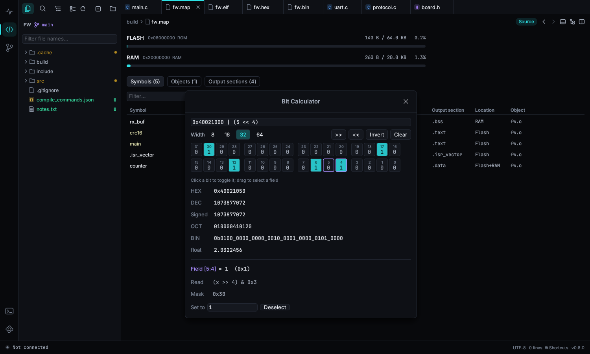

## Toolbox

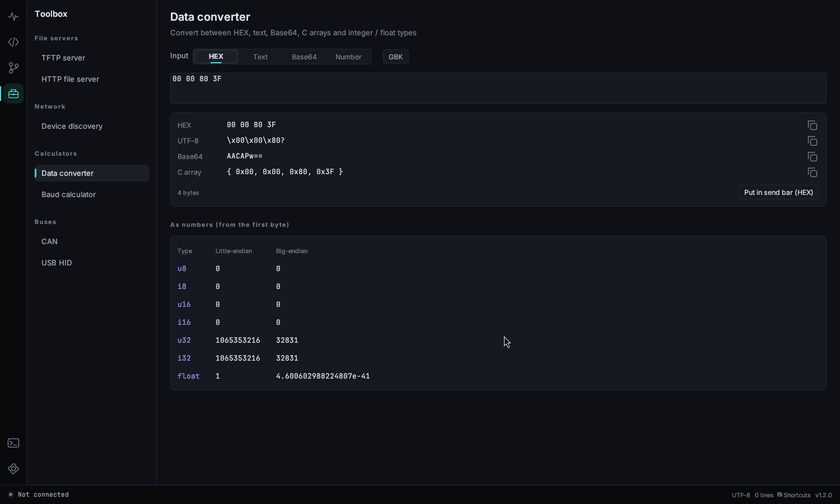

The toolbox icon in the activity bar (`Ctrl+Shift+B`) opens a page with all the communication tools and small utilities. A green dot next to a tool means it is running or connected; servers and connections keep running when you switch pages.

Type in the search box above the list to filter tools (Enter opens the first match). Right-click a tool and choose *Pin to top* to put it in a *Favorites* group. Every tool can also be opened from the command palette (`Ctrl+Shift+P`, then type its name).

The *Communication* tools (TCP, UDP, MQTT, Bluetooth LE, WebSocket, HTTP API) are described in their own sections above. The others:

- **Modbus slave**: simulate a device for a PLC, HMI or Modbus master. Choose Modbus TCP (port: 502 on Windows, 1502 on Linux where ports below 1024 need root) or RTU on a serial port, and the slave ID. Holding registers, input registers, coils and discrete inputs are shown in an editable grid from the start address you choose (HEX toggles the display). Every request is listed with its function, address, count and result. Values written by the master update the grid.
- **MQTT broker**: an MQTT 3.1.1 broker on this computer, no Mosquitto needed. Wildcard subscriptions, retained messages, last will and keep-alive are supported; set a user name and password to require them. The page lists connected clients with their subscriptions, connection events and every message. Publish from the page, or click *Connect with the MQTT tool* to connect QCCOM's own MQTT tool to it.
- **Syslog receiver**: listens on a UDP port (514 on Windows; 5514 on Linux, where ports below 1024 need root) and parses RFC 3164 and RFC 5424 messages into time, host, program, severity and text. Filter by host, program or text, and by minimum severity. On a Linux board, `syslogd -R <pc-ip>:5514` (busybox; the page shows this command with your address) or a `*.* @<pc-ip>:5514` rsyslog rule sends logs here.
- **Ping / ports**: continuous ping with a latency chart, min / average / max and loss; a count of 0 pings until you stop. *TCP port check* tries a list of ports and ranges (`21-23, 80, 502`) and shows which are open.
- **Subnet calculator**: type `192.168.1.10/24` or an address and mask to get the network, broadcast, usable range, host count, wildcard and binary forms. Type another address under *Compare* to check whether it is in the same subnet.
- **Checksums**: type HEX bytes or text and see SUM8 / SUM16 / XOR / LRC and 14 CRC presets (CRC-8, CRC-16/MODBUS, CCITT, XMODEM, CRC-32…) at once, with the result in both byte orders. *Custom CRC* takes any width, polynomial, initial value, input / output reflection and final XOR.
- **Timestamps**: converts Unix seconds, milliseconds, `0x` hex and date-times into each other, with the current time ticking at the top.
- **Regex tester**: matches are highlighted in the test text and listed with their groups; the replace box previews `$1`-style replacements.
- **Font & image to C**: *Text* draws each character with any TTF / TTC font (system fonts are listed, or pick a file) into a W×H cell; adjust size, offset and stroke weight. *Image* scales a PNG, JPG, BMP or GIF to the size you want and outputs monochrome (threshold or dithering) or RGB565 / RGB565 byte stream / RGB888 / 8-bit gray. Scan modes: row by row, column by column, page by page (SSD1306 and most OLEDs) and column-page; MSB or LSB first; inverse. The preview shows exactly the bits that are output. Copy the C array or save it as a header.
- **Color converter**: HEX, `rgb()`, RGB888, RGB565 (also as bytes), RGB555, HSV and gray; the RGB565 swatch shows how the color will look on the display.
- **ASCII table**: decimal, hex, octal and control-character names; *Show 128–255* adds the upper half. Click a hex value to copy it.

- **TFTP server**: pick a folder and a port (69 needs admin rights; the default on Linux is 6969) and click *Start server*. The page shows the U-Boot command to copy. Turn on *Allow upload* to accept `tftp put`. Every transfer is listed with its progress.
- **HTTP file server**: shares a folder with a directory listing and resumable downloads, handy for OTA tests. *Allow PUT upload* lets devices push logs with `curl -T`.
- **Device discovery**: scans the local /24 network for common ports and asks mDNS for named devices. Click a port to connect: HTTP opens the HTTP API tool, MQTT connects the MQTT tool, anything else uses the TCP client.
- **Data converter**: type HEX, text, Base64 or a number and see all the other forms, including every integer and float reading in both byte orders. Text understands `\r`, `\n`, `\t`, `\0` and `\xNN`. *Put in send bar* copies the bytes to the command bar as HEX.
- **Baud calculator**: enter the peripheral clock (`72M`, `16MHz`…) and a baud rate to get the divider register for STM32, AVR, 16550 and ESP32 and the real error. Click a chip below to try another common rate.
- **CAN**: works with SLCAN adapters (CANable, USBtin and many USB-CAN modules). Choose the adapter's serial port and bitrate and click *Open*. *Listen only* sends no ACK. Send single frames or repeat them at a period. *By ID* shows the latest data, count and period per ID, with bytes that changed in the last second highlighted; *Chronological* shows every frame.
- **USB HID**: pick a device to open it; input reports appear in the log. The first byte you send is the report ID (00 if the device does not number its reports). On Linux you may need a udev rule for `/dev/hidraw*`.

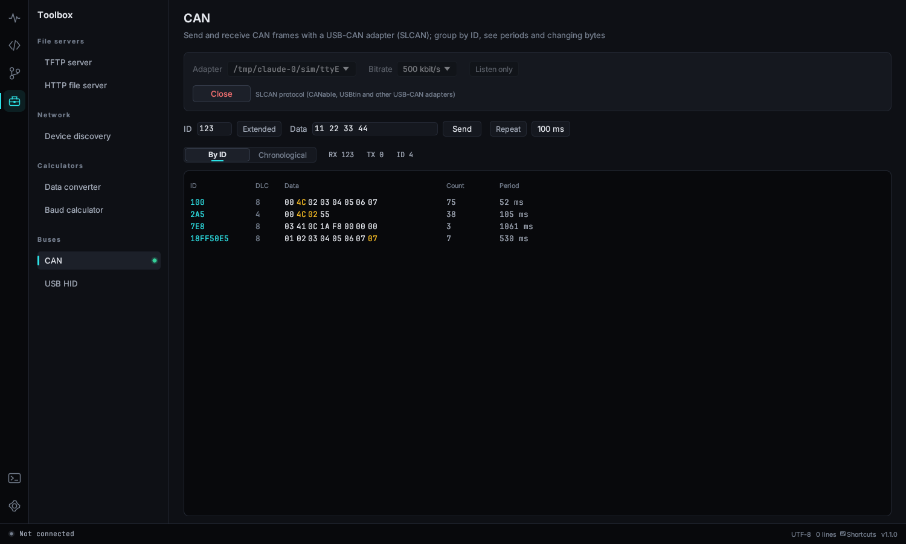

## Embedded tools

Version 1.6 adds four groups to the Toolbox. Most tools take files: click *Choose…*, type a path, or drop the file on the page. Paths and options are remembered.

### Firmware

- **Firmware convert / merge**: add HEX, BIN, S-record or ELF files (ELF loads the program segments at their load address). With one file, pick the output format and save; with several, they are merged in list order and later files overwrite earlier ones. Each BIN needs a *Load at* address; other files can be shifted with an *Address offset*. The address map shows where every file lands, and overlaps are reported. Output options: *Fill gaps* with a byte (refused when the result would be over 16 MB, which usually means a BIN has no load address), *Range only*, *Pad end to* a multiple of 4…4096 bytes, and *Split at* a list of addresses to write one file per part. The CRC32 of the output is shown before you save.
- **Update package**: pick the firmware and a *Format template*. A template is a list of fields: *Constant* (magic numbers), *Version* (`1.2.3` packed into the field), *Firmware length*, *CRC32*, *CRC16*, *Sum*, *Timestamp*, *Text*, *Reserved* and *Header CRC32* (computed over the header bytes before it). Choose byte order, *Header* / *Trailer* / *At address*, the padded header size, firmware alignment and fill byte. *Save as template* keeps your own layouts; *Restore built-in templates* brings back the three examples. The result lists every field with its offset and bytes.
- **Size diff**: choose the old and new build: two `.map` files (GNU ld, Keil armlink or LLVM lld) or two `.elf` files. The cards show ROM and RAM totals with the change; the table lists every function and variable whose size changed, largest change first. With map files the *File* tab totals by object file. Symbols are matched by name and file, and a symbol whose file was renamed is still matched. *Copy as CSV* copies the table.
- **Stack usage**: build with `-fstack-usage` (and ideally `-fcallgraph-info=su`, GCC 10+), then choose the build folder; `.su` and `.ci` files are found in all subfolders. Without `.ci` files, choose the ELF and the calls are read from the Cortex-M code (`BL` / `B.W`). *Entry points* lists the functions nobody calls (main, tasks, interrupts) with their worst-case stack; click one to see the deepest chain. Recursion, calls through function pointers and dynamic stack (`alloca`, VLAs) are flagged, because the real usage can be higher. On Cortex-M an interrupt also pushes 32 bytes (104 with the FPU context).
- **Vector table**: choose an ELF. The table is found by symbol (`g_pfnVectors`, `__Vectors`…) or section (`.isr_vector`, `RESET`…). Each slot shows the exception or IRQ, the entry address and the handler; slots still pointing at `Default_Handler` are highlighted, and *Unimplemented only* hides the rest. Load the chip's SVD in *SVD registers* to see IRQ names.

### Chip & project

- **SVD registers**: choose the chip's `.svd` file (in the Keil device pack or the cmsis-svd repository). The tree lists peripherals and their registers; the search box matches peripherals, registers and fields. Selecting a register shows its address, access and reset value, a 32-bit grid (click a bit to toggle it) and the fields with their values and enumerations; type a value read from the debugger to decode it. While an SVD is loaded, hovering `USART1->CR1` or `USART1.CR1` in the code editor shows the same information.
- **Keil / IAR project**: choose a `.uvprojx` / `.uvproj` (Keil MDK) or `.ewp` (IAR EWARM). Pick the target to see its device, defines, include paths and source groups; paths that do not exist are marked (usually a moved project). *Generate compile_commands.json* writes the file next to the project so clangd and go to definition use the real defines and include paths; *Open in code page* opens the project folder.
- **CubeMX pin table**: choose an `.ioc` file to list every configured pin with its function, user label, mode, pull and speed. Search, *Copy as CSV*, *Export CSV…*, or *Copy #defines* for the user labels.

### Hardware calculators

Values accept SI suffixes: `4k7`, `4.7k`, `100n`, `72M`.

- **Resistors**: *Divider* finds R1 / R2 pairs from E12, E24 or E96 for an input and a target voltage within a resistance range, with the error and the current. *LED resistor* gives the exact and nearest standard value and the power. *Color bands* shows the 4- or 5-band code for a value.
- **ADC / NTC**: raw reading ↔ voltage for any resolution and reference, with an optional input divider. The NTC part converts raw readings and temperatures both ways from R25 and the B value (or a pasted R-T table), with the NTC to GND or to Vref, draws the curve, and generates a C lookup table for a temperature range and step.
- **Timer / PWM**: from the timer clock, frequency and duty, finds PSC / ARR / CCR with the best resolution and the exact error (16-bit counter unless *32-bit counter* is on), shows the waveform and other combinations, and prints the STM32 HAL lines.
- **I2C pull-ups**: minimum and maximum pull-up resistance from the supply voltage, bus capacitance and mode, and a suggested E24 value.

### Data & protocols

- **Struct parser**: paste a C struct (typedefs, nested structs, unions, enums, arrays, bit fields, `#pragma pack`, `__attribute__((packed))`, `#define` constants) and the received bytes in HEX. Choose the struct if there are several; every field is listed with its offset, raw bytes and value. Options: byte order, *Pack everything*, 64-bit pointers. In the code editor, select a struct (or put the cursor in it) and right-click → *Edit → Parse struct (Toolbox)*.
- **CBOR / MsgPack / Protobuf**: paste HEX or Base64 (toggle *Base64*); the format is detected automatically or chosen by hand. The tree shows keys, types, offsets and values; Protobuf fields show the field number and wire type, and length-delimited fields are tried as nested messages and strings. *Copy as JSON*.
- **VCD waveforms**: choose a `.vcd` file from PulseView / sigrok, Saleae (export as VCD) or a Verilog / VHDL simulator. Scroll to zoom, drag to pan, left-click to set cursor A and right-click for cursor B; the time between them and the matching frequency appear at the top. Select a signal and press `←` / `→` to jump to its previous / next edge. Buses are shown as hex values.
- **QR code**: *Text / URL* or *Wi-Fi* (network name, password, security, hidden). Choose the error-correction level, then *Save PNG…* or *Copy as C array* (one bit per module, row by row) for a display. The Wi-Fi password is kept only while the app is open.

## Terminal panel

`` Ctrl+Shift+` `` (or `Alt+F12`, or the terminal icon in the activity bar) opens a command line at the bottom of the window, in the project folder. On Windows you can choose PowerShell, cmd, Git Bash or WSL; on Linux your login shell, bash, zsh or fish. The `+` button opens another tab (`Ctrl+Shift+5`) and the arrow next to it picks the shell. `Ctrl+click` a `file:line` in the output, such as a compiler error or grep result, to open it in the editor. When a shell exits, press Enter to start it again. The panel can be maximized and remembers its height.

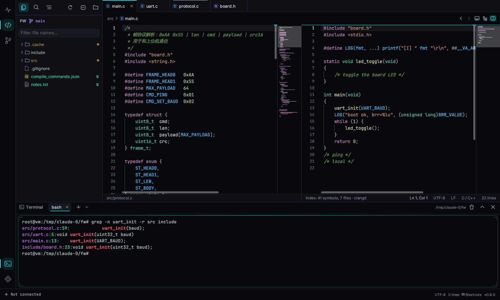

## Git viewer

Click the branch icon in the activity bar. It opens the repository that contains the code-viewer folder, or you can pick another one. It needs `git` to be installed and in your `PATH`.

- **Branch card**: the current branch, its upstream, ahead / behind counts and the number of uncommitted changes. The buttons fetch from all remotes, refresh, and open a different repository.
- **Working tree changes**: staged, unstaged and untracked files. Click one to see its diff.
- **Commits on all branches**: a commit graph with colored lanes, branch and tag labels, author, relative time and short hash. Use ↑ / ↓ to move, and scroll to load more history. The search box filters by commit message (case-insensitive).
- **Branches, remotes and tags** in the sidebar: click one to show only its history, double-click to check it out, and right-click for more actions. Checking out a remote branch creates a local tracking branch. Checking out a tag (or a commit, from its context menu) gives a detached HEAD. QCCOM warns you first when you have uncommitted changes and explains in plain language why a checkout failed.
- **Commit details**: message, author, date, parent links and changed files with add / delete bars. Click a file for a line-numbered, highlighted diff. Double-click a diff line to open that file at that line in the code viewer.

## Compare and merge

The compare icon in the activity bar (`Ctrl+Shift+M`) opens the **Compare** page. Its home tab takes a left and a right path (type them, use the file / folder buttons, or drop files on the page: two at once compare right away, one at a time fills left then right). *Compare* picks the mode by itself; the buttons next to it force folder, text, hex, table or three-way merge. Recent comparisons are listed below, and any comparison can be kept with **⋯ → Save as session**. Each comparison opens as its own tab; a dot on a tab means unsaved edits.

The same comparisons start from right-click menus:

- **Code page**: in the file tree, *Select as left side for compare* on one file or folder, then *Compare with "…"* on another, or *Compare with Git HEAD*. On an editor tab, *Compare with… → Saved version* (your unsaved edits against the file on disk), *Git HEAD*, another open tab, or any file.
- **Git page**: in *Working tree changes*, *Compare with HEAD*; in a commit, right-click a file → *Compare in Compare page* (the file before and after that commit). Files with merge conflicts are listed under *Merge conflicts*; a click opens the three-way merge.
- **System file manager**: see [System right-click menu](#system-right-click-menu).

### Text

Lines are paired side by side. Changed lines are tinted, the changed words inside them are highlighted, and lines that exist on one side only are hatched on the other. When a line was inserted next to a modified one, similar lines are still kept on the same row. The strip on the right shows every change in the file; click it to jump.

- `F7` / `Shift+F7` (or `Alt+↓ / Alt+↑`, or the arrows in the toolbar) go to the next / previous change.
- The chips **Whitespace**, **Case**, **Comments** and **Blank lines** ignore those differences (they are then shown in a faint violet instead). **Differences only** hides unchanged lines except three around each change.
- **Editing**: double-click a line to edit it, `Enter` to accept (`↑ / ↓` accept and move to the next line), `Esc` to cancel. Right-click a line to insert or delete lines, copy it, or open it in the Code page.
- **Copy a change across**: the arrows in the middle column replace the other side's block with this one; `Alt+→` / `Alt+←` do the same for the current change. `Ctrl+Z` undoes. `Ctrl+S` or the *Save* buttons write the file back with its original encoding (UTF-8 or GBK), BOM and line endings. Sides that come from Git or from unsaved editor content are read-only.
- **Alignment points**: if the automatic pairing is wrong, right-click a line on the left → *Set as alignment point (left)*, then a line on the right → *(right)*. The two lines are paired and everything else is aligned around them.
- The toolbar also swaps the sides, reloads both files (`F5`) and exports an **HTML report** with three lines of context around each change, which opens in any browser.

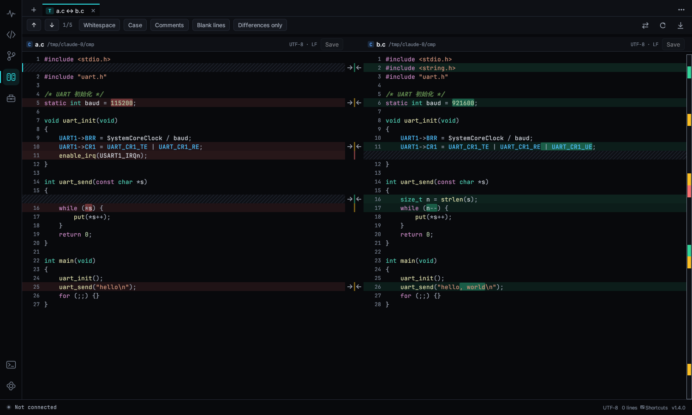

### Folders

Both trees are listed side by side with size and modified time; the newer time is highlighted. The middle column shows `=` for identical, `≠` for different, and an arrow for items that exist on one side only. Folders show how many differences they contain, and at first only folders with differences are expanded.

- By default files are compared by size and time, and files with the same size but a different time are checked byte by byte in the background. **By content** checks every file byte by byte.
- **Filters** (funnel icon) skip files and folders: separate entries with `;` or new lines, end folder names with `/`, and use `*` and `?`. The default skips `.git/`, `.svn/`, `.vs/`, `build/`, `*.o`, `*.obj` and `*.d`.
- Double-click (or `Enter`) a file to compare it in a new tab; `←` / `→` collapse and expand folders.
- Right-click an item to copy it to the other side, delete it on either side (after a confirmation), show it in the file manager, open it in the Code page or copy its relative path.
- **Sync…** offers *Update right*, *Update left*, *Update both* (newer file wins), *Mirror to right* and *Mirror to left* (these also delete files that exist only on the target side). Every operation is listed for confirmation before anything is copied or deleted. Copies keep the modified time.
- **HTML report** lists every file with its status, size and time.

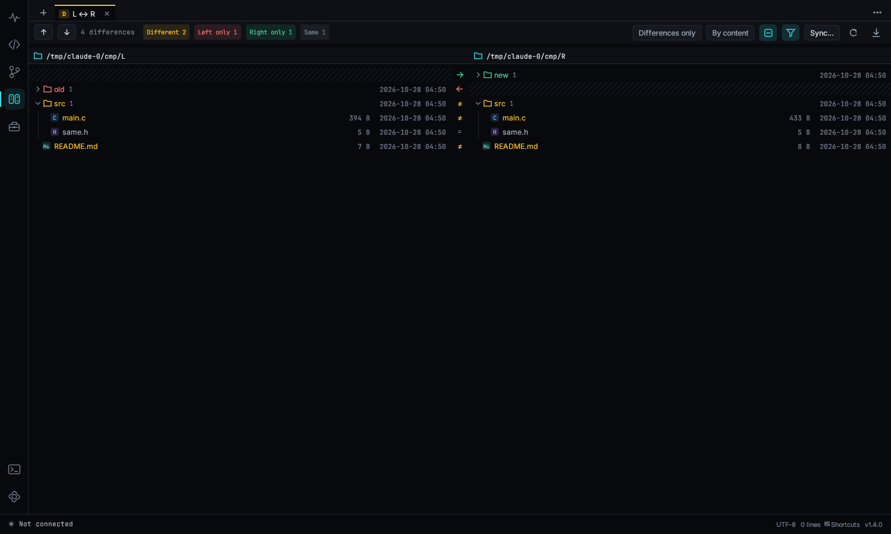

### Hex

BIN files are compared byte by byte. With **Auto-align** on (the default, for files up to 8 MB), inserted or deleted bytes are detected and shown as `--` on the other side, so the rest of the file still lines up. Intel HEX and S-record files are compared by address: record order and line length do not matter, and gaps between segments are shown as `⋯`. The toolbar shows how many bytes differ, jumps between differing ranges, and exports or copies the list of ranges (address on each side, length, bytes).

### Three-way merge

The top shows the left, base and right versions side by side; blocks changed on one side only are merged automatically (blue for left, green when both sides made the same change), and conflicts are red. Above each conflict, choose **Take left**, **Take right**, **Left + right**, **Right + left** or **Take base**; click the selected button again to undo the choice. **Take left for all** / **Take right for all** decide every conflict at once.

The merged result at the bottom can be edited directly; unresolved conflicts are written with the usual `<<<<<<<` / `|||||||` / `=======` / `>>>>>>>` markers, shown in red. Drag the divider to resize. **Save** (`Ctrl+S`) writes the result; for a Git conflict, **Save and mark resolved** also runs `git add`. To merge any three files, fill in *Base* on the home tab and press *Three-way merge*; the result is written to the left file.

### Tables

CSV and TSV files (comma, semicolon, tab or `|` separated, detected automatically) and linker `.map` files (as a table of symbol, object, section and size) are compared row by row. Rows are matched by the **key column** (the first column by default, symbol + object for map files) or by row order. Changed cells show `old → new`; a Δ column shows how much the size column changed, and **Sort by change** puts the largest changes first. *Copy differences* puts a CSV of the changed rows on the clipboard.

### External tools

If Beyond Compare, WinMerge, Meld or KDiff3 is installed, **⋯ → Open with …** on a comparison tab opens the same two files in it.

## System right-click menu

Settings → General → **System context menu** adds QCCOM to the file manager. No administrator rights are needed, and turning the switch off removes everything again.

- **Windows**: right-click a file → **Open with QCCOM** (source files open in the editor, `.log` files in the log view, map / ELF / HEX / BIN files in their viewers), a folder or the background of a folder → **Open with QCCOM** (opens it as a project). **Compare with QCCOM** on two selected files or folders compares them; on one item it is set as the left side, and the next one you pick is compared with it. On Windows 11 these entries are under *Show more options*.
- **Linux**: adds QCCOM to *Open With* in the file manager, two Nautilus scripts (*Scripts → Open with QCCOM / Compare with QCCOM*) and a Dolphin service menu.

If QCCOM is already running, the file goes to the open window instead of starting a new one. If you move the program, turn the switch off and on again. The same works from a terminal: `qccom --file a.c`, `qccom --project ~/fw`, `qccom --compare old.bin new.bin`.

## Theme

Dark, Light or **System default** (follows the operating system and switches live). Change it in Settings → Appearance, from the gear menu, or with `Ctrl+K Ctrl+T`. Every color, including popups, code highlighting and log levels, is tuned for at least 4.5:1 contrast in both themes. Settings → Appearance also has a UI scale for high-DPI screens.

## Language

QCCOM follows the system language on first start. To change it, open the gear menu → Language, or search *language* in the command palette. Choosing **Follow system** returns to automatic detection. The change takes effect immediately.

Supported: English, 简体中文, 繁體中文, 日本語, 한국어, Deutsch, Français, Español, Русский, Português.

## Updates

A few seconds after start, QCCOM checks for a newer version. If one exists, a card in the bottom-right corner shows the version, date and release notes, with **Update now**, **Later** and **Skip this version**. After the download is verified, **Restart and update** replaces the program and starts the new version. Your settings are kept.

- Gear menu → **Check for updates** checks at any time.
- Settings → General, or the switch on the card, turns the automatic check off.
- On Linux, an update is downloaded automatically only if the publisher provides a Linux build. Otherwise **Open download page** takes you to the Releases page.

Publishers: see [UPDATE_SERVER.md](UPDATE_SERVER.md).

## Keyboard shortcuts

**Schemes**: Settings → Keyboard Shortcuts offers QCCOM, VS Code, Source Insight and Keil layouts (for example `F8`/`F3`/`F4` highlights and `Alt+,` back in Source Insight, `Ctrl+-` back in Keil). Bindings you changed yourself always win.

Every shortcut can be changed in Settings → Keyboard Shortcuts (`Ctrl+K Ctrl+S`): click a key to record a new one, right-click to reset or remove, and add more than one binding per command. Two combos pressed in a row make a sequence such as `Ctrl+K Ctrl+T`; the status bar shows the first half while it waits. Conflicts are flagged, and the whole set can be exported to or imported from a JSON file. The tables below list the defaults.

**Everywhere**

| Keys | Action |
|---|---|
| Ctrl+Shift+P / F1 | Command palette |
| Ctrl+, | Settings |
| Ctrl+K Ctrl+S | Keyboard shortcuts |
| Ctrl+K Ctrl+T | Toggle dark / light theme |
| Ctrl+Shift+D / E / G / M / B | Debug / Code / Git / Compare / Toolbox page |
| Ctrl+Shift+N | New window |

**Debug page**

| Keys | Action |
|---|---|
| F5 | Connect / disconnect |
| Ctrl+F | Search the log |
| Enter / Shift+Enter | Next / previous match |
| Ctrl+L | Clear |
| Ctrl+S | Save the log |
| Ctrl+P | Pause / resume |
| Ctrl+K | Focus the command bar |
| Ctrl+B | Show / hide the sidebar |
| Ctrl+J | Show / hide quick commands |
| Alt+1 … 9 | Send quick command 1–9 of the current group |
| Ctrl+A | Select the whole log |
| Ctrl+C | Copy the selection |
| Esc | Clear the selection |
| Ctrl+\` | Switch between Log and Terminal |
| Ctrl+M | Insert a marker |
| Ctrl+F2 / F2 / Shift+F2 | Bookmark the line / next / previous |
| Ctrl+Shift+W | Show / hide the plot |
| Ctrl+Shift+H | Filter & highlight rules |
| Ctrl+O | Open a log file |
| Tab | Complete an AT command |
| Ctrl+Enter | Send (multi-line input) |

**Code viewer**

| Keys | Action |
|---|---|
| Ctrl+P | Quick open |
| Ctrl+T | Go to a symbol in the workspace |
| Ctrl+Shift+O | Go to a symbol in the file |
| Ctrl+G | Go to a line |
| Ctrl+O | Open a file |
| Ctrl+Shift+F | Search everywhere |
| Ctrl+Shift+E | Show the explorer |
| Ctrl+F / Ctrl+H | Find / replace in the file |
| Ctrl+\\ | Split editor |
| Ctrl+Shift+\` / Alt+F12 | Show / hide the terminal panel |
| Ctrl+Shift+5 | New terminal |
| F12 / Ctrl+click | Go to definition |
| Shift+F12 | Find references |
| Alt+← / Alt+→ | Back / forward |
| Ctrl+Tab / Ctrl+W | Next tab / close tab |
| Ctrl+S | Save |
| Ctrl+= / Ctrl+- | Font size |
| Ctrl+Shift+Y | Context window |
| Ctrl+Shift+R | Call hierarchy |
| Ctrl+F2 / F2 / Shift+F2 | Toggle bookmark / next / previous |

**Editor**

| Keys | Action |
|---|---|
| Ctrl+Z / Ctrl+Y | Undo / redo |
| Ctrl+/ | Toggle line comment |
| Alt+↑ / Alt+↓ | Move line |
| Shift+Alt+↑ / ↓ | Copy line |
| Ctrl+Shift+K | Delete line |
| Ctrl+L | Select line |
| Ctrl+Enter / Ctrl+Shift+Enter | Insert line below / above |
| Ctrl+D / Ctrl+Shift+L | Add next occurrence / select all occurrences |
| Ctrl+Alt+↑ / ↓ | Add cursor above / below |
| Alt+click / Alt+Shift+drag | Add cursor / column select |
| Ctrl+Shift+\ | Go to matching bracket |
| Ctrl+Shift+[ / ] | Fold / unfold |
| Ctrl+K Ctrl+0 / Ctrl+K Ctrl+J | Fold all / unfold all |

On macOS-style keyboards, Ctrl may be shown as ⌘. QCCOM uses the platform's command key.

## Troubleshooting

**Portable mode.** If a folder named `qccom-data` exists next to the program, settings and recovery data are stored there instead of the user profile, so QCCOM can live on a USB stick. Settings → General → Portable mode creates it for you.

**No ports on Linux, or "Permission denied".** Add yourself to the `dialout` group (`uucp` on Arch): `sudo usermod -aG dialout $USER`, then log out and back in. Some distributions also need `brltty` removed for CH340 adapters.

**No ports on Windows.** Install the driver for your USB-serial chip (CH340, CP210x, FTDI or PL2303) and check Device Manager.

**Garbled text.** Try **⚡ Auto** for the baud rate, or switch the encoding (GBK for many Chinese-language firmwares).

**Windows SmartScreen warning.** The executable is not code-signed yet. Click **More info → Run anyway**, or unblock the file in its Properties.

**The Git page says Git was not found.** Install Git from https://git-scm.com and restart QCCOM.

**Update failed: no permission to replace the program.** The executable is in a protected folder such as `Program Files`. Move it to a folder you own, or run the new version manually.

**Where are my settings?** On Windows they are in `%APPDATA%\qccom\data\app.ron`, and on Linux in `~/.local/share/qccom/app.ron`. Delete the file to reset everything.

Found a bug? Please open an issue at https://github.com/zenghi/QCCOM/issues.
