# QCCOM 使用手册

[English](USER_GUIDE.md) · 简体中文

- [界面](#界面)
- [串口连接](#串口连接)
- [看日志](#看日志)
- [发送数据](#发送数据)
- [快捷命令](#快捷命令)
- [终端模式](#终端模式)
- [TCP、UDP 和 MQTT](#tcpudp-和-mqtt)
- [代码浏览器](#代码浏览器)
- [Git 查看器](#git-查看器)
- [比较与合并](#比较与合并)
- [系统右键菜单](#系统右键菜单)
- [界面语言](#界面语言)
- [自动更新](#自动更新)
- [快捷键](#快捷键)
- [常见问题](#常见问题)

## 界面

最左边的细长**活动栏**用来切换页面：

| 图标 | 页面 |
|---|---|
| 脉冲 | **调试**：串口、日志、终端、快捷命令。绿点表示当前有连接。 |
| `</>` | **代码**：在日志旁边看源码。 |
| 分支 | **Git**：分支、提交图、差异。 |
| 双栏 | **比较**：文件夹、文本、十六进制、表格比较和三方合并。 |
| 工具箱 | **工具箱**：TCP、UDP、MQTT、BLE、WebSocket、HTTP 接口、Modbus 从站，以及各种服务器、网络工具、计算工具、CAN 和 HID。 |

活动栏底部的**齿轮**收着不常用的入口：命令面板、设置、快捷键、主题、语言、检查更新、关于。只有在有更新需要处理时，齿轮上方才会出现**下载箭头**。

### 命令面板

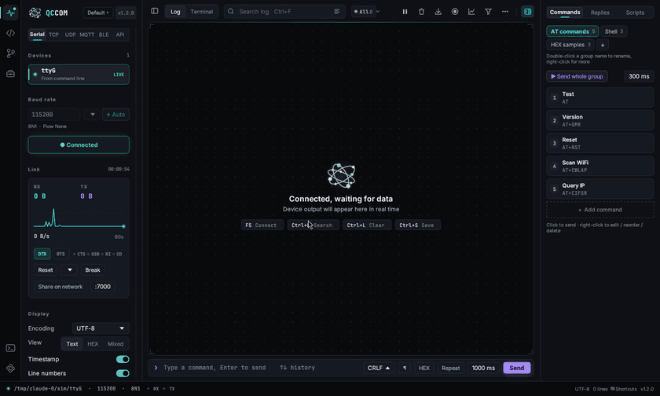

按 `Ctrl+Shift+P`（或 `F1`），输入想做的事的几个字，比如“主题”“清屏”“快捷键”。方向键选择，回车执行，Esc 关闭。所有命令、主题、语言和设置分类都能搜到，最近用过的排在最前。

### 回到原来的地方

- **后退 / 前进**（`Alt+←` / `Alt+→`，或鼠标侧键）可以跨页面：在代码页「与…比较」、从命令面板打开工具、从日志跳到代码之后，按 `Alt+←` 回到原来的文件和行。在代码页里先走编辑器自己的跳转历史。
- 被别处带到另一个页面时，左下角会出现一个小的 **← 返回 main.c**，点一下回去；自己切换页面后自动消失。
- **`Ctrl+Tab`** 把最近用过的页面、工具、比较和文件放在一个列表里：按住 `Ctrl` 连按 `Tab`（`Shift+Tab` 往回）选择，松开就切过去。编辑器标签用 `Ctrl+PgDn` 轮换。
- 工具箱里打开过的工具会在顶部留成**标签**（最多 8 个，绿点表示在运行），单击切换，中键或 × 关闭，拖动排序。悬停工具箱图标会列出最近用过的工具，点它回到上次的那个工具。

### 设置

`Ctrl+,` 打开设置页：常规、外观、日志、连接、代码编辑器、快捷键、关于。顶部搜索框可以筛选所有选项。按 Esc 或点 × 回到原来的页面。

调试页分三栏：

- **左侧边栏**（`Ctrl+B` 收起）：设备列表、波特率、连接按钮、链路监视（收发字节数和最近 60 秒速率曲线）、显示设置和高级设置。点分组标题可以折叠成一行摘要，右键标题可以全部折叠或展开。
- **中间**：顶栏（日志 / 终端切换、搜索、级别过滤、暂停、清屏、复制、保存、录制），日志或终端本身，以及底部命令栏。
- **右侧**：快捷命令面板（`Ctrl+J` 展开或收起）。

底部状态栏显示连接、RX / TX 指示灯、其它在线的连接（点一下切过去，收到数据时小点会闪）、编码、行数和版本号；点 **快捷键** 可以看全部按键。点侧边栏顶部的版本号会打开“关于”窗口。

## 串口连接

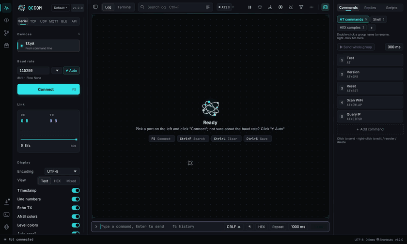

1. **选择端口**。端口每秒自动扫描一次，卡片上显示芯片型号和 VID:PID，已连接的标 **LIVE**。新插入的设备会自动选中。
2. **选择波特率**，可以直接输入或从列表里选。不知道波特率时，让设备输出点东西，然后点 **⚡ 自动**：程序会依次尝试 18 种常用波特率，给收到的数据打可读性分，选最好的自动连接。
3. 点 **连接** 或按 **F5**，再按一次断开。

已连接的设备被拔掉后，程序会一直等它重新出现并自动连回去。

**高级设置**（侧边栏最下面）里可以调数据位、校验位、停止位、流控、DTR / RTS（很多 ESP32、Arduino 板子用它们控制复位）、拔出后自动重连、自动选中新设备、字号、保留的最大行数，以及空闲分帧（看二进制协议时，数据间隔超过 N 毫秒就另起一行）。

系统扫描不到的端口（比如虚拟串口 `/dev/pts/3`）可以通过命令行指定：`qccom /dev/pts/3`。

## 看日志

- **颜色**：支持 ANSI 颜色（16 / 256 / 真彩色），ESP-IDF、Zephyr、Linux 内核日志会和在终端里看到的一样。另外还会按级别着色：错误行淡红底、左侧红条，警告行淡黄；`[ERROR]`、`E (123) tag:`、`E/tag:`、`<err>`、`<wrn>`、`[INFO]` 等级别标记会单独高亮。
- **编码**：UTF-8、GBK / GB2312、ASCII、Latin-1，切换后整个历史都按新编码重新显示。
- **视图**：文本、HEX，或混合（文本下面显示 HEX）。
- **显示开关**：毫秒时间戳、行号、发送回显、ANSI 颜色、级别颜色、自动滚动。
- **关键词**：用逗号分隔多个词，每个词自动配一种高亮色。
- **搜索**（`Ctrl+F`）：高亮所有匹配，回车 / Shift+回车 在匹配之间跳转；打开 **只看匹配** 会隐藏其他行。
- **级别过滤**：`ALL` / `ERR` / `WRN` / `INF` / `DBG` 上有实时计数，点一个就只看该级别及以上。
- **暂停**（`Ctrl+P`）：画面冻结，但后台继续接收，不丢数据。
- **滚动**：往上翻时自动滚动会停住，并出现 **回到最新** 按钮，上面显示期间新来了多少行。
- **快速翻看**：`Alt+滚轮` 10 倍速滚动；命令栏没有焦点时 `PgUp / PgDn`、`Ctrl+Home / End` 可用；按一下鼠标中键开始自动滚动（鼠标离锚点越远越快，再点一下停止）。滚动条旁的小标记显示错误、警告、搜索结果和书签的位置，点一下就跳过去。`Ctrl+G` 跳到某个时间，如 `12:30` 或 `12:30:05.250`。
- **选择**：拖动可以自由选择任意文字，双击选中单词，三击选中整行；点行号栏选中整行（Shift+点击选一段）。拖到上下边缘会自动滚动。`Ctrl+C` 默认复制不带时间戳；在 设置 → 日志 打开“复制时带时间戳”，或者右键选 **复制（含时间戳）**。
- **保存**（`Ctrl+S`）把当前日志写到文件；**录制** 会把之后收到的每一行实时追加到文件，适合挂一整晚抓日志，在 设置 → 日志 里可以按分钟数或 MB 自动分卷。**复制全部日志** 在 **⋯** 菜单里。
- **时间差**（侧边栏 → 显示）：每行前显示和上一行相隔的时间，超过 1 秒的标黄。
- **书签和标记**：`Ctrl+M` 插入一条带时间的分隔标记；右键某行可以加书签（`Ctrl+F2`），`F2` / `Shift+F2` 在书签之间跳。
- **合并日志**：同时连着多个连接时（比如串口加 TCP），**⋯ →「合并日志（所有连接）」** 把它们最近的日志按时间排在一个窗口里，每行前面有彩色的来源标签；「复制全部」可以一次复制。
- **清屏**：`Ctrl+L`。

## 发送数据

在底部命令栏输入（`Ctrl+K` 跳到命令栏），按 **回车** 发送。

- **↑ / ↓** 翻历史命令，历史会保存。
- **换行符**：无 / LF / CR / CRLF。
- **HEX**：`AA 55 01`、`0xAA,0x55`、`AA5501` 都能识别。
- **重复** 按设定的间隔不断发送同样的数据，直到关掉。
- **校验**：打开 HEX 后，旁边的下拉框可以给每帧自动加上 SUM8、XOR、CRC-8、CRC-16（Modbus / CCITT / XMODEM）或 CRC-32。
- **多行输入（¶）**：回车换行，`Ctrl+Enter` 发送。可以整段一起发，也可以打开 **逐行**，每行单独一包、按间隔发出（间隔在 设置 → 日志）。
- **AT 助手**：输入 `AT` 就弹出匹配的指令（3GPP 通用、ESP-AT、蜂窝模组、蓝牙模块）和一句说明，`↑` / `↓` 选择，`Tab` 补全。

发送的文本按侧边栏选择的编码进行编码。

## 快捷命令

右侧面板放的是一组组一键发送的命令，自带三组示例：AT 指令、Shell、HEX 示例。

- 点命令卡片就发送；`Alt+1` … `Alt+9` 发送当前分组的前 9 条。
- 点 **+** 新建分组；双击分组名重命名，右键可以复制或删除分组。
- **+ 添加命令** 新建命令；右键命令可以编辑、移动、删除。每条命令可以是文本或 HEX，换行符可以单独设，也可以跟随命令栏。
- **依次发送全组** 按旁边的间隔把整组命令按顺序发出去。
- **发到哪个连接**：串口和网络同时连着时，可以在命令的编辑框里把它固定发给其中一个（串口、TCP 客户端 / 服务器、UDP、MQTT、WebSocket、BLE）；默认发给当前连接。

所有内容自动保存。

## 终端模式

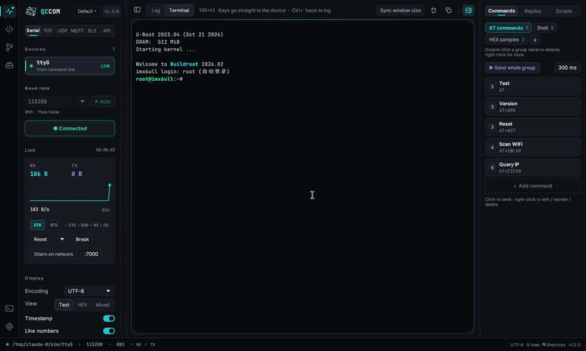

点顶栏的 **终端** 或按 `Ctrl+\``。点一下终端区域，键盘输入就直接发给设备，和 PuTTY、minicom 一样。

- 所有按键都直接发送：Ctrl+C、Tab 补全、方向键翻历史、Ctrl+R、Ctrl+D、F1–F12、Home / End / PgUp / PgDn。只有 F5 和 `Ctrl+\`` 例外。
- 支持 VT100 / xterm 控制序列：光标移动、清屏清行、16 / 256 / 真彩色、滚动区域、备用屏。vi、top、less、menuconfig 等全屏程序都能用，退出后恢复原来的画面。
- 中日韩字符占两格；线框和方块字符用矢量绘制，框线严丝合缝。
- 鼠标拖动选择文字，松开自动复制；`Ctrl+Shift+C` 复制，`Ctrl+V` 粘贴；右键可以复制整屏、粘贴、重置。
- 滚轮可以往上翻最近 3000 行，按任意键或点 **回到最新** 返回。
- **同步窗口大小** 会发送 `stty rows R cols C`，让设备上的程序铺满窗口。请在 shell 提示符下使用。
- 日志和终端共用同一个连接，随时切换都不会丢数据；快捷命令在终端模式下也能用。

终端固定按 UTF-8 解析（Linux 板子默认就是）。

## TCP、UDP、MQTT 和 WebSocket

网络连接放在**工具箱**（`Ctrl+Shift+B`）最上面的「通信调试」分组里。点开后页面和调试页一样有侧边栏、日志、终端和快捷命令，所以日志、终端、快捷命令、录制等功能在网络连接下全部可用。

**多个连接同时在线。** 串口、TCP、UDP、MQTT、BLE、WebSocket 各有自己的连接，也各有一份日志、终端、统计和录制。先连串口，再连 TCP 服务器，再连 MQTT，它们都会一直连着；看其中一个时，其它的在后台照常收日志、断线重连。状态栏列出所有在线的连接，点一下就切过去。工具箱列表里，已连接的工具旁有绿点，收到新数据时会闪一下。

| 方式 | 设置 | 说明 |
|---|---|---|
| **TCP 客户端** | 主机、端口 | 连接 WiFi 模块、测试工装等服务器。 |
| **TCP 服务器** | 监听端口 | 可以同时接受多个客户端；发送的数据会发给所有客户端，侧边栏显示当前连接数。 |
| **UDP** | 本地端口、目标主机和端口 | 目标主机留空时，回复给最后一个发来数据的地址；允许广播地址。每个收到的数据报显示为一条日志，并标出发送方地址。 |
| **MQTT** | 服务器地址和端口、TLS、客户端 ID、用户名、密码、心跳间隔、清除会话 | MQTT 3.1.1。可以添加任意多个订阅（支持 `+`、`#` 通配符）。选好发布主题、QoS 0 / 1 / 2 和 retain 后，在命令栏输入内容就是发布。收到的消息会带主题显示。 |
| **WebSocket** | 地址（`ws://` 或 `wss://`）、文本帧或二进制帧、Ping 间隔、额外请求头 | 每条收到的消息是一条日志，前面标 `txt` 或 `bin`；发送的内容作为一条消息发出。请求头框里可以填 `Authorization: Bearer …` 之类。 |

TLS 在 Windows 上用系统证书库，在 Linux 上用 Mozilla 根证书。

## 低功耗蓝牙（BLE）

在工具箱里打开 **低功耗蓝牙**，点 **扫描**。附近的设备会显示名字、地址、提示（比如 *Nordic UART* 或厂商名）以及信号格和 RSSI。在过滤框里输入可以缩小范围，过滤按钮可以隐藏没有名字的设备；30 秒没再看到的设备会变暗。

选中设备点 **连接**（或直接双击）。连上后侧边栏列出它的服务和特征：

- **通知开关**：订阅通知 / 指示。标准 GAP / GATT 服务以外的可通知特征会自动订阅。每条通知是一行日志，前面标出特征，比如 `[NUS TX] temp=24.1`。
- **读** 按钮：读取一次。文字原样显示；较短的二进制值显示成 HEX 加小端整数值，比如 `[Battery Level R] 57  (87)`。
- **写入目标**：点一下可写的特征（标着 **W**）就把它设为目标；命令栏、快捷命令、脚本、自动应答发出的数据都写到这里，超过 MTU 自动分包。Nordic UART 的 RX、`FFE1`、`FFF2` 会被自动选中。
- **写入要求应答** 开关：用 Write Request（设备确认）代替 Write Command。

环境要求：Windows 10 及以上并打开蓝牙；Linux 需要 BlueZ 且 `bluetooth` 服务在运行（程序依赖 `libdbus-1`，桌面发行版都自带）。蓝牙不可用时，标签里会写明原因。没有硬件也想试试的话，用环境变量 `QCCOM_BLE_DEMO=1` 启动 QCCOM：会模拟几个设备，`QC-Sensor` 会把写入的数据原样回传，并每秒发一条读数。

## HTTP 接口调试

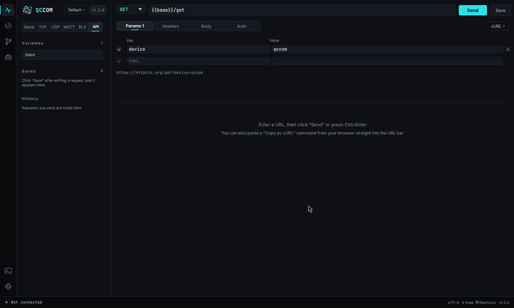

工具箱里的 **HTTP 接口** 是类似 Postman 的请求编辑器，适合调 ESP32、Linux 开发板和云服务的 REST 接口。串口或网络连接在后台照常收日志。

- 选方法、填地址，点 **发送**（或按 `Enter` / `Ctrl+Enter`）。响应上方显示状态码、耗时和大小；JSON 自动缩进和着色（**格式化** 开关），**响应头** 页列出响应头；右边的按钮可以复制或保存响应体。
- **参数**、**请求头**、**请求体**（JSON、表单、文本）、**认证**（Bearer Token 或 Basic）几页。`Content-Type`、`Authorization` 会自动加上，并列在请求头表格下方。
- **环境变量**：定义一次 `base = http://192.168.4.1`，然后写 `{{base}}/api/status`。地址、参数、请求头、请求体、Token 里都能用。变量窗口里还有超时和「跟随跳转」设置。
- **保存** 会把请求放进侧边栏的列表（右键可重命名、复制一份、删除）；发送过的请求都记在 **历史** 里。
- **cURL**：把 curl 命令（浏览器开发者工具 →「复制为 cURL」）粘贴到地址栏就会导入；**cURL ▾** 菜单可以把当前请求复制成 curl，或新建请求。

访问 `localhost`、内网和链路本地地址时不走系统代理。

## 调试工具

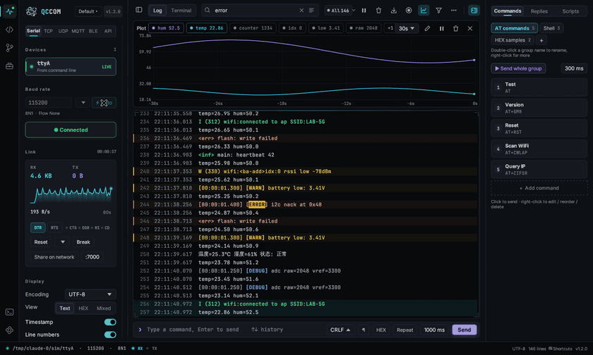

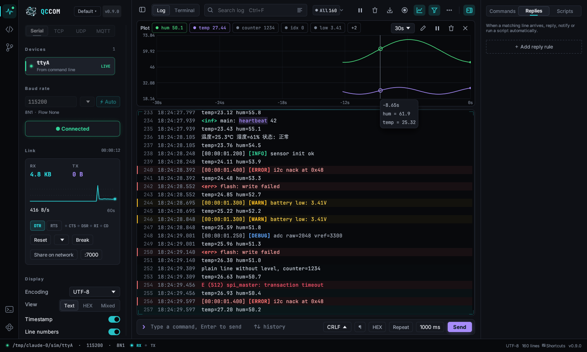

不常用的工具都收在日志右上角的 **⋯** 菜单和命令面板里，主界面保持清爽。

**波形图**（曲线图标，`Ctrl+Shift+W`）：把日志里的数字实时画成曲线，显示在日志上方。自动识别 `temp=25.3`、`vbat: 3.71`、`x:1,y:2` 和逗号分隔的数字；一直不变的量（版本号、地址）只列出不画，免得把刻度拉平。点图例显示 / 隐藏曲线，滚轮缩放时间窗口，悬停读数，可以冻结画面（数据照收），也可以自己写正则（每个括号一条曲线）。拖动分隔线调整高度。

**过滤与高亮规则**（漏斗图标，`Ctrl+Shift+H`）：每条规则是文字或正则加一个动作：*高亮*（自选颜色）、*只显示*（多条之间是“或”）、*隐藏*（优先级最高）。规则只影响显示，录制照样记下每一行。

**协议分帧**（侧边栏 → 显示 → 协议分帧）：给二进制协议用。填帧头（如 `AA 55`）、固定长度或长度字段（偏移、字节数、大小端、修正值）和校验方式，收到的数据就一帧一行按 HEX 显示，帧头 / 长度 / 校验分别上色，校验错的帧标红。开着分帧时状态栏会提示。

**自动应答**（右侧面板 → *应答*）：收到匹配的行时，延时回复文字或 HEX、弹提醒、暂停日志或运行脚本，每条规则显示命中次数。右键日志某一行 → *用此行新建应答规则* 最快。回放日志时不会真的回复。

**脚本**（右侧面板 → *脚本*）：用 [Rhai](https://rhai.rs) 写测试流程：

```rust
for i in 0..3 {
    sendln("AT");
    if wait("OK", 1000) { log(`#${i + 1}: OK`); } else { log(`#${i + 1}: no reply`); }
    sleep(500);
}
```

可用函数：`send(文字)`、`sendln(文字)`、`send_hex("AA 55")`、`wait(文字, 毫秒)`、`wait_re(正则, 毫秒)`（返回第一个括号的内容）、`read_line(毫秒)`、`sleep(毫秒)`、`now()`、`log(文字)`、`clear()`、`dtr(bool)`、`rts(bool)`。编辑器里 `Ctrl+Enter` 运行；运行中状态栏会显示，点一下停止。

**Modbus 主站**（⋯ 菜单）：读线圈 / 离散输入 / 保持寄存器 / 输入寄存器，写单个或多个线圈、寄存器。串口用 RTU（CRC-16），TCP 连接用 Modbus TCP。结果可以按 UINT16、INT16、HEX、32 位整数或浮点显示（可选字交换），也可以定时轮询。

**发送文件**（⋯ 菜单）：XMODEM（128 / 1K）和 YMODEM，配合 U-Boot 的 `loadx` / `loady` 等 bootloader。先让设备开始接收再点发送，或者先点发送，60 秒内设备开始都行。

**校验计算器**（⋯ 菜单）：输入 HEX 字节或文字，一次算出所有支持的校验，并给出线路上的字节顺序。

**日志文件**：*打开日志文件* 把保存或录制的日志载入查看、搜索；*回放日志文件* 按原来的时间间隔重放（0.5× 到 10× 或最快），不接设备也能调波形、规则和自动应答。也可以把日志拖进窗口，或用 `qccom --open 文件.log` / `qccom --replay 文件.log` 打开。

**统计**（⋯ 菜单，或点状态栏的行数）：收发字节和行数、当前 / 峰值 / 平均速率、连接时长、各级别行数、最近一分钟的错误分布。

**串口扩展**（连上串口后显示在链路卡片里）：

- DTR / RTS 开关，CTS / DSR / RI / CD 输入线实时状态。
- **复位**：DTR 或 RTS 脉冲，或者 ESP32 的“复位运行”“进下载模式”时序。小箭头选默认方式，右键直接选其他方式。
- **Break**：发送 250 ms 的 Break 信号。
- **虚拟串口**：给其他软件（烧录工具、别的串口助手）一个通到同一设备的串口，QCCOM 不用断开，大家都能收到数据、都能发，真实 COM 口不被占用。开关下面显示其他软件该打开哪个口（旁边可以复制）。Linux 和 macOS 直接创建（QCCOM 数据目录里的 `ttyQCCOM0` 指向它）；Windows 第一次用时会提示一键安装内置的 com0com 驱动（只弹一次管理员确认），装好后自动建一对 COM 口并直接用上。
- **共享到网络**：开一个 TCP 端口，连上来的客户端和串口双向透传，同事或别的工具可以远程用这台设备。

右键端口卡片可以起别名（如“主控板”），或者设为 **监听口 B**。监听口 B 和主串口一起打开，数据用琥珀色、`B ›` 前缀显示，两个 USB 转串口同时监听一条链路的收发很方便。

**配置方案**（logo 旁边的按钮）：把连接参数、快捷命令、规则、应答和脚本存成一个方案，一键切换。

**多窗口**：*新窗口*（`Ctrl+Shift+N`）再开一个 QCCOM，各用各的设置，可以同时看两台设备。

**两个关键字之间的耗时**（⋯ 菜单）。填开始和结束关键字（或正则），比如 `boot:` 和 `WiFi connected`；每次开始到下一次结束按日志时间戳算一次，给出次数、最小、最大、平均和每一次的耗时，偏差大的标出来。「复制结果」复制成表格。

**串口被占用**：串口因为被别的程序占着而打不开时，报错里直接写出是哪个程序和进程号（Windows 上列出可能占用它的串口软件）。

**插拔记录**：端口右键 →「插拔记录…」，列出 USB 串口每次插入、拔出的时间和 VID:PID。

**不休眠**：有连接或正在录制时，QCCOM 会阻止电脑睡眠（屏幕照常可以关）。

## 代码浏览器

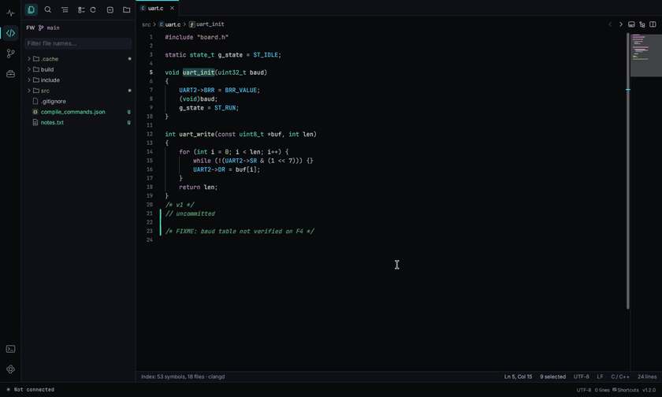

点活动栏的 `</>`，然后点 **打开文件夹** 打开固件工程（也可以带文件夹启动：`qccom ~/fw`）。程序会记住这个文件夹和已打开的标签页。

- **资源管理器**（`Ctrl+Shift+E`）：文件树，带 Git 状态颜色（M 已修改，U 未跟踪），有筛选框、刷新、全部折叠。符号索引和搜索会跳过 `.git`、`node_modules`、`target`、`dist` 等目录。
- **文件操作**：在文件或文件夹上右键可以复制、剪切、粘贴、在此文件夹中搜索、新建文件（可以直接输入 `drv/spi.c`，中间的文件夹会自动建好）、新建文件夹、重命名、删除；在空白处右键可以粘贴或在根目录新建。右键顶部的文件夹按钮可以打开最近的工程。
- **复制、粘贴、移动文件**：`Ctrl+单击`、`Shift+单击` 多选；树获得焦点时 `Ctrl+C` / `Ctrl+X` / `Ctrl+V` 复制、剪切、粘贴。复制的文件同时放进系统剪贴板，可以直接粘到 Windows 资源管理器或文件管理器里；在那边复制的文件也能粘进树里。把文件拖到某个文件夹上就是移动（按住 `Ctrl` 是复制）。从外面拖进来的文件会复制进指针下面的文件夹（按住 `Shift` 是移动）；没打开工程时拖进一个文件夹就当工程打开。同名时自动起名「xxx - 副本」，不会覆盖；移动前会先打一个本地历史存档点。
- **标签页**：`Ctrl+PgDn` 切换，`Ctrl+W` 关闭，鼠标中键点标签也能关闭。拖动标签可以调整顺序；右键标签可以关闭其他、关闭右侧、关闭已保存的、向右拆分、复制路径、在文件管理器中显示。
- **拆分编辑器**（`Ctrl+\`，或面包屑栏右侧的按钮）：左右并排看两个文件，拖中间的分隔线调整宽度。
- **语法高亮**：C / C++、Rust、Python、JavaScript / TypeScript、Go、Java / Kotlin、Shell、JSON、Makefile / CMake、INI / TOML / YAML、Markdown、汇编。
- **快速打开**（`Ctrl+P`）：输入文件名的一部分即可。查询前也可以加前缀：
  - `#` 搜索整个工程的符号（`Ctrl+T`）。
  - `@` 列出当前文件的符号（`Ctrl+Shift+O`）。
  - `:` 跳到指定行（`Ctrl+G`）。
- **全局搜索**（`Ctrl+Shift+F`）：在整个工程里全文搜索，可以区分大小写、全字匹配、正则表达式。边输入边搜，多线程并行，文件内容缓存在内存里，厂商库很大的工程也是立刻出结果（已打开文件里没保存的修改也会搜到），点结果跳过去。
- **搜索范围**：选项下面一行写着在搜什么（「整个工程 · 已按 .gitignore 排除」），点开有快捷开关（仅 C/H、排除厂商库、排除编译产物、.gitignore、仅已打开）和「包含」「排除」两个框，写法和 .gitignore 一样，如 `*.c, src/`、`Drivers/, !main.c`。在结果的文件上右键可以排除这个文件、它所在的文件夹或这类文件，或者只在这个文件夹里搜；资源管理器里文件夹右键「在此文件夹中搜索」。范围缩小时这一行变成蓝色，带 × 一键恢复。范围按工程记住。展开替换行可以全工程替换：每条结果都有替换预览，**全部替换** 要再点一次确认。已打开的文件在编辑器里改（可撤销），其他文件直接写回磁盘，保留原来的编码。
- **文件内查找替换**（`Ctrl+F` / `Ctrl+H`）：支持区分大小写、全字匹配、正则表达式（`$1` 引用分组），显示匹配数和当前替换的预览。`Enter` 替换当前，`Ctrl+Enter` 全部替换，`Ctrl+Z` 一次撤销。
- **C / C++ 导航**：鼠标悬停在标识符上会显示它的定义。悬停在宏上会显示 `#define`、完整展开和计算出的数值（例如 `BRR_VALUE` → `((72 * 1000 * 1000) / 115200)` → `0x271 (625)`）；悬停在枚举常量上会显示它的值。`Ctrl+点击` 或 `F12` 跳转到定义，`Shift+F12` 查找引用，`Alt+←` / `Alt+→` 后退 / 前进。
- **clangd（可选）**：电脑上装了 [clangd](https://clangd.llvm.org/)（在 PATH 里，或 Windows 的 LLVM 默认安装目录），并且工程根目录或 `build/` 下有 `compile_commands.json` 时，跳转定义会交给 clangd，能准确区分同名的 static 函数、局部变量和结构体成员。状态栏会显示 `· clangd`。没有时自动用内置索引，不需要任何配置。可以在 设置 → 代码编辑器 里关闭或指定 clangd 路径。
- `Ctrl+=` / `Ctrl+-` 调整字号，右侧有缩略图。

### 编辑

文件直接可以编辑，`Ctrl+S` 保存，标签上的圆点表示有未保存的修改。编辑器的常用操作和 VS Code 一致：

- **撤销 / 重做**：`Ctrl+Z` / `Ctrl+Y`（或 `Ctrl+Shift+Z`），连续输入会合并成一步。
- **多光标**：`Alt+点击` 添加光标；`Ctrl+D` 把下一个相同的词加入选择，`Ctrl+Shift+L` 选中全部；`Ctrl+Alt+↑/↓` 在上下行添加光标。`Esc` 回到单光标。
- **列选择**：`Alt+Shift+拖动` 或鼠标中键拖动。
- **括号**：自动补全括号和引号，选中文字后输入括号会把它包起来；光标旁边的配对括号会框出来，`Ctrl+Shift+\` 跳到配对的括号。
- **缩进**：回车自动缩进，`{` 后回车会自动展开成块；`Tab` / `Shift+Tab` 缩进或减少缩进；缩进参考线会高亮当前所在的块。
- **折叠**：点行号旁的箭头，或 `Ctrl+Shift+[` / `Ctrl+Shift+]`；`Ctrl+K Ctrl+0` 全部折叠，`Ctrl+K Ctrl+J` 全部展开。支持 `{}`、`#if/#endif` 和多行注释。
- **行操作**：`Ctrl+/` 注释或取消注释，`Alt+↑/↓` 移动行，`Shift+Alt+↑/↓` 复制行，`Ctrl+Shift+K` 删除行，`Ctrl+L` 选中整行，`Ctrl+Enter` / `Ctrl+Shift+Enter` 在下方 / 上方插入行。
- **其他**：光标所在的词会在全文高亮；滚动时顶部固定显示当前所在的函数和代码块；按住 `Ctrl` 悬停会给标识符加下划线。

### 自动换行、空白、编码和格式化

- **自动换行**：`Alt+Z`（或命令面板「切换自动换行」）。长行在空格和标点处折开，打字、移动光标、选择都按折开后的行来。
- **空白显示**：「显示 / 隐藏空白字符」把 Tab 画成箭头、空格画成点，行尾空格标红，Tab 和空格混用的缩进标黄，全角空格和不换行空格加框。「删除行尾空格」一键清理。
- **编码和换行符**：状态栏显示 `UTF-8`、`UTF-8 BOM` 或 `GBK`，以及 `LF` / `CRLF`，点击就能转换并保存。QCCOM 不会自己改文件编码：GBK 文件按 GBK 打开、按 GBK 保存。工程里 GBK 和 UTF-8 混用时，顶部提示一次「统一成 UTF-8…」：窗口列出全部 GBK 文件（默认全选），默认加 BOM（Keil 靠它识别 UTF-8），转换前自动打存档点，点存档点就能回去。命令面板里也有「整个工程 GBK 转 UTF-8」。
- **格式化**：`Shift+Alt+F` 用工程里的 `.clang-format` 调 `clang-format` 格式化整个文件或选中的行；没有 `.clang-format` 时不动文件。设置 → 代码编辑器里可以开「保存时格式化」。
- **两边都改了**：编辑器里有没保存的修改、文件又被别的程序改了时，提示条里有「合并…」，打开三方合并（上次保存、我的修改、外部修改），两边都不丢。

### 寄存器预览

工程配置里写了芯片时（Keil `.uvprojx`、IAR `.ewp`、CubeMX `.ioc`、STM32CubeIDE `.cproject`、ESP-IDF `sdkconfig`、PlatformIO `platformio.ini`），QCCOM 会自己找对应的 SVD 文件（工程里、Keil / IAR / STM32Cube 的 Pack 目录、`~/STMicroelectronics`），状态栏显示芯片型号。然后：

- 鼠标停在 `USART1->CR1` 或 `USART_CR1_UE` 这类宏上，显示地址、复位值和位域；停在赋值的数字上（`USART1->CR1 = 0x200C;`），按位域拆开并写出每个位的名字。
- 点状态栏的芯片（或命令面板「寄存器面板（SVD）」）打开浮动面板：当前文件用到的寄存器或全部外设，输入数值或勾选位来拼一个值，复制数值或 C 语句。「转储对比」页粘贴两段日志里的寄存器转储（`CR1=0x200C`、`0x40013800: 0x200C`、`USART1->CR1 = …`），列出哪些位变了。
- 日志里右键一行 →「按 SVD 解码寄存器值」。
在工具箱里手动加载的 SVD 优先。

### 工程文件夹

代码页、Git 页、终端面板以及 TFTP / HTTP 服务器共用同一个工程文件夹。可以在文件夹按钮、Git 页或命令面板（「打开工程文件夹」）里切换。每个工程都会记住打开的标签、光标位置和书签，切回来就是上次的样子。

### 导航

| 按键 | 作用 |
|---|---|
| Alt+← / Alt+→、鼠标侧键 | 后退 / 前进 |
| Ctrl+Alt+-（或快速打开里输入 `<`） | 导航历史 |
| Ctrl+Q | 上次编辑的位置 |
| Alt+O | 切换头文件 / 源文件 |
| Ctrl+Alt+] | 配对的 `#if` / `#else` / `#endif` |
| Alt+PageUp / Alt+PageDown | 上一个 / 下一个函数 |
| Ctrl+F12 | 跳转到声明 |
| Ctrl+K F12 | 在侧边打开定义 |

**高亮**：`F8` 给光标处的词上色，换个词再按换下一种颜色（共 8 种），在同一个词上再按换颜色。`Shift+F8` 取消，`Ctrl+Shift+F8` 全部清除，`F3` / `Shift+F3` 在高亮词之间跳。滚动条上也会标出位置。

**不编译的代码变灰**：`#if 0`、未定义宏的 `#ifdef`、`#if / #else` 中不生效的分支。宏取自工程里的 `#define`，编译时用 `-D` 传的宏可以在 设置 → 代码编辑器 →「额外的宏」里补上。算不出来的条件按生效处理。

### 代码生成和宏动作

在编辑器里右键可以看到「代码生成」「编辑」「按键宏」。默认动作：

| 按键 | 作用 |
|---|---|
| Ctrl+Alt+I | 用 `#ifdef` 包裹选中内容（会询问宏名） |
| Ctrl+Alt+P | 打印光标处的变量，格式符按类型自动选 |
| Ctrl+Alt+D | 函数的 Doxygen 注释（也可以输入 `/**` 后回车） |
| Ctrl+Alt+H | 文件头说明 |
| Ctrl+Shift+Alt+P | 删除 QCCOM 插入的全部调试打印 |
| Ctrl+Shift+/ | 切换块注释 |
| Ctrl+Alt+/ | 用 `#if 0` 包裹 / 取消 |
| Ctrl+Alt+U | 切换命名风格（snake / camel / Pascal / 大写） |

菜单里还有：`#if / #else` 包裹、十六进制打印、头文件保护 + `extern "C"`、TODO、分隔注释、由枚举生成 switch、在头文件加声明 / 在源文件加定义、按 `=` 或 `,` 对齐。

在 设置 → 代码编辑器 →「代码生成」里可以修改、新增动作：名字、插入位置（替换选中、光标处、下一行 / 上一行、函数上方、文件开头、整个文件）和模板。可用变量：`${SELECTION}` `${WORD}` `${FUNC}` `${FILE}` `${GUARD}` `${DATE}` `${TIME}` `${YEAR}` `${AUTHOR}` `${COPYRIGHT}` `${PRINT}` `${FMT}` `${ARG}` `${PARAMS}` `${RETURN}` `${MARK}` `${INPUT:提示}` `${CURSOR}`。作者、版权行和打印函数（`printf`、`rt_kprintf`、`SEGGER_RTT_printf(0, ` 等）也在这里设置。某行的变量为空时整行省略。

**按键录制**：`Shift+Alt+R` 开始 / 停止录制，`Shift+Alt+P` 回放；右键菜单里「保存为宏」可以起名留着用。

### 上下文窗口、调用关系和书签

这几项参考了 Source Insight 的用法，适合读陌生的工程。

- **上下文窗口**（`Ctrl+Shift+Y`，或面包屑栏右侧的按钮）：在编辑器下方显示光标所在函数、宏、类型的定义，连同上面的注释。不用跳过去就能看到定义，点文件名再跳过去。高度可以拖动。
- **调用关系**（`Ctrl+Shift+R`）：右侧显示当前函数 **调用了** 哪些函数，以及 **被** 哪些函数 **调用**，可以逐层展开。点一项跳过去；点图钉可以固定当前函数，不随光标变化。
- **书签**：`Ctrl+F2` 在当前行加或去掉书签（也可以点行号左边），`F2` / `Shift+F2` 跳到下一个 / 上一个。大纲面板顶部会列出所有打开文件里的书签。
- **语义着色**：函数、宏、类型、枚举常量、全局变量按种类用不同颜色显示，一眼能分清。

### 保存、Git 行标记和行内 Blame

- 文件被别的程序改了会自动重新加载；如果编辑器里也有没保存的修改，会出现提示条让你选 **重新加载** 或 **保留我的修改**。
- 设置 → 代码编辑器里打开 **自动保存**，停止输入 1 秒后自动保存。
- 没保存的文件每隔几秒自动备份；程序崩溃或断电后再打开，会提示恢复。
- 行号左边的彩色竖条标出和上次提交相比新增（绿）、修改（蓝）、删除（红）的行，边打字边更新。
- 当前行末尾淡淡显示最后修改它的人、时间和提交说明（可在设置里关闭）。

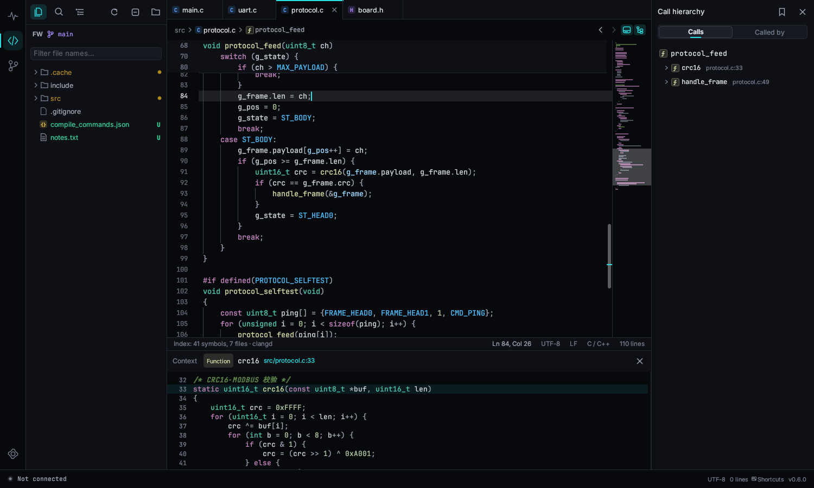

## 外部修改和本地历史

QCCOM 会给打开的工程里的文件自动保存每个版本，只存在本机（设置 → 代码编辑器 →「本地历史」：默认 30 天、10 GB，超过 20 MB 的文件不记）。工程 `.gitignore` 排除的目录和文件同样跳过；`.gitignore` 还没排除编译产物时，顶部提示一键添加 Keil、IAR、GCC、CMake、ESP-IDF、PlatformIO、Zephyr 的规则（`.bin` / `.hex` 默认不排除）。

- **外部修改**：别的程序（AI 工具、Keil、脚本等）改了工程里的文件时，文件树会标出来，顶部提示改了几个文件、多少行。「查看」打开按回合分组的清单；点文件和修改前比较，可以逐块还原，也可以整回合或全部保留 / 还原，「全部保留」时自动打存档点。敏感文件（链接脚本、启动和时钟文件、分区表、设备树、构建文件、厂商库目录，可在设置里改）醒目标出；只改了空白的文件可以隐藏；编码或换行被改的文件可以「保留内容，换回原来的编码和换行符」。「不提示的程序」运行时的修改照常记版本，但不进清单。
- **文件历史**：文件右键 →「本地历史…」。每次保存和外部修改都是一个版本，点开和现在或上一版比较，一键还原。
- **存档点**：「新建存档点」（可写说明）记下整个工程。「回到这里」把工程恢复到那个点，回去之前先自动存一次，所以回退本身也能撤销；不会动 `.git`。时间线里能看到存档点、外部修改的回合和被删除的文件（可以恢复）。
- **烧录标记**：用「烧录」任务烧录时，串口日志里插一行「烧录 · 存档 #12」，以后看日志就知道是哪版代码。

## 查看器

部分文件用查看器打开，面包屑栏右边的按钮在查看器和原文之间切换。

- **图片**（PNG、JPEG、BMP、GIF、ICO、WebP、TGA）：滚轮缩放、拖动平移，放大后显示像素网格，鼠标处的颜色显示十六进制和 RGB565（点击复制）。GIF 自动播放，可暂停、逐帧。「更多」里可以把当前帧或 GIF 全部帧复制成 C 数组（RGB565、RGB888、ARGB8888、单色 1 位），导出单帧 PNG，或者和另一张图对比（也可以直接把第二张图拖到第一张上）：并排、叠加滑块、差异图（带不同像素数）。
- **原始像素**：`.rgb565`、`.raw`、`.gray` 文件和十六进制查看器里的数据（「按像素查看」）按 RGB565 / RGB888 / 灰度 / 单色显示成图像，宽度可调，默认按常见屏幕尺寸猜；也可以粘贴日志里的 HEX。
- **Markdown**：带大纲的渲染预览，支持图片（GIF 会动）、代码高亮、表格和工程内文件链接。按钮依次切换「预览 → 分屏 → 原文」；分屏时预览跟着编辑器滚动和输入同步。可以拖选文字按 `Ctrl+C` 复制；鼠标移到代码块上右上角有「复制」，右键可以复制全部文字或 Markdown 原文。
- **JSON / YAML / TOML**：「树形」显示可折叠的树和筛选框，点节点跳到原文那一行；语法错误会写明第几行。
- **CSV / TSV**：几十万行也流畅的表格（最大 64 MB）。点最多 4 个数字列的列标题画曲线，并显示最小 / 最大 / 平均值。

## 固件工具

- **Map、ELF、HEX、BIN 文件**会用专门的查看器打开。Map 文件显示每个内存区域用了多少，以及可排序、可筛选的符号 / 目标文件 / 输出段表格；ELF 文件显示代码、数据、bss 大小和段、符号、程序头；HEX、BIN、S-record 显示十六进制网格：点一个字节就能看到 u8 到 u64、有符号、浮点、大小端的各种解读，拖动选择后 `Ctrl+C` 复制，可以输入地址跳转，HEX 可以导出为 BIN。面包屑栏右边的按钮可以切回原文。
- **文件比较**：右键标签 → **与…比较**，或在文件树里右键一个文件 → **选为比较左侧**，再右键另一个 → **与“…”比较**。比较在比较页打开，见 [比较与合并](#比较与合并)。
- **数字**：鼠标停在数字（或有值的宏）上，显示十六进制、十进制、二进制和哪些位是 1。`Ctrl+点击` 在**位域计算器**里打开（命令面板里也有）：输入数值或表达式，点击切换某一位，拖过几位选中一个字段，得到读取表达式和掩码，还能直接输入字段的新值。
- **代码片段**：输入 `for`、`isr`、`guard`、`reg` 等前缀按 `Tab` 展开，再按 `Tab` 跳到光标位置；`Ctrl+Alt+J` 搜索全部片段。设置 → 代码编辑器 → 代码片段可以打开 JSON 文件添加自己的片段。
- **TODO 列表**：侧边栏的清单图标列出工程里所有 `TODO`、`FIXME`、`HACK`、`XXX`、`BUG`。
- **Vim 键位**：在设置 → 代码编辑器里打开（或命令面板里的「打开 / 关闭 Vim 键位」）。支持常用移动、操作符、文本对象、计数、`.` 重复、可视模式、`/` 搜索加 `n` / `N`，以及 `:w`、`:q`、`:wq`、`:bn`、`:bp`、`:vs`、`:行号`。

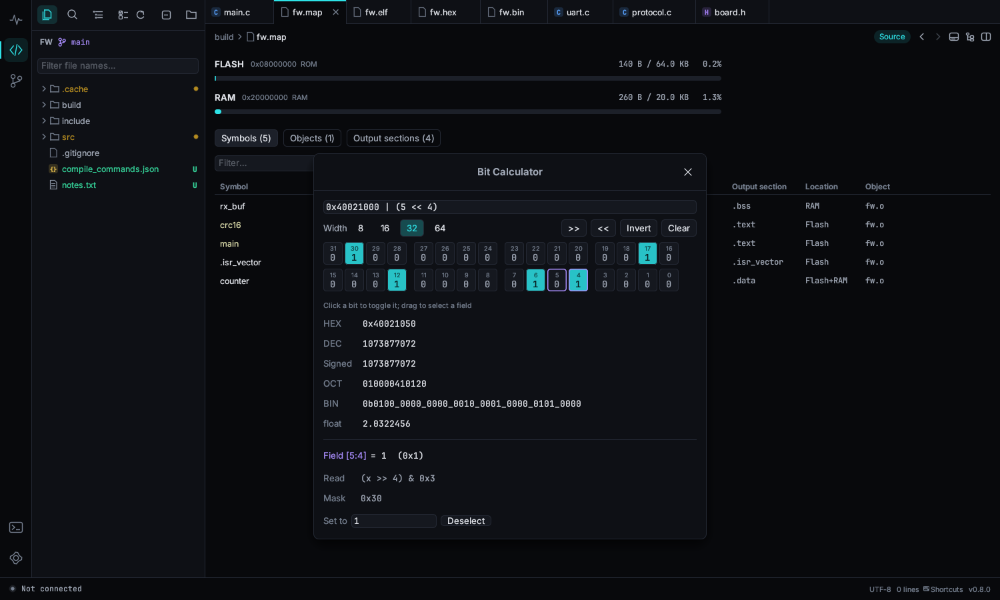

## SSH 和 Telnet

工具箱 →「通信调试」→ **SSH / Telnet**，用来远程登录开发板、网关和服务器。

- 在上面的输入框里输入地址回车：`pi@192.168.1.5`、`root@10.0.0.2:2222` 或 `telnet://192.168.1.1`，主机会自动保存到左边的列表。单击保存的主机就连接（已经连着就切过去）；右键可以编辑、复制一份、复制地址、新开一个会话或删除。保存的主机也能从命令面板直接打开。
- 多个会话以标签的形式同时在线。会话断开后，在里面按回车重新连接。
- SSH 调用系统自带的 OpenSSH（Linux 上的 `ssh`；Windows 10 及以上在「设置 → 应用 → 可选功能」里添加「OpenSSH 客户端」），所以密钥、`ssh-agent`、`~/.ssh/config` 都能直接用。密码在终端里输入，QCCOM 不保存密码。
- **编辑主机** 可以设置名称、私钥、上传目录、额外的 `ssh` 参数，以及登录后自动执行的命令（每行一条）。
- **传文件**（SSH 且用密钥登录）：把文件或文件夹拖到终端上，或点上传按钮，就会传到主机的上传目录；「下载文件…」把远程文件或文件夹取回来。传输用 `scp`，服务器没有 SFTP 时（BusyBox / Dropbear 的板子常见）会自动改用旧协议。只能密码登录的主机，请在终端里用 `rz` / `sz` 或手动 `scp`。
- Telnet 会协商终端类型和窗口大小，全屏程序能铺满窗口。Telnet 不能传文件。

## 电路和接线

工具箱 →「电路和接线」。左边是元件库和示例，中间是画布，右边是属性、元件讲解和接错检查。

- **搭电路**：把元件拖到画布上（或者点一下元件再点画布；`R` 旋转，按住 `Shift` 连续放）。从引脚或面包板孔拖出导线，点击加拐点，数字键换线色。面包板同一竖列的 5 个孔是通的，两边长条是电源轨。「实物 / 原理图」切换视图。
- **通电**（`F5`）开始仿真。点按钮、拨开关，在电位器、光敏电阻上滚轮调节。过载的元件会冒烟烧坏，选中后点「换个新的」。速度菜单可以放慢时间；底部输出里有烧坏、单片机打印等事件。
- **仪器**：从「仪器」里放万用表、示波器探针或逻辑分析仪。电流表会估算电池续航、给元件耗电排行；「接实物测电流」通过串口读 INA219 / INA226。
- **单片机引脚**：选中开发板，给每个引脚设模式，再加规则（「如果…就…」）。文字里可以用 `{count} {temp} {hum} {dist} {t} {adc:A0} {v:A0}`。「生成代码」写出同样行为的 Arduino、STM32 HAL、ESP-IDF 或 51 代码。
- **模块**（ESP-01、ESP32、HC-05、JDY、HM-10、Air780E、EC800M、ML307、GPS）会应答 AT 指令，联网是真的连出去。USB 转 TTL 或 USB 供电的开发板会在调试页显示成一个串口，QCCOM 可以直接和仿真电路通信。
- **示例**：8 组共 72 个，每个都有「原理」「试一试」「学到什么」和搭建步骤；「恢复成示例原样」撤销自己的改动。

### 接线记录

点电路工具栏里的「接线记录」。

- 每行是一根线：从哪、接到哪、线色、备注，接好了打勾。「从电路生成」把画布上的连接列出来；「设备模板」加入 USB-TTL、ST-Link、J-Link、ESP-Prog、CMSIS-DAP、逻辑分析仪、INA219 的常用引脚。
- **照片**：点 **+** 或把实物照片拖进来（大照片会自动缩小）。选好行，点照片就在那里标上编号，自动跳到下一行没标的；右键删除标记。
- **硬件改动记录**：飞线、换元件、割线，带日期记下来。
- 「导出 Markdown」存成 `.md` 并复制到剪贴板。
- 存在工程文件夹的 `.qccom/wiring/` 里（没打开工程时放在 QCCOM 数据目录），一个工程可以有多份。

## 工具箱

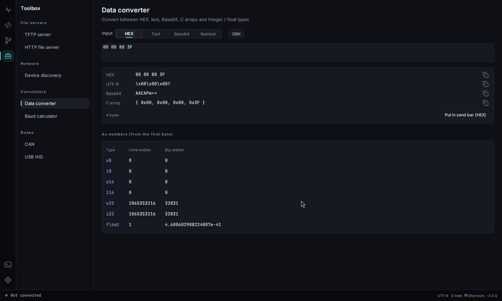

活动栏的工具箱图标（`Ctrl+Shift+B`）打开工具箱：通信调试工具和各种小工具都在这里。工具名旁边的绿点表示正在运行或已连接；切到别的页面时服务器和连接都不会断。

列表上方的搜索框可以筛选工具（回车打开第一个）。右键工具选「收藏到最上面」，它会出现在「收藏」分组里。每个工具也都能从命令面板打开（`Ctrl+Shift+P` 后输入名字）。

「通信调试」里的 TCP、UDP、MQTT、低功耗蓝牙、WebSocket、SSH / Telnet、HTTP 接口见上面各自的章节。其它工具：

- **Modbus 从站**：模拟一台设备给 PLC、触摸屏或 Modbus 主站测试。选 Modbus TCP（端口：Windows 默认 502，Linux 默认 1502，因为 1024 以下要 root）或串口 RTU，再填从站地址。保持寄存器、输入寄存器、线圈、离散输入以表格显示，从你填的起始地址开始，可以直接改值（HEX 切换显示）。主站的每个请求都会列出功能码、地址、数量和结果；主站写入的值会实时更新到表格。
- **MQTT 服务器**：在本机跑一个 MQTT 3.1.1 服务器，不用装 Mosquitto。支持通配符订阅、保留消息、遗嘱和心跳；填了用户名密码就要求认证。页面列出已连接的客户端及其订阅、连接事件和每条消息。可以直接在页面上发布，或点「用 MQTT 工具连接」让 QCCOM 自己的 MQTT 工具连上去。
- **Syslog 接收**：监听 UDP 端口（Windows 默认 514；Linux 默认 5514，因为 1024 以下要 root），把 RFC 3164 / RFC 5424 消息解析成时间、主机、程序、级别和内容，可以按主机、程序、内容和最低级别筛选。Linux 板子上用 `syslogd -R <电脑IP>:5514`（busybox，页面上会显示带本机地址的命令）或 rsyslog 的 `*.* @<电脑IP>:5514` 就能把日志发过来。
- **Ping / 端口**：连续 Ping，带延迟曲线、最小 / 平均 / 最大值和丢包率；次数填 0 表示一直 Ping 到停止。「TCP 端口检测」按列表和范围（`21-23, 80, 502`）逐个尝试，列出哪些端口开着。
- **子网计算**：输入 `192.168.1.10/24` 或地址加掩码，得到网络地址、广播地址、可用范围、主机数、反掩码和二进制形式。在「比较」里填另一个地址，可以判断是否在同一子网。
- **校验计算**：输入 HEX 字节或文字，同时算出 SUM8 / SUM16 / XOR / LRC 和 14 种 CRC（CRC-8、CRC-16/MODBUS、CCITT、XMODEM、CRC-32…），并给出两种字节序。「自定义 CRC」可以设置任意位宽、多项式、初值、输入 / 输出反转和结果异或值。把文件拖进来（或点「选择文件…」）算 CRC32、MD5、SHA1、SHA256，粘贴期望值可以核对。
- **时间戳**：Unix 秒、毫秒、`0x` 十六进制和日期时间互相转换，顶部显示当前时间。
- **正则测试**：测试文本里高亮匹配，下方列出每个匹配和分组；替换框可以预览 `$1` 这类替换结果。
- **取模**：「文字取模」用任意 TTF / TTC 字体（列出系统字体，也可以选文件）把每个字画进 W×H 的格子，可调字号、偏移和粗细。「图片取模」把 PNG、JPG、BMP、GIF 缩放到指定大小，输出单色（阈值或抖动）或 RGB565 / RGB565 字节流 / RGB888 / 8 位灰度。取模方式有逐行、逐列、行列式（SSD1306 等大多数 OLED）、列行式，支持高位 / 低位在前和阴码。预览就是实际输出的点阵。C 数组可以复制或另存为头文件。
- **颜色转换**：HEX、`rgb()`、RGB888、RGB565（含字节形式）、RGB555、HSV 和灰度互转；RGB565 色块显示在屏幕上的实际效果。
- **ASCII 表**：十进制、十六进制、八进制和控制字符含义；「显示 128–255」加上高半部分。点十六进制值即可复制。

- **TFTP 服务器**：选好文件夹和端口（69 需要管理员权限，Linux 默认用 6969），点「启动服务」。页面上有 U-Boot 下载命令，点击即可复制。打开「允许上传」才接受 `tftp put`。每次传输都列出进度。
- **HTTP 文件服务器**：共享一个文件夹，带目录列表和断点续传，适合测 OTA。「允许 PUT 上传」后设备可以用 `curl -T` 把日志传上来。
- **设备发现**：扫描本机所在 /24 网段的常用端口，并用 mDNS 查询带名字的设备。点端口直接连接：HTTP 打开 HTTP 接口工具，MQTT 直接用 MQTT 工具连上，其它用 TCP 客户端。
- **数据转换**：输入 HEX、文字、Base64 或数字，其它形式同时列出，包括大小端下的各种整数和浮点解读。文字支持 `\r`、`\n`、`\t`、`\0`、`\xNN` 转义。「放到发送栏」把这些字节以 HEX 填进命令栏。
- **波特率计算**：输入外设时钟（`72M`、`16MHz`…）和波特率，算出 STM32、AVR、16550、ESP32 的分频寄存器值和实际误差。点下面的常用波特率可以直接换算。
- **CAN 调试**：支持 SLCAN 协议的适配器（CANable、USBtin 和很多国产 USB-CAN 模块）。选适配器的串口和位速率，点「打开」。「只听」不发 ACK。可以单发或按周期循环发送。「按 ID」显示每个 ID 的最新数据、次数和周期，一秒内变过的字节高亮；「时间顺序」列出每一帧。
- **USB HID**：选一个设备打开，输入报告显示在下面。发送的第一个字节是报告 ID（设备不编号就填 00）。Linux 上可能要给 `/dev/hidraw*` 加 udev 规则。

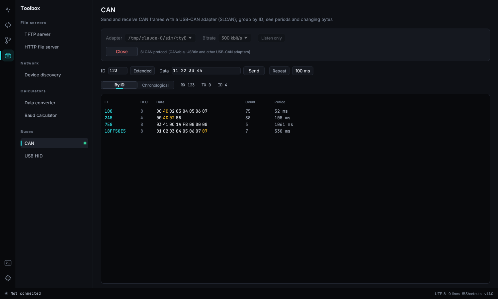

## 嵌入式工具

1.6 版在工具箱里新增四组工具。需要文件的工具都可以点「选择…」、直接输入路径，或者把文件拖到页面上；路径和选项会记住。

### 固件

- **固件转换 / 合并**：添加 HEX、BIN、S-record 或 ELF 文件（ELF 按程序段的加载地址读取）。只有一个文件时选输出格式保存即可；多个文件按列表顺序合并，后面的覆盖前面的。BIN 需要填「放到地址」，其它文件可以设「地址偏移」。地址图显示每个文件落在哪里，有重叠会提示。输出选项：「填充空隙」（结果超过 16 MB 时会拒绝，通常是 BIN 没填加载地址）、「只取范围」、「末尾对齐」到 4…4096 字节、「按地址拆分」成多个文件。保存前就能看到输出的 CRC32。
- **升级包打包**：选固件和「格式模板」。模板是一串字段：常量（魔数）、版本（`1.2.3` 打包进字段）、固件长度、CRC32、CRC16、累加和、时间戳、文本、保留、头部 CRC32（对它前面的包头字节计算）。可以选字节序、放在包头 / 包尾 / 指定地址、包头补齐大小、固件对齐和填充字节。「存为模板」保存自己的格式，「恢复内置模板」找回三个示例。结果里列出每个字段的偏移和字节。
- **体积对比**：选旧版本和新版本：两个 `.map`（GNU ld、Keil armlink 或 LLVM lld）或两个 `.elf`。卡片显示 ROM、RAM 总量和变化；表格按变化大小列出所有大小变了的函数和变量。用 map 文件时「文件」标签按目标文件汇总。符号按名字和文件配对，文件改名后同名符号也能对上。「复制为 CSV」复制表格。
- **栈用量分析**：编译时加 `-fstack-usage`（最好再加 `-fcallgraph-info=su`，GCC 10 以上），然后选编译目录，所有子目录里的 `.su` 和 `.ci` 都会读到。没有 `.ci` 时选 ELF，会从 Cortex-M 代码里的 `BL` / `B.W` 找调用关系。「入口」列出没人调用的函数（main、任务、中断）和它们的最坏栈深度，点一个看最深的调用链。递归、函数指针调用和动态栈（`alloca`、变长数组）会标出来，因为实际用量可能更大。Cortex-M 进中断还会再压 32 字节（带 FPU 上下文是 104 字节）。
- **中断向量表**：选 ELF。按符号（`g_pfnVectors`、`__Vectors`…）或段（`.isr_vector`、`RESET`…）找到向量表，每一项显示异常 / 中断号、入口地址和处理函数；还指向 `Default_Handler` 的会高亮，「只看未实现的」隐藏其它行。在「SVD 寄存器」里载入芯片的 SVD 后能显示中断名。

### 芯片和工程

- **SVD 寄存器**：选芯片的 `.svd` 文件（在 Keil 器件支持包或 cmsis-svd 仓库里）。左边树形列出外设和寄存器，搜索框能搜外设、寄存器和位域。选中寄存器后显示地址、读写属性、复位值、32 位位图（点一位切换）和各字段的值与枚举；输入调试器里读到的值就能拆开看。载入 SVD 后，在代码编辑器里鼠标停在 `USART1->CR1` 或 `USART1.CR1` 上也会显示同样的信息。
- **Keil / IAR 工程**：选 `.uvprojx` / `.uvproj`（Keil MDK）或 `.ewp`（IAR EWARM）。选目标后显示器件、宏定义、头文件目录和源文件分组；不存在的路径会标出来（通常是工程挪过位置）。「生成 compile_commands.json」把文件写到工程旁边，clangd 和跳转定义就会用真实的宏和头文件路径；「在代码页打开」打开工程文件夹。
- **CubeMX 引脚表**：选 `.ioc` 文件，列出每个配置过的引脚的功能、用户标签、模式、上下拉和速度。可以搜索、「复制为 CSV」、「导出 CSV…」，或「复制 #define」生成用户标签的宏。

### 硬件计算

数值支持单位后缀：`4k7`、`4.7k`、`100n`、`72M`。

- **电阻计算**：「分压」在给定阻值范围内从 E12 / E24 / E96 里找 R1 / R2 组合，显示误差和电流；「LED 限流」给出精确值、最近的标准值和功率；「色环」显示阻值对应的四环或五环颜色。
- **ADC / NTC**：任意位数和参考电压下原始值 ↔ 电压，可加输入分压。NTC 部分按 R25 和 B 值（或粘贴的 R-T 表）双向换算原始值和温度，支持 NTC 接地或接 Vref，画出曲线，并按温度范围和步长生成 C 查找表。
- **定时器 / PWM**：根据定时器时钟、目标频率和占空比，找出分辨率最高、误差最小的 PSC / ARR / CCR（默认 16 位计数器，可切 32 位），显示波形和其它组合，并给出 STM32 HAL 代码。
- **I2C 上拉电阻**：根据电源电压、总线电容和速率算出上拉电阻的最小值、最大值和建议的 E24 值。

### 数据和协议

- **结构体解析**：粘贴 C 结构体（支持 typedef、嵌套结构体、联合体、枚举、数组、位域、`#pragma pack`、`__attribute__((packed))`、`#define` 常量）和收到的 HEX 数据。有多个结构体时选一个，每个字段列出偏移、原始字节和值。选项：字节序、「全部按 packed」、64 位指针。在代码编辑器里选中结构体（或光标放在里面），右键 →「编辑」→「解析结构体（工具箱）」直接送过去。
- **CBOR / MsgPack / Protobuf**：粘贴 HEX 或 Base64（打开「Base64」），格式自动识别也可以手选。树形显示键、类型、偏移和值；Protobuf 字段显示字段号和类型，长度字段会尝试按嵌套消息和字符串解析。「复制为 JSON」。
- **VCD 波形**：选 PulseView / sigrok、Saleae（导出为 VCD）或 Verilog / VHDL 仿真生成的 `.vcd` 文件。滚轮缩放、拖动平移，左键放光标 A、右键放光标 B，顶部显示两者的时间差和对应频率。选中一个信号后按 `←` / `→` 跳到上一个 / 下一个边沿。总线显示为十六进制值。
- **二维码**：「文字 / 网址」或「Wi-Fi」（名称、密码、加密方式、隐藏网络）。选好纠错等级后「保存 PNG…」或「复制为 C 数组」（每个模块一位，逐行）给屏幕显示用。Wi-Fi 密码只在程序运行期间保留，不会保存。

## 终端面板

`` Ctrl+Shift+` ``（或 `Alt+F12`，或活动栏的终端图标）在窗口底部打开命令行，当前目录就是工程文件夹。Windows 上可以选 PowerShell、cmd、Git Bash、WSL；Linux 上是登录 shell、bash、zsh、fish。`+` 新建标签（`Ctrl+Shift+5`），旁边的箭头选 shell。输出里的 `文件:行号`（编译错误、grep 结果）按住 `Ctrl` 点击就能在编辑器里打开。shell 退出后按回车重新启动。面板可以最大化，高度会记住。

- **任务按钮**：面板头部的按钮点一下就在当前终端里执行命令，默认有「编译」（`make -j8`）、「烧录」（`make flash`）、「清理」（`make clean`）；右键按钮（或「+ 任务」）可以编辑。
- **问题**：输出里 GCC / Clang、Keil / MSVC、IAR 的错误和警告会计数显示在徽标上，点开是列表，单击一条就在编辑器里打开对应的行。
- **命令分块**：每条输入的命令在左边留一个标记，单击标记复制这条命令和它的输出；`Ctrl+↑ / ↓` 在命令之间跳。
- **查找**（`Ctrl+F`）：在输出和回滚记录里搜索，回车 / Shift+回车 在匹配之间跳。右键 →「保存输出…」把全部内容存成文件。`Ctrl+滚轮` 调字号（右键「恢复默认字号」）。
- **标签**：双击改名；右键设置颜色，或和另一个终端左右并排显示。标签上的小圆点表示有新输出。
- 跑了一阵的命令结束时，如果 QCCOM 在后台，会弹通知提醒。
- 把文件拖到面板上，会插入文件路径。
- shell 启动时设置了 UTF-8 环境（Windows 上 `chcp 65001` / UTF-8 控制台，Git 设 `core.quotepath=false`），中文文件名和输出不再乱码。

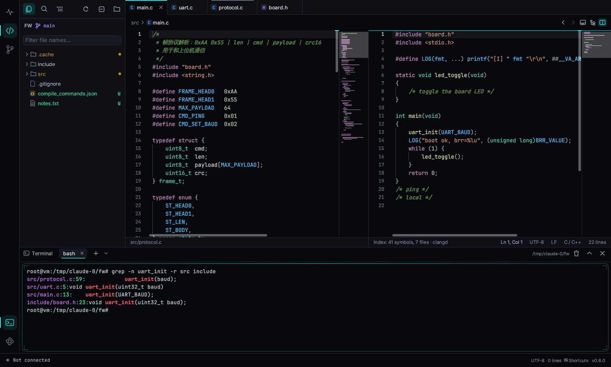

## Git 查看器

点活动栏的分支图标。它会打开代码浏览器所在文件夹对应的仓库，也可以另选一个仓库。需要电脑上装了 `git`，并且在 `PATH` 里。

- **分支卡片**：当前分支、上游分支、领先 / 落后的提交数、未提交更改数。旁边的按钮分别是从所有远程拉取、刷新、打开其他仓库。
- **工作区更改**：已暂存、未暂存、未跟踪的文件，点文件看差异。
- **全部分支的提交**：彩色分支线的提交图，带分支和标签标记、作者、相对时间、短哈希。用 ↑ / ↓ 移动，往下滚会自动加载更多历史。搜索框按提交说明筛选（不区分大小写）。
- **侧边栏里的本地分支、远程分支、标签**：单击只看它的历史，双击切换过去，右键有更多操作。切换到远程分支会自动建立本地跟踪分支；切换到标签（或者通过右键菜单切到某个提交）会进入分离 HEAD 状态。有未提交的更改时会先提醒，切换失败时会用易懂的话说明原因。
- **提交详情**：说明、作者、时间、父提交链接，以及带增删比例条的改动文件列表。点文件可以看带行号和高亮的差异；双击差异里的某一行，会在代码浏览器里打开这个文件并跳到那一行。
- **提交和推送**：「工作区更改」顶部是提交框；「生成」根据暂存的文件和改动的函数写说明草稿。没有暂存文件时「提交全部」提交所有更改，`Ctrl+Enter` 提交。文件右键可以暂存、取消暂存、放弃修改；打开文件的差异后，每一块右边有「暂存此块 / 取消暂存此块」。提交前会检查没保存的文件、冲突标记、编译产物、超过 5 MB 的大文件、疑似密钥、被改的敏感文件，可以「仍然提交」。
- **更多（⋯）**：拉取并合并、推送、撤销上次提交（改动保留在暂存区）、暂存和恢复修改（stash）、打标签（自动建议下一个版本号）、记录固件体积、更新子模块。子模块会列出状态。
- **固件体积**：在 QCCOM 里每次提交都会用最新的 `.map` / `.elf` 记一笔 ROM / RAM，侧边栏「固件体积」列出每个提交的变化。
- **状态栏**显示当前分支和领先 / 落后数（`main ↑1 ↓2`），点击打开 Git 页。

## 比较与合并

活动栏的比较图标（`Ctrl+Shift+M`）打开**比较**页。首页填左侧和右侧路径（直接输入、用文件 / 文件夹按钮选，或者把文件拖进来：一次拖两个直接比较，一个一个拖就先填左边再填右边）。点「比较」会自动选择方式；旁边的按钮可以强制用文件夹、文本、十六进制、表格或三方合并。下面列出最近的比较，任何比较都可以用 **⋯ → 保存为会话** 留着下次一键打开。每个比较是一个标签，标签上的圆点表示有未保存的修改。

这些比较也可以从右键菜单开始：

- **代码页**：文件树里对一个文件或文件夹选「选为比较左侧」，再在另一个上选「与“…”比较」，或者「与 Git HEAD 比较」。编辑器标签上「与…比较 → 已保存的版本」（没保存的修改和磁盘上的文件比）、Git HEAD、另一个打开的标签或任意文件。
- **Git 页**：「工作区更改」里右键「与 HEAD 比较」；提交详情里右键文件 →「在比较页中比较」（这个提交前后的文件）。有合并冲突的文件列在「合并冲突」分组里，单击直接打开三方合并。
- **系统文件管理器**：见 [系统右键菜单](#系统右键菜单)。

### 文本

左右逐行对照。改动的行有底色，行内改动的词单独高亮，只在一边有的行在另一边画斜线。某一行被插入在改动行旁边时，相似的行仍然对在同一排。右侧的概览条显示整个文件的所有改动，点一下就跳过去。

- `F7` / `Shift+F7`（或 `Alt+↓ / Alt+↑`、工具栏的箭头）跳到下一处 / 上一处改动。
- **空白**、**大小写**、**注释**、**空行** 几个开关忽略这些差别（忽略掉的差别改用淡紫色显示）。**只看不同** 隐藏没改的行，每处改动前后只留 3 行。
- **编辑**：双击一行直接修改，`Enter` 确认（`↑ / ↓` 确认并移到上 / 下一行），`Esc` 取消。右键一行可以插入、删除、复制，或在代码页打开。
- **把改动推到另一边**：中间一栏的箭头用这一边的这段替换另一边；`Alt+→` / `Alt+←` 对当前这处改动做同样的事。`Ctrl+Z` 撤销。`Ctrl+S` 或「保存」按钮按原来的编码（UTF-8 或 GBK）、BOM 和换行风格写回文件。来自 Git 或编辑器未保存内容的一边是只读的。
- **对齐点**：自动配对不对时，右键左边一行 →「设为对齐点（左）」，再右键右边一行 →「（右）」，这两行会对在一起，其余内容围绕它们对齐。
- 工具栏还能交换左右、重新读取两边的文件（`F5`）、导出 **HTML 报告**（每处改动前后带 3 行），用浏览器就能打开。

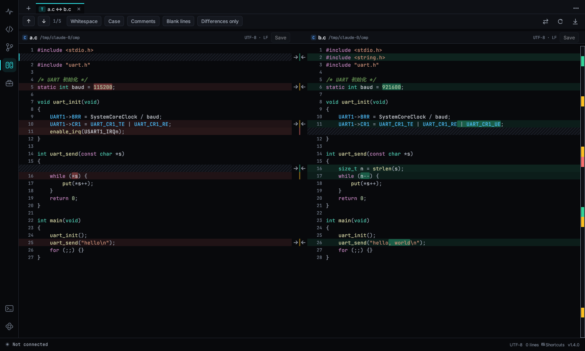

### 文件夹

两棵目录树左右对照，显示大小和修改时间，较新的时间高亮。中间一栏 `=` 表示相同，`≠` 表示不同，箭头表示只在一边有。文件夹旁边显示里面有几处不同，一开始只展开有不同的文件夹。

- 默认按大小和时间比较，大小一样、时间不同的文件在后台逐字节确认。打开 **按内容** 会逐字节比较所有文件。
- **过滤规则**（漏斗图标）跳过文件和文件夹：用 `;` 或换行分开，文件夹名以 `/` 结尾，支持 `*` 和 `?`。默认跳过 `.git/`、`.svn/`、`.vs/`、`build/`、`*.o`、`*.obj`、`*.d`。
- 双击（或 `Enter`）一个文件，在新标签里比较它；`←` / `→` 收起和展开文件夹。
- 右键可以复制到另一边、删除任意一边（会先确认）、在文件管理器中显示、在代码页打开、复制相对路径。
- **同步…** 有「更新右边」「更新左边」「双向更新」（取较新的）、「镜像到右边」「镜像到左边」（会删除目标一边多出来的文件）。复制或删除之前会列出每一项操作让你确认。复制会保留修改时间。
- **HTML 报告** 列出每个文件的状态、大小和时间。

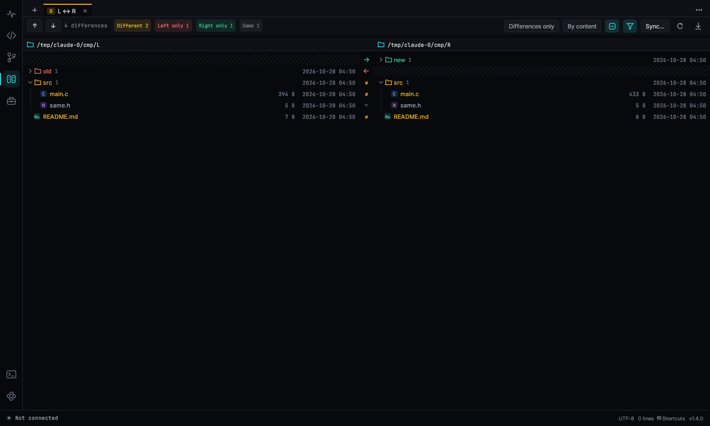

### 十六进制

BIN 文件逐字节比较。**自动对齐** 打开时（默认，8 MB 以内的文件），能识别中间插入或删除的字节并在另一边显示 `--`，后面的内容仍然对得上。Intel HEX 和 S-record 按地址比较：记录顺序和每行长度都不影响，段与段之间的空隙显示为 `⋯`。工具栏显示有多少字节不同，可以逐段跳转，也可以导出或复制差异列表（两边地址、长度、字节）。

### 三方合并

上面是左边、基准、右边三栏；只有一边改了的地方自动合并（左边改的是蓝色，两边改成一样的是绿色），冲突是红色。每处冲突上方选 **用左边**、**用右边**、**左 + 右**、**右 + 左** 或 **用基准**，再点一次选中的按钮就取消。**全部用左边** / **全部用右边** 一次决定所有冲突。

下面的合并结果可以直接修改；没解决的冲突写成常见的 `<<<<<<<` / `|||||||` / `=======` / `>>>>>>>` 标记并标红。拖动分隔线调整大小。**保存**（`Ctrl+S`）写出结果；Git 冲突还有 **保存并标记已解决**，会顺便执行 `git add`。合并任意三个文件：在首页填上「基准」，点「三方合并」，结果写回左侧文件。

### 表格

CSV / TSV（逗号、分号、Tab、`|` 分隔自动识别）和链接器 `.map` 文件（符号、目标文件、段、大小组成的表）逐行比较。按 **关键列** 对齐（默认第一列，map 文件是符号 + 目标文件），也可以按行顺序。改了的格子显示 `旧值 → 新值`；Δ 列显示大小列变化了多少，**按变化排序** 把变化最大的排在前面。「复制差异」把改动的行以 CSV 放到剪贴板。

### 外部工具

装了 Beyond Compare、WinMerge、Meld 或 KDiff3 时，比较标签的 **⋯ → 用 … 打开** 可以把同样两个文件交给它。

## 系统右键菜单

设置 → 常规 → **系统右键菜单** 把 QCCOM 加进文件管理器。不需要管理员权限，关掉开关就全部删掉。

- **Windows**：右键文件 →「用 QCCOM 打开」（源码在编辑器打开，`.log` 在日志视图打开，map / ELF / HEX / BIN 用对应的查看器），右键文件夹或文件夹空白处 →「用 QCCOM 打开」（作为工程打开）。选中两个文件或文件夹点「用 QCCOM 比较」直接比较；只选一个就先记为左侧，下一个再选「用 QCCOM 比较」时和它比较。Windows 11 上这些菜单在「显示更多选项」里。
- **Linux**：在文件管理器的「打开方式」里加入 QCCOM，加两个 Nautilus 脚本（「脚本 → 用 QCCOM 打开 / 用 QCCOM 比较」）和一个 Dolphin 右键菜单。

QCCOM 已经开着时，文件会交给已经打开的窗口，不会再开一个新窗口。程序换了位置后，把开关关掉再打开一次。命令行也一样：`qccom --file a.c`、`qccom --project ~/fw`、`qccom --compare old.bin new.bin`。

## 主题

深色、浅色或**跟随系统**（随操作系统实时切换）。在 设置 → 外观、齿轮菜单里切换，或按 `Ctrl+K Ctrl+T`。两种主题下所有颜色（包括弹窗、代码高亮、日志级别）的对比度都不低于 4.5:1。设置 → 外观 里还有界面缩放，高分屏可以放大。

Windows 10 / 11 上窗口标题栏会跟随主题（深色或浅色；Windows 11 上标题栏底色、文字和边框都和界面一致）。

**背景图片**（设置 → 外观）：给代码编辑器、底部终端和串口终端加一张背景图，可以三处共用一张，也可以分别选。可以调不透明度（10%–25% 文字最清楚）和显示方式：铺满、居中完整显示、平铺、右下角，或「左侧渐隐」（代码所在的左侧更干净）。命令面板里的「隐藏 / 显示背景图片」可以随时开关。

## 界面语言

第一次启动时跟随系统语言。要更改，打开齿轮菜单 → 界面语言，或在命令面板里搜“语言”；选 **跟随系统** 就恢复自动识别。切换立即生效。

支持：English、简体中文、繁體中文、日本語、한국어、Deutsch、Français、Español、Русский、Português。

## 自动更新

启动几秒后，程序会检查有没有新版本。有的话，右下角会弹出卡片，显示版本号、日期和更新说明，按钮有 **立即更新**、**稍后**、**跳过此版本**。下载并校验通过后，点 **重启并更新** 就会替换程序并启动新版本，设置都会保留。

- 齿轮菜单 → **检查更新** 随时手动检查。检查失败时，完整的错误信息会自动复制到剪贴板，方便贴给我们排查。
- 设置 → 常规，或卡片上的开关，可以关闭自动检查。
- Linux 版只有在发布者提供了 Linux 文件时才会自动下载，否则点 **打开下载页** 去 Releases 页面下载。

发布者请看 [UPDATE_SERVER.md](UPDATE_SERVER.md)。

## 快捷键

**快捷键方案**：设置 → 快捷键 里可以选 QCCOM、VS Code、Source Insight、Keil 方案（比如 Source Insight 方案里 `F8`/`F3`/`F4` 高亮、`Alt+,` 后退，Keil 方案里 `Ctrl+-` 后退）。自己改过的键始终优先。

所有快捷键都能在 设置 → 快捷键（`Ctrl+K Ctrl+S`）里修改：点按键录制新的，右键恢复默认或删除，一个命令可以绑多个键。连按两组组合键就是序列键，比如 `Ctrl+K Ctrl+T`，按下第一组时状态栏会提示在等第二组。冲突会标出来，整套快捷键可以导出、导入为 JSON 文件。下面是默认值。

**全局**

| 按键 | 功能 |
|---|---|
| Ctrl+Shift+P / F1 | 命令面板 |
| Ctrl+, | 设置 |
| Ctrl+K Ctrl+S | 快捷键设置 |
| Ctrl+K Ctrl+T | 切换深色 / 浅色主题 |
| Ctrl+Shift+D / E / G / M / B | 调试 / 代码 / Git / 比较 / 工具箱页 |
| Ctrl+Shift+N | 新窗口 |

**调试页**

| 按键 | 功能 |
|---|---|
| F5 | 连接 / 断开 |
| Ctrl+F | 搜索日志 |
| 回车 / Shift+回车 | 下一个 / 上一个匹配 |
| Ctrl+L | 清屏 |
| Ctrl+S | 保存日志 |
| Ctrl+P | 暂停 / 继续 |
| Ctrl+K | 跳到命令栏 |
| Ctrl+B | 显示 / 隐藏侧边栏 |
| Ctrl+J | 展开 / 收起快捷命令 |
| Alt+1 … 9 | 发送当前分组的第 1–9 条快捷命令 |
| Ctrl+A | 全选日志 |
| Ctrl+C | 复制选中内容 |
| Esc | 取消选中 |
| Ctrl+\` | 切换 日志 / 终端 |
| Ctrl+M | 插入分隔标记 |
| Ctrl+F2 / F2 / Shift+F2 | 给当前行加书签 / 下一个 / 上一个 |
| Ctrl+Shift+W | 显示 / 隐藏波形图 |
| Ctrl+Shift+H | 过滤与高亮规则 |
| Ctrl+O | 打开日志文件 |
| Tab | 补全 AT 指令 |
| Ctrl+Enter | 发送（多行输入时） |

**代码浏览器**

| 按键 | 功能 |
|---|---|
| Ctrl+P | 快速打开 |
| Ctrl+T | 跳到工程里的符号 |
| Ctrl+Shift+O | 跳到当前文件的符号 |
| Ctrl+G | 跳到行（代码）/ 跳到时间（日志） |
| Ctrl+O | 打开文件 |
| Ctrl+Shift+F | 全局搜索 |
| Ctrl+Shift+E | 显示资源管理器 |
| Ctrl+F / Ctrl+H | 文件内查找 / 替换 |
| Ctrl+\\ | 拆分编辑器 |
| Ctrl+Shift+\` / Alt+F12 | 显示 / 隐藏终端面板 |
| Ctrl+Shift+5 | 新建终端 |
| F12 / Ctrl+点击 | 跳转到定义 |
| Shift+F12 | 查找引用 |
| Alt+← / Alt+→ | 后退 / 前进（可跨页面） |
| Ctrl+Tab | 最近用过的页面、工具和文件 |
| Ctrl+PgDn / Ctrl+W | 下一个标签 / 关闭标签 |
| Ctrl+S | 保存 |
| Ctrl+= / Ctrl+- | 调整字号 |
| Ctrl+Shift+Y | 上下文窗口 |
| Ctrl+Shift+R | 调用关系 |
| Ctrl+F2 / F2 / Shift+F2 | 切换书签 / 下一个 / 上一个 |

**编辑器**

| 按键 | 功能 |
|---|---|
| Ctrl+Z / Ctrl+Y | 撤销 / 重做 |
| Ctrl+/ | 切换行注释 |
| Alt+↑ / Alt+↓ | 移动行 |
| Shift+Alt+↑ / ↓ | 复制行 |
| Ctrl+Shift+K | 删除行 |
| Ctrl+L | 选中当前行 |
| Ctrl+Enter / Ctrl+Shift+Enter | 在下方 / 上方插入行 |
| Ctrl+D / Ctrl+Shift+L | 添加下一个相同内容 / 选中全部相同内容 |
| Ctrl+Alt+↑ / ↓ | 在上方 / 下方添加光标 |
| Alt+点击 / Alt+Shift+拖动 | 添加光标 / 列选择 |
| Ctrl+Shift+\ | 跳到匹配的括号 |
| Ctrl+Shift+[ / ] | 折叠 / 展开 |
| Ctrl+K Ctrl+0 / Ctrl+K Ctrl+J | 全部折叠 / 全部展开 |

## 常见问题

**便携模式**：程序旁边有名为 `qccom-data` 的文件夹时，设置和恢复数据都保存在里面，而不是用户目录，整个文件夹放 U 盘就能带着走。设置 → 通用 → 便携模式 可以一键创建。

**Linux 下看不到端口，或提示 Permission denied。** 把自己加入 `dialout` 组（Arch 是 `uucp`）：`sudo usermod -aG dialout $USER`，然后重新登录。有些发行版用 CH340 时还需要卸载 `brltty`。

**Windows 下看不到端口。** 安装 USB 转串口芯片的驱动（CH340、CP210x、FTDI、PL2303），并在设备管理器里确认。

**显示乱码。** 先用 **⚡ 自动** 识别波特率，或者切换编码（很多中文固件用 GBK）。

**Windows SmartScreen 提示。** 程序暂时还没有代码签名。点 **更多信息 → 仍要运行**，或者在文件属性里勾选“解除锁定”。

**Git 页面提示没有找到 git。** 到 https://git-scm.com 安装 Git，然后重启 QCCOM。

**更新失败：没有权限替换程序。** 程序放在了受保护的目录里（比如 `Program Files`）。把它移到你自己有写权限的文件夹，或者手动运行新版本。

**设置保存在哪里？** Windows 在 `%APPDATA%\qccom\data\app.ron`，Linux 在 `~/.local/share/qccom/app.ron`。删掉这个文件就恢复默认设置。

遇到问题请到 https://github.com/zenghi/QCCOM/issues 提交。
