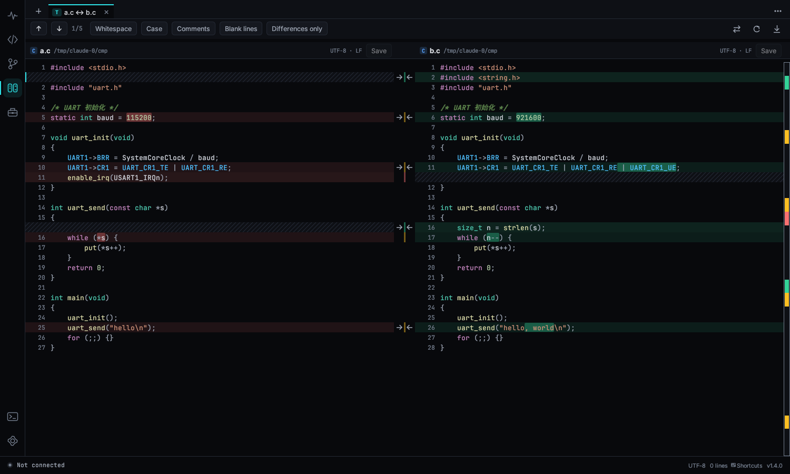
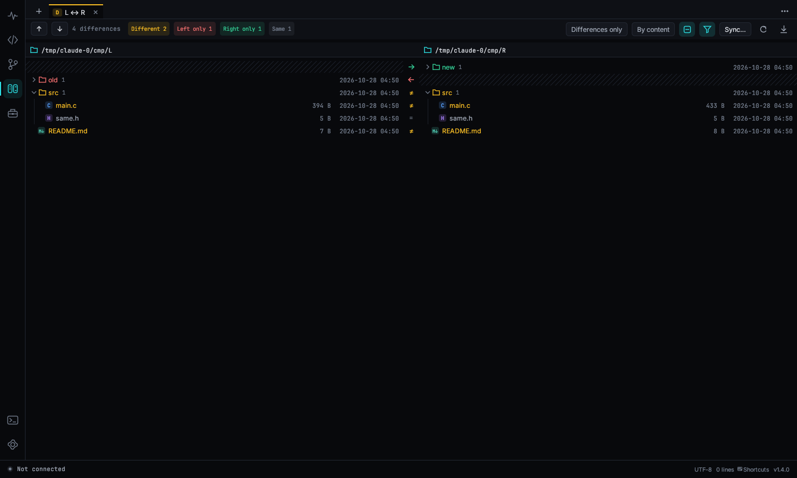

# 用 QCCOM 代码对比工具找出两版固件的串口改动

同一块开发板，刷旧固件能看见启动日志，刷新固件只收到乱码。可以先用 QCCOM 的代码对比工具查看两版 UART 初始化代码，核对波特率和寄存器设置。如果手头是两套完整工程，也可以先比较文件夹，再打开改过的源文件。

## 对比两个源文件

1. 在 QCCOM 左侧活动栏打开「比较与合并」，默认快捷键是 `Ctrl+Shift+M`。在「左侧」选旧版文件，在「右侧」选新版文件，例如两个版本各自的 `uart.c`，然后点「比较」。
2. 对照同一行左右两侧的高亮。下图中，`a.c` 的波特率是 `115200`，`b.c` 改成了 `921600`，还在控制寄存器的赋值中加入了 `UART_CR1_UE`。如果设备运行的就是右侧版本，可以回到串口助手，把接收波特率调到 `921600` 再看启动日志。
3. 按 `F7` 看下一处改动，按 `Shift+F7` 返回上一处。长文件可打开工具栏的「只看不同」，每处改动前后各保留最多三行，方便读懂上下文。

## 从两个工程文件夹找到改过的文件

1. 在比较页的「左侧」和「右侧」分别选旧版、新版工程文件夹，点「比较」。打开「按内容」，即使同名文件的大小和修改时间一致，也会核对文件内容。
2. 展开目录，查看文件名中间的标记。`≠` 表示两边有差异，`=` 表示相同。下图里，`src/main.c` 从 394 B 变为 433 B，`src/same.h` 相同，`old/` 只在左侧，`new/` 只在右侧。打开「只看不同」可以隐藏相同项。
3. 双击两边都有的 `src/main.c`，在新标签里查看具体改了哪几行。需要把结果交给同事时，在文本或文件夹比较页的工具栏选「导出 HTML 报告」即可。以上查看和导出操作都保留原文件。

已经编译成 `.bin` 的两份固件也可以从同一入口打开，QCCOM 会切换到十六进制比较，按字节显示差异。[查看完整比较指南](USER_GUIDE.zh-CN.md#比较与合并) · [下载 QCCOM](https://www.zenghi.com/#download)
