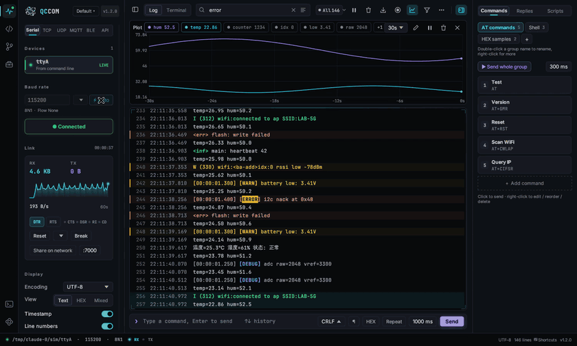

# Replay a UART capture without keeping the board on your desk

*Project disclosure: I maintain QCCOM. The capture below is a synthetic teaching sample. It is not sensor data recorded from a board.*

The plotted value drops, but that alone doesn't tell you whether the sensor changed, the board rebooted, or the firmware printed the wrong value. A plot is more useful when you can still see the serial line that produced each point. Saving the original capture also lets another developer look at the same sequence without borrowing your board.

This walkthrough uses [QCCOM](https://www.zenghi.com/en/), an open-source desktop serial monitor for Windows and Linux. No attached UART device, broker, or external service is needed to try the sample.

## Keep time and raw values in the same capture

Open the included [example log](samples/serial/qccom-serial-replay-demo.log) in a text editor. The time and direction fields are part of QCCOM's saved-log format, not bytes sent by a sensor:

```text
2026-11-18 09:00:00.000 RX temp=24.1,hum=51.0
2026-11-18 09:00:01.000 RX temp=24.2,hum=51.4
2026-11-18 09:00:02.000 RX temp=24.4,hum=52.0
```

There are 16 records, one second apart. Both values climb and then ease back. The line at 09:00:08 contains the highest values in the sample: `temp=27.4,hum=60.2`. That gives you one known line to find without already knowing how the plot should look.

## Replay the original timing

1. In QCCOM, open the waveform panel using the plot icon or **Ctrl+Shift+W**.
2. In the log toolbar's **⋯** menu, choose the log **replay** action, not the action that just opens the file for viewing.
3. Choose the sample and use **1×** timing. Expect about 15 seconds between the first and last timestamps. Keep the waveform and RX text in the same window.
4. Look for both named fields. Use the legend to hide one temporarily and inspect the other. Check the peak against the raw log line. Temperature and relative humidity use different units, so don't compare the height of one trace against the other.

If a capture plays all at once, inspect its timestamps first. A real saved copy preserves the inter-line delays; the sample's one-second steps are intentional. If a line doesn't make a usable point, check that it actually contains a changing numeric value in a recognized form such as `temp=24.1`.



## Adapt it to a bench problem

For a real incident, save the log before changing firmware or serial settings. Write down the selected baud rate and the action you just took, like cycling power. Keep several seconds around the event. Redact identifiers and credentials from anything shared outside the team, but retain the timestamp spacing and the values under investigation.

If your firmware prints three different events between two samples, the raw text retains that context. The trace helps find where to look; it doesn't establish why the value changed.

[Source and license](https://github.com/zenghi/Qccom/tree/main) · [v1.9.6 replay documentation](https://github.com/zenghi/Qccom/blob/v1.9.6/docs/USER_GUIDE.md#debugging-tools) · [Existing plot GIF on GitHub](https://github.com/zenghi/Qccom/blob/v1.9.6/docs/gif/demo-plot.gif)

**Editorial status:** The sample's format, timing and peak were checked against the tagged source. The existing GIF shows the actual QCCOM interface; this new sample has not yet been replayed in the tagged desktop build. For publication, attach the log natively or publish it alongside the article and verify the link.
