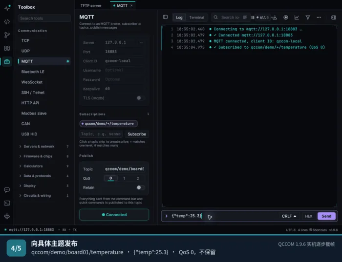

# 用 QCCOM MQTT 工具订阅主题、发布 JSON 并查看回包

想先验证温度消息能不能发出去，再接入真实开发板？用 QCCOM 的 MQTT 客户端连接本机消息服务器，在同一窗口里订阅和发布，就能看到服务器转发回来的主题和数据。示例使用 MQTT 3.1.1，适用于 Windows 和 Linux。



图中的订阅条件是 `qccom/demo/+/temperature`，发布目标是 `qccom/demo/board01/temperature`。一个订阅条件可以同时接收多块板子的温度。

## 启动本机 MQTT 服务器

安装 Eclipse Mosquitto 2.x 后，在终端运行下面的命令并保留窗口。Windows 用户也可以在 Mosquitto 安装目录的 PowerShell 中运行 `.\mosquitto.exe -p 18883 -v`。[Mosquitto 下载](https://mosquitto.org/download/)。

```sh
mosquitto -p 18883 -v
```

这里省略配置文件，Mosquitto 2.x 会以仅本机可连接的模式启动。看到终端提示 `local only mode` 后，打开 QCCOM。实验结束时，在这个终端按 `Ctrl+C` 即可停止服务器。[Mosquitto 本机监听说明](https://mosquitto.org/documentation/migrating-to-2-0/#listener-without-configuration)

## 用 QCCOM 订阅温度

1. 在工具箱的「通信调试」中选择「MQTT」。在「服务器」填 `127.0.0.1`，「端口」填 `18883`，「客户端 ID」填 `qccom-local`。用户名和密码留空，「TLS 加密（mqtts）」关闭。
2. 在「发布」区域选择 QoS `0`，关闭「保留消息」。在「订阅主题」区域输入 `qccom/demo/+/temperature`，点「订阅」。如果列表里有默认的 `qccom/#`，点一下这个标签取消它，这样后面的实验就只会收到温度。
3. 点「连接」。日志先显示连接成功，然后显示「已订阅 qccom/demo/+/temperature（QoS 0）」。`+` 匹配一层，既能接收 `board01`，也能接收 `board02`。

## 发布一条 JSON 消息

在「发布」区域的「主题」中填 `qccom/demo/board01/temperature`。关闭底部命令栏的 HEX，把下面这行作为文本发送一次。

```json
{"temp":25.3}
```

找到日志中**带方括号主题名**的接收行。这里显示的是服务器转回来的一条消息，时间戳和行号会随各自的设置变化。

```text
[qccom/demo/board01/temperature] {"temp":25.3}
```

试着只把发布主题中的 `board01` 改为 `board02`，再发送一次。相同的订阅会收到第二块板子的消息。接着把末尾的 `temperature` 改为 `humidity`，此时这个温度订阅不会产生新的接收行。如果打开了「发送回显」，日志中仍可能看到自己刚发出的内容。

## 连接成功后，怎样定位问题？

| 现象 | 在哪里核对 |
| --- | --- |
| 已连接，发送后只有本地回显 | 等「已订阅」提示出现后再发。逐层比对主题的大小写、斜杠和层数。发布主题应写具体设备名。`+` 和 `#` 用在订阅条件中。 |
| 客户端显示连不上服务器 | 查看 Mosquitto 终端是否已启动并监听 `18883`。QCCOM 的「服务器」只填主机地址，本例使用明文连接。 |
| 收到了接收行，但另一端解析 JSON 失败 | 对照方括号后的消息体，确认发送的是包含双引号的完整 JSON，输入框没有连同主题名或 Markdown 标记一起复制。发文本时关闭 HEX。 |
| 重新订阅就收到上次的数值 | 检查此前是否曾向同一主题发布过保留消息。关闭「保留消息」只影响接下来发出的消息。换一个全新的主题即可验证。 |

QCCOM 的 MQTT 客户端可选择 TLS 和 QoS 0、1、2。本例用 QoS 0 观察实时消息。工具箱中另有供局域网设备联调用的「MQTT 服务器」，它向订阅者转发的消息最高为 QoS 1。

[下载 QCCOM](https://www.zenghi.com/#download) · [QCCOM 中文使用指南](USER_GUIDE.zh-CN.md)
