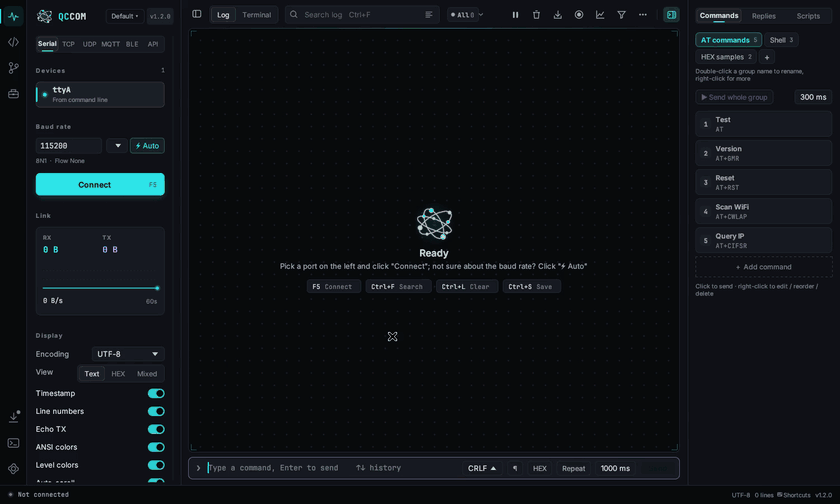
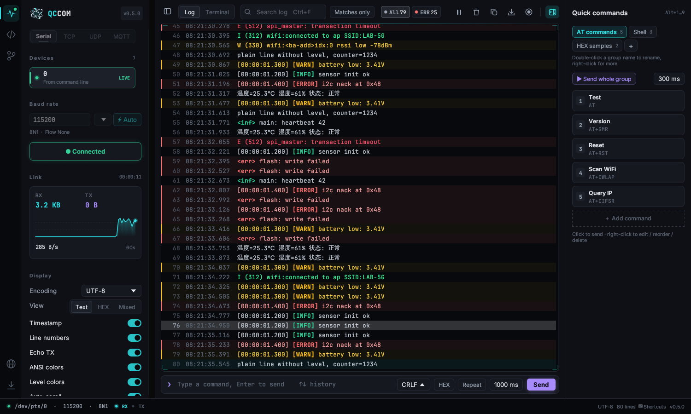

# 用 QCCOM 串口助手发送第一条 AT 指令

从 SSCOM32 换到 QCCOM，可以用一次请求和应答确认串口调试链路。下面以运行 ESP-AT 固件的模块为例，先发文本 `AT`，再用 HEX 发送同样的四个字节。成功时，模块会回复 `OK`。[下载 QCCOM](https://www.zenghi.com/#download) · [乐鑫 AT 指令说明](https://docs.espressif.com/projects/esp-at/zh_CN/latest/esp32/AT_Command_Set/Basic_AT_Commands.html#cmd-at)

## 打开模块的 AT 指令端口

1. 先关闭 SSCOM32 或串口监视器里已经打开的端口。打开 QCCOM，插入模块或 USB 转串口适配器，观察左侧列表中新出现的端口。如果板子有多个串口，按板卡文档选择接收 AT 指令的那个端口。
2. 按模块文档设置波特率、数据位、校验位和停止位。点 **连接** 或按 **F5**。若设备在持续输出可读日志，但你不知道波特率，可以点 **⚡ 自动** 让 QCCOM 试探。

## 发文本，再看设备有没有回答

1. 在底部发送栏关闭 **HEX** 和 **定时**，换行符选 **CRLF**。
2. 输入 `AT`，点 **发送**。看左侧链路计数，本次发送应让 **TX** 增加 4 字节，即两个字母加回车、换行。
3. 观察 **RX** 是否增加，并在接收日志中找到单独一行 `OK`。如果打开了「发送回显」，日志还会记录自己发出的 `AT`。判断模块是否应答，要看接收方向的 `OK`。

## 用 HEX 核对这四个字节

在底部打开 **HEX**，校验选 **无校验**，输入 `41 54 0D 0A` 并发送一次。`41 54` 是 `AT`，`0D 0A` 是 CRLF。HEX 模式直接发送这些字节，因此结束符也写在输入框里。模块应再次回复 `OK`。

要看回包的字节，在左侧「显示」中把视图切到 **HEX** 或 **混合**。`OK` 的两个字节是 `4F 4B`。左侧视图控制日志怎样显示，底部 HEX 开关控制下一条指令怎样发送。

| 你看到的现象 | 先检查这里 |
|---|---|
| 打开端口提示占用 | 在其他串口助手或 IDE 里断开这个端口，再按 F5。 |
| TX 增加，RX 一直不变 | 核对模块是否在运行 AT 固件、选的是否为 AT 指令端口，以及指令末尾是否带 CRLF。若通过 USB 转 TTL 接线，再核对 TX 接对方 RX、RX 接对方 TX，双方共地且逻辑电平匹配。 |
| RX 增加，但看到乱码 | 先核对波特率及串口参数。若英文正常、只有中文日志乱码，再切换 UTF-8 或 GBK。 |

需要在 QCCOM 里找到 SSCOM32 常用的定时发送、快捷指令和保存日志，可查看[官网操作对照](https://www.zenghi.com/switch-from-sscom/)。
